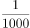
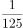

# 物理-透镜成像放大率（比例换算）与匀速直线运动求曝光时间

考点：[[20-考点/判断推理/科学推理/物理-透镜成像放大率（比例换算）与匀速直线运动求曝光时间|科学推理 / 物理-透镜成像放大率（比例换算）与匀速直线运动求曝光时间]]

**问法模型**：题干问'曝光时间至多为多少秒'→先用像长/物长求放大率，把'像移动的尺寸不大于0.1mm'换算为实际位移，再由 t=x/v 求临界时间

## 推理链
1. 第1步：从题干提取数据——'底片上汽车长为2cm，实际汽车车身长3m'，得成像放大率 k=像长/物长=2cm/3m=2×10⁻²/3=1/150。
2. 第2步：成像不模糊的前提是'底片上汽车的像移动的尺寸不大于0.1mm'，由放大率反推（像移÷放大率=实际位移），对应实际位移 x=0.1mm×150=15mm=0.015m。
3. 第3步：汽车以速度v匀速行驶，做匀速直线运动，位移满足 x=vt。
4. 第4步：'曝光时间至多'取临界值，即像移恰好等于0.1mm时，t=x/v=0.015/v 秒。
5. 第5步：与选项对照，A项表达式与 t=0.015/v 一致，B/C/D为放大率方向弄反或单位换算错误的干扰结果，故选A。

**最快解法**：⚡ 比例法+单位换算口诀'像移÷放大率=实移'：k=2cm÷3m=1/150，0.1mm×150=15mm=0.015m，t=0.015÷v，直接锁定A；全程统一换算成米即可避开陷阱。

## 易错点
- ⚠ 单位换算混乱：0.1mm=0.01cm，与像长2cm比较时易错成100倍或1000倍关系，导致 t 差10倍或1000倍而误选干扰项。
- ⚠ 放大率方向弄反：把'物长/像长=150'误用作'实移=像移×1/150'，错得0.00067mm对应的微小位移，误选含1/150系数的选项。
- ⚠ 忽略'至多'的临界含义：应取像移恰好等于0.1mm的极限值，若按'远小于'处理或再除以多余系数会算错数量级。

## 母题抽象
> 🧩 当题干出现'成像不模糊/像移动尺寸不超过某值'特征时，先用'像长/物长'求放大率，把像移换算为实际位移，再除以物体速度即得临界曝光时间。

**同类特征**：侧面拍摄运动物体、像移动的尺寸不大于0.1mm、底片上汽车长2cm、实际车身长3m、求曝光时间至多、放大率换算+匀速运动

## 相关题
（暂无）

---

### 题干
一名摄影师要从侧面拍摄一辆以行驶的汽车，成像不模糊的前提是底片上汽车的像移动的尺寸不大于0.1mm，已知底片上汽车长为2cm，实际汽车车身长3m，那么曝光时间至多为        秒。

### 选项
- A. 

　✅
- B. 

- C. 

- D. 

### 官方解析
汽车速度。汽车的实际长度与成像之间的比例；则底片上汽车的像移动的尺寸不大于0.1mm，所对应的距离。
故曝光的时间=。
故正确答案为A。

### 给定材料
（无）
