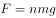
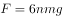

# 物理-滑轮组受力分析（动滑轮绳段数与张力计算）+装置设计目的判断

考点：[[20-考点/判断推理/科学推理/物理-滑轮组受力分析（动滑轮绳段数与张力计算）+装置设计目的判断|科学推理 / 物理-滑轮组受力分析（动滑轮绳段数与张力计算）+装置设计目的判断]]

**问法模型**：题干以'判断下列说法正确的是'给出物理装置情境 → 先定量计算排除数值类选项（滑轮组张力），再定性辨析装置设计目的锁定功能类选项

## 推理链
1. 第1步：从题干提取：配重D是n个质量为m的混凝土圆盘，绳子自由端由配重悬吊，故绳中张力恒等于配重重力G_D=nmg
2. 第2步：由题面图形识别滑轮组结构：C端为定滑轮（只改变力的方向），B为动滑轮，与B相连的绳子段数为3
3. 第3步：应用滑轮组受力关系（省力公式反向使用）：绳端拉力F=nmg，动滑轮B被3段绳拉向电杆C，故钢缆在B端所受拉力T=3F=3nmg，与C、D选项给出的表达式均不符，排除C、D
4. 第4步：定性分析装置功能：配重可随绳上下移动，自动补偿输电线高度变化（热胀冷缩、受电弓抬升等）引起的绳长变化，钢缆B端始终受到大小恒为3nmg的拉伸力
5. 第5步：对照A项：'保证输电线高度变化时钢缆始终保持张紧状态'与恒张力自动补偿功能一致，A正确
6. 第6步：对照B项：该滑轮组使钢缆张力被放大为3nmg而非省力，'为了省力'与设计目的不符，排除B，故选A

**最快解法**：⚡ 张力定量排除+功能定性锁定：先由'绳端张力=nmg、动滑轮B连3段绳→B端张力=3nmg'秒杀排除C、D；再抓'配重自动升降补偿高度变化→钢缆拉力恒定→始终张紧'锁定A，且'省力'与张力被放大为3nmg的事实相悖排除B

## 易错点
- ⚠ 绳段数看错或动/定滑轮混淆，把B端张力误算为nmg或nmg/3而错选C、D
- ⚠ 误判滑轮组的设计目的为'省力'——实际钢缆张力被放大为3nmg，真正目的是恒张力自动补偿保持张紧
- ⚠ 忽视'配重重力恒定→绳端拉力恒定→钢缆张力恒定'这条因果链，无法解释高度变化时为何仍能保持张紧

## 母题抽象
> 🧩 当题干出现'缆绳一端固定、另一端经滑轮组连接配重'的特征时，先用'绳端张力=配重重力、缆端张力=配重重力×绳段数'排除数值选项，再从'恒张力自动补偿'的设计目的对照功能描述选项

**同类特征**：钢缆B端通过滑轮组连接配重、配重为n个质量m的圆盘、B为动滑轮且相连绳段数为3、输电线高度变化、判断说法正确的是

## 相关题
（暂无）

---

### 题干
如图所示为铁路的输电线悬挂在钢缆上的方式。钢缆的A端固定在电杆上，B端通过滑轮组连接在电杆C上。配重D是n个混凝土圆盘，每个盘的质量是m。根据以上信息判断下列说法正确的是          。

### 选项
- A. 
B处使用滑轮组是为了保证输电线的高度变化时钢缆始终保持张紧状态
　✅
- B. 
B处使用滑轮组是为了省力

- C. 
不考虑钢缆和滑轮质量，钢缆在B端受的拉力

- D. 
不考虑钢缆和滑轮质量，钢缆在B端受的拉力

### 官方解析
因每个混凝土圆盘的质量为，则配重D的重力。结合题干图形可知，滑轮B为动滑轮，与之相连的绳子段数是3。作用在钢缆自由端的拉力为配重D的重力。根据滑轮组省力公式可得，。故作用在B端钢缆的拉力。由此排除C、D两项。在B处使用滑轮组可以保证输电线在高度变化时，钢缆始终受到拉伸的作用力，故而保持张紧状态，A项满足。
故正确答案为A。

### 给定材料
（无）
