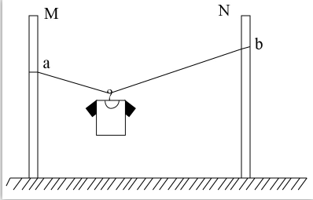

# 物理-共点力平衡（光滑挂钩两侧绳等角模型、绳长与张角关系决定拉力大小）

考点：[[20-考点/判断推理/科学推理/物理-共点力平衡（光滑挂钩两侧绳等角模型、绳长与张角关系决定拉力大小）|科学推理 / 物理-共点力平衡（光滑挂钩两侧绳等角模型、绳长与张角关系决定拉力大小）]]

**问法模型**：问'为防止绳断该如何调整（移端点/换绳长）'→用光滑挂钩等角模型：先由对称性确认两段绳与竖直方向夹角相等，再由sinθ=d/L结合T=mg/(2cosθ)判断各操作对拉力的影响

## 推理链
1. 第1步：题干'衣架挂钩可视为光滑'→挂钩两侧绳的拉力大小相等，水平方向平衡要求左右两段绳与竖直方向夹角相等（官方解析：'左右两个绳子关于竖直方向是对称的，与竖直方向夹角是相等的'）
2. 第2步：几何关系——设绳总长L、两杆间距d，挂钩水平居中，每段绳水平投影为d/2，得sinθ=d/L（θ为绳与竖直方向夹角）；竖直方向合力平衡：2Tcosθ=mg，即T=mg/(2cosθ)，'左右两个绳子的合力与衣服的重力等大反向'
3. 第3步：对照A、B项——将固定点b上移或下移时，绳长L与两杆间距d均不变→由sinθ=d/L知夹角θ不变→拉力T不变，无法防断，A、B排除
4. 第4步：对照C项——换略短绳，L减小而d不变→sinθ=d/L增大、绳更接近水平→cosθ减小→T=mg/(2cosθ)增大，'绳子更容易断'，C排除
5. 第5步：对照D项——换略长绳，L增大而d不变→sinθ=d/L减小、绳更接近竖直下垂→cosθ增大→T=mg/(2cosθ)减小，可防止绳断，D正确

**最快解法**：⚡ 极限法+口诀'光滑挂钩模型：绳越长越省力、绳越短越费力，移动端点高度不改变拉力'。要防断就换略长的绳，直接选D；可用极限验证——绳短到接近两杆间距时绳近乎水平，拉力趋于无穷大必断；绳很长时近乎竖直下垂，每段拉力趋近mg/2为最小

## 易错点
- ⚠ 误以为上/下移动b点会改变绳的倾斜程度从而改变拉力，实际上绳长与两杆间距均未变，张角与拉力都不变（本模型最反直觉之处）
- ⚠ 误以为绳短'绷得紧更结实'，实际绳越接近水平，由T=mg/(2cosθ)拉力越大、越容易断
- ⚠ 混淆绳与竖直方向的夹角和与水平方向的夹角，sin与cos用反，会得出与正确结论完全相反的判断

## 母题抽象
> 🧩 当题干出现'光滑挂钩/滑轮挂在两端固定的绳上，问如何调整使绳不易断'时，先由对称性得两段绳与竖直夹角相等，再用sinθ=d/L（θ为与竖直夹角，d为两杆水平间距，L为绳长）判断：绳加长或杆距减小→绳更竖直→拉力减小；仅移动端点高度则L、d不变→拉力不变

**同类特征**：轻质不可伸长的晾衣绳两端固定在竖直杆、衣架挂钩可视为光滑、担心绳可能会断、防止绳断、将固定点b上移或下移、换略短/略长的绳、绳长可变而两杆间距不变

## 相关题
（暂无）

---

### 题干

某同学将轻质不可伸长的晾衣绳两端分别固定在竖直杆M、N上的a、b两点，将衣架挂在绳上晾晒衣物，衣架挂钩可视为光滑。晾晒一件短袖T恤时，衣架静止于如图位置。当晾晒一件厚滑雪衫时，该同学担心晾衣绳可能会断，为防止绳断，他应该      。

### 选项
- A. 将绳的右端固定点b略向上移
- B. 将绳的右端固定点b略向下移
- C. 换一根略短的晾衣绳
- D. 换一根略长的晾衣绳　✅

### 官方解析

如图所示，左右两个绳子关于竖直方向是对称的，与竖直方向夹角是相等的。设绳子的总长度为，两杆之间的距离为，则。当绳子右端上移或者下移时，与均不变，则角度不变，左右两个绳子的合力与衣服的重力等大反向，因角度不变，所以绳子的拉力不变，A项与B项错误；

当换一根略短的晾衣绳，减小，因不变，则角度变小，左右两个绳子拉力的合力与衣服的重力等大反向，，，则绳子的拉力增大，绳子更容易断，C项错误；

当换一根略长的晾衣绳，变大，因不变，则角度变大，则绳子的拉力减小，可防止绳断，D项正确。

故正确答案为D。

### 给定材料
（无）
