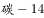
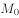
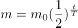

# 物理-放射性同位素衰变（半衰期）指数衰减图像

考点：[[20-考点/判断推理/科学推理/物理-放射性同位素衰变（半衰期）指数衰减图像|科学推理 / 物理-放射性同位素衰变（半衰期）指数衰减图像]]

**问法模型**：给出'每隔一定时间质量减为原来一半'的衰减规律，问质量m随时间t变化的图像 → 建立指数衰减模型 m=M₀·(1/2)^(t/T)，再比对图像的单调性与凹凸趋势

## 推理链
1. 第1步：提取题干前提——'每隔一定的时间质量减少为原来的一半'，即半衰期规律，初始质量为M₀，t=0时m=M₀。
2. 第2步：建立模型——设半衰期为T，则质量满足 m=M₀·(1/2)^(t/T)，即官方解析所指的指数衰减规律。
3. 第3步：分析函数性质——随t增大，m单调递减但永远大于0（不与t轴相交），且减少速度越来越慢，曲线为上凸的递减曲线，以时间轴为渐近线。
4. 第4步：逐项对照——A为直线匀速递减（对应等差减少，不符）；C为下凹曲线，递减越来越快且最终与t轴相交（不符）；D为阶梯状突变，把连续衰变误作离散跳变（不符）。
5. 第5步：只有B项起始为M₀、单调递减、变化越来越慢、渐近于t轴，完全符合指数衰减规律，故选B。

**最快解法**：⚡ 排除法+凹凸性口诀：半衰期衰减'减半越来越慢、永不为零'——先排除A（直线）和D（阶梯突变），再对比B、C：B上凸递减越来越慢，C下凹递减越来越快且触到t轴，选B。

## 易错点
- ⚠ 误选D：把'每隔一定时间减半'理解为只在整倍时刻突变，忽略衰变是随时间连续进行的。
- ⚠ 误选A：把'每段减为一半（等比）'误当成'每段减少相同量（等差）'，混淆等比与等差。
- ⚠ 误选C：只关注'递减'而忽略变化快慢（凹凸性），未发现C曲线递减越来越快且与t轴相交（质量不可能减为零）。

## 母题抽象
> 🧩 当题干出现'每隔固定时间减为原来的一半（半衰期/折半衰减）'特征时，用指数衰减模型m=M₀·(1/2)^(t/T)，验证图像应为起点M₀、单调递减、越来越慢、以时间轴为渐近线的上凸曲线。

**同类特征**：同位素测年法、每隔一定时间质量减为原来的一半、初始质量M₀、质量随时间变化规律、选择函数图像

## 相关题
（暂无）

---

### 题干

考古学中用同位素测年法测量古生物的年代，每隔一定的时间质量减少为原来的一半。如果以表示的质量，表示时间，的初始质量为，那么的质量随时间的变化规律是下面的<u>      </u>图。

### 选项
- A. A
- B. B　✅
- C. C
- D. D

### 官方解析

若每隔时间衰减为原来的一半，则衰减规律满足 。随着的增长，越来越小，且变化越来越慢，结合选项，B项较为符合。

故正确答案为B。

### 给定材料
（无）
