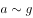
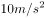
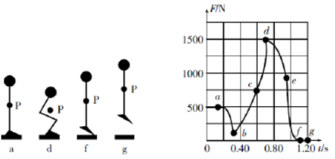
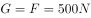
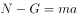
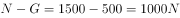

# 物理-牛顿第二定律与超重失重（力-时间图像分段分析）

考点：[[20-考点/判断推理/科学推理/物理-牛顿第二定律与超重失重（力-时间图像分段分析）|科学推理 / 物理-牛顿第二定律与超重失重（力-时间图像分段分析）]]

**问法模型**：'根据图像分析可知'+力传感器F-t图像与动作各点对应 → 先由静止段定重力G，再用超重/失重规则逐点分析合力方向与加速度大小

## 推理链
1. 第1步：从图像读数，a点前人处于静止状态，F≈500N，由二力平衡得重力G=500N（m=G/g=50kg），并非750N，排除A
2. 第2步：所用规则——牛顿第二定律a=(F-G)/m：F<G为失重（加速度向下），F>G为超重（加速度向上），F=G时加速度为零、速度达极值
3. 第3步：下蹲阶段a→b，F<G，人向下加速；b点F最小仅说明向下加速度最大，b点后一小段F仍<G，人继续加速下蹲，最低点（v=0）应在c点之后F>G的减速段末，故b不是最低点，排除B
4. 第4步：c点附近F≈750N>G，合力向上、加速度向上，与向下速度反向，人减速下蹲；向下最大速度出现在b、c之间F=G处，c点速度不是最大，排除C
5. 第5步：d点F达峰值≈1500N，合力F-G≈1000N为全程最大（对比b点合力仅约350N），由a=(F-G)/m知d点加速度最大，D正确
6. 第6步：与选项对照，结论为D

**最快解法**：⚡ 图像峰值法+超重失重口诀：静止点a定出G=500N后，直接找F偏离G最远的点——d点F最高（超重最甚）即合力最大、加速度最大，秒选D

## 易错点
- ⚠ 混淆'加速度最大'与'速度最大'：b点F最小是向下加速度最大，速度最大在F=G处；c点前后是减速下蹲而非速度最大
- ⚠ 误把b点当成下蹲最低点：忽略b点后F仍<G、人继续加速，最低点在c点之后减速段末尾（v=0处）
- ⚠ 只看F大小不看合力：比较加速度须比较|F-G|，d点虽在下蹲姿势但F≈1500N远超G，向上加速度反而全程最大

## 母题抽象
> 🧩 当题干出现'力传感器F-t图像+动作过程各点对应'特征时，先由静止段读出重力G，再按'F<G失重、F>G超重、F=G速度极值、|F-G|最大处加速度最大'逐点验证各选项

**同类特征**：力-时间图像、下蹲起跳动作与重心对应点、力传感器采集数据、超重与失重、牛顿第二定律、静止状态定重力

## 相关题
（暂无）

---

### 题干

左下图是某人站在力传感器上做下蹲、起跳动作的示意图，点P是他的重心位置。右下图是根据力传感器采集到的数据做出的力-时间图像。两图中各点均对应，其中有几个点在左下图中没有画出。重力加速度取。

根据图像分析可知：

### 选项
- A. 此人受到的重力为750N
- B. b点是此人下蹲至最低点的位置
- C. 此人在c点的速度最大
- D. 此人在d点的加速度最大　✅

### 官方解析

人站在力传感器上做下蹲、起跳动作，一开始在a点处于静止状态，此时人对传感器压力F大小等于人所受重力G，故此人所受重力，A项错误；

在下蹲过程中，从a到b点，人对传感器压力F小于人所受重力G，故传感器对人的支持力N小于人所受重力G，人向下加速下蹲，由于b点后一小段部分支持力N仍小于人所受重力G，因而继续加速下蹲，故b点不是下蹲至最低点的位置，B项错误；

在c点前后附近，支持力N大于人所受重力G，故此时人具有向上的加速度，与下蹲方向相反，因而减速下蹲，c点前后速度逐渐减少，C项错误；

，在d点时，最大，此时加速度a也最大，D项正确。

故正确答案为D。

### 给定材料
（无）

> [!warning] 疑点（官方解析可能有误，待人工复核）
> 官方解析文字中'此人所受重力'后的数值缺失（按图像应为500N），且未定量比较b、d两点合力大小（d点F-G≈1000N＞b点G-F≈350N），但结论与图像数据一致，不影响答案
