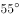
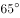
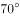

# 物理-光的反射定律（入射角=反射角、法线平分入射与反射光线夹角）结合几何角度计算镜面倾角

考点：[[20-考点/判断推理/科学推理/物理-光的反射定律（入射角=反射角、法线平分入射与反射光线夹角）结合几何角度计算镜面倾角|科学推理 / 物理-光的反射定律（入射角=反射角、法线平分入射与反射光线夹角）结合几何角度计算镜面倾角]]

**问法模型**：给出入射光线与水平夹角（60°）、要求反射光线竖直向下照井底 → 画法线作入射/反射光线的角平分线，镜面与法线垂直，换算镜面与水平面的夹角

## 推理链
1. 第1步：从题干图形提取信息：探照灯灯光（入射光线）与水平方向夹角为60°，斜向下射向井口上方放置的平面镜
2. 第2步：明确目标光路：反射光线必须竖直向下（与水平成90°）才能垂直照到竖井底部，因此光线传播方向相对入射方向偏转了30°
3. 第3步：应用光的反射定律：入射角=反射角，法线（与镜面垂直）平分入射光线与反射光线的夹角；入射光线反向延长线与反射光线的夹角=180°-30°=150°，故入射角=反射角=150°÷2=75°
4. 第4步：镜面与光线方向的夹角=90°-入射角=90°-75°=15°；也可表述为：镜面平分'入射光线延长线（与水平成60°向下）'与'竖直向下反射线'之间30°的夹角，故镜面与竖直方向成15°
5. 第5步：由镜面与竖直方向成15°，换算镜面与水平方向的夹角=90°-15°=75°
6. 第6步：逐项对照选项，镜面与水平方向成75°对应D项，故正确答案为D

**最快解法**：⚡ 角平分线口诀法：入射光线延长线与竖直向下的夹角=90°-60°=30°，镜面恰为这两条线的角平分线，故镜面与竖直成15°、与水平成90°-15°=75°，直接选D

## 易错点
- ⚠ 把'光线与水平夹角60°'误当成入射角：入射角是光线与法线的夹角（本题实为75°），不是光线与镜面或与水平面的夹角
- ⚠ 误记'镜面平分入射光线与反射光线的夹角'：实际是法线平分入射/反射光线夹角，镜面平分的是入射光线延长线与反射光线的夹角，记错会错算成其他角度
- ⚠ 算出镜面与竖直方向的15°后忘记换算成与水平方向的夹角（90°-15°=75°），误把15°当答案

## 母题抽象
> 🧩 当题干出现'光线以某角度入射、经平面镜反射后需沿另一指定方向（如竖直向下）出射'的图形时，用'画法线定角平分线'模型：法线平分入射与反射光线夹角（或镜面平分入射延长线与反射线夹角），再由镜面⊥法线换算镜面与水平面的夹角

**同类特征**：探照灯灯光与水平方向成60°、竖井上方放置平面镜改变光路、要求反射光线竖直向下照井底、求镜面反射面与水平面的夹角、入射角等于反射角、法线垂直于镜面

## 相关题
- [[10-真题/判断推理/科学推理/2137378 物理-光的反射定律（法线平分入射-反射光线夹角，入射角=反射角，镜面⊥法线）|2137378]]（上海 2018，相关度1）

---

### 题干
如图所示，小董在一口与地面垂直的竖井旁边装了一只探照灯，灯光照射的方向与水平的夹角为，为了使灯光垂直照射向竖井的底部，小董在井上方又放置了一块镜子，那么，该镜子的反射面与水平面的夹角为：

### 选项
- A. 

- B. 

- C. 

- D. 

　✅

### 官方解析
如图所示，画出竖直的反射光线，根据光的反射定律，入射角和反射角相等，法线（虚线）和镜子垂直，则镜面与水平方向成，
故正确答案为D。

### 给定材料
（无）
