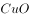

# 化学-可逆反应与平衡移动（光化学分解2AgBr⇌2Ag+Br₂、催化剂与光照条件判断）

考点：[[20-考点/判断推理/科学推理/化学-可逆反应与平衡移动（光化学分解2AgBr⇌2Ag+Br₂、催化剂与光照条件判断）|科学推理 / 化学-可逆反应与平衡移动（光化学分解2AgBr⇌2Ag+Br₂、催化剂与光照条件判断）]]

**问法模型**：“下列分析错误的是”（选非题）→ 逐项依据可逆反应规律判断正误，剔除正确项、锁定错误项

## 推理链
1. 第1步：题干给出“变色镜片含有卤化银（氯化银、溴化银）微晶”，图中反应为2AgBr⇌(CuO催化)2Ag+Br₂，且“卤素不会逸失，所以能发生可逆反应”
2. 第2步：调用可逆反应规律——反应物与生成物在平衡中共存、任一方向都不能进行到底；CuO写在可逆号上方为催化剂；“受到紫外线或短波可见光等激活光照射时”分解，即强光促进正反应、平衡右移
3. 第3步：A项：强太阳光含紫外线等激活光，促使AgBr分解生成Ag，平衡右移，说法正确
4. 第4步：B项：方程式中CuO位于可逆号上方，起催化作用，说法正确
5. 第5步：C项：可逆反应“反应物不能全部转化为生成物”，故强太阳光下镜片中仍有AgBr，说法正确
6. 第6步：D项：室内日光灯下激活光弱，平衡左移、Ag大量转回AgBr，但可逆反应不能进行到底，镜片中仍有Ag，“无Ag”说法错误
7. 第7步：本题为选非题，故选D

**最快解法**：⚡ 可逆共存排除法：记住“可逆反应中反应物与生成物永远共存、都不能100%转化”，凡断言“无某物质”（无论说无AgBr还是无Ag）的选项必错，直接锁定D

## 易错点
- ⚠ 忽略选非题要求，误把正确项A/B/C当答案
- ⚠ 误认为室内无强光时反应完全逆向进行、Ag全部变回AgBr，掉入“无Ag”绝对化表述的陷阱
- ⚠ 没看出方程式中写在可逆号上方的CuO是催化剂信息，误判B项

## 母题抽象
> 🧩 当题干出现“可逆反应⇌+外界条件（光照/催化剂）”特征时，用“共存原则+平衡移动方向”逐项验证，凡含“完全转化/完全无某物质”绝对化表述的选项即为错误项

**同类特征**：变色镜片/卤化银微晶、可逆反应⇌（卤素不逸失）、CuO写在等号上方、光照条件改变（强太阳光/室内日光灯）、选非题“分析错误的是”

## 相关题
（暂无）

---

### 题干

变色镜片含有卤化银（氯化银、溴化银）微晶，当受到紫外线或短波可见光等激活光照射时，卤素离子放出电子，该电子被银离子捕获，发生下列反应：

无色的卤化银分解为不透明的银原子和透明的卤素原子，银原子吸收光线使镜片透光率降低。由于变色镜片中的卤素不会逸失，所以能发生可逆反应。下列分析错误的是<u>                    </u>。

### 选项
- A. 强太阳光使平衡右移
- B. CuO在变色中起催化作用
- C. 强太阳光下镜片中仍有AgBr
- D. 室内日光灯下镜片中无Ag　✅

### 官方解析

当受到紫外线或短波可见光照射时，卤化银分解生成不透明的银原子，镜片透光率降低，故而强太阳光下照射会促使卤化银分解，使平衡右移，A项正确；根据反应方程式可知，作为催化剂，在反应中起催化作用，B项正确；可逆反应中反应物不能全部转化为生成物，所以强太阳光下镜片中仍有，室内日光灯下镜片中也仍有 ，C项正确、D项错误。

本题为选非题，故正确答案为D。

### 给定材料
（无）

> [!warning] 疑点（官方解析可能有误，待人工复核）
> 官方解析末句“室内日光灯下镜片中也仍有”漏写“Ag”二字，属文字缺漏，不影响其“D错误”的结论与逻辑

<!-- CODEX-ANSWER-REVIEW:BEGIN -->
### 本次独立复核

**复核状态：** `confirmed`（独立复算确认答案）

**计分答案：** D（可计分）

**复核解析：**

卤化银在激活光照下分解生成银和卤素，且反应可逆。强光促使平衡向生成银的一侧移动，但反应物不会完全耗尽，镜片中仍有AgBr。反应式标注CuO为催化剂，室内日光灯下也会有少量光化学反应，不能断言镜片中无Ag。因此错误项是D。

**相关信息：**

可逆反应在平衡时反应物与生成物共存；催化剂不改变平衡位置。

**题源依据：** [固定版本原题](https://github.com/Mentat-Uran/kaogongzhentizhengliu/blob/84ab93d4b64b61d897bece8a1c0a5bab06b4feb2/10-%E7%9C%9F%E9%A2%98/%E5%88%A4%E6%96%AD%E6%8E%A8%E7%90%86/%E7%A7%91%E5%AD%A6%E6%8E%A8%E7%90%86/2452951%20%E5%8C%96%E5%AD%A6-%E5%8F%AF%E9%80%86%E5%8F%8D%E5%BA%94%E4%B8%8E%E5%B9%B3%E8%A1%A1%E7%A7%BB%E5%8A%A8%EF%BC%88%E5%85%89%E5%8C%96%E5%AD%A6%E5%88%86%E8%A7%A32AgBr%E2%87%8C2Ag%2BBr%E2%82%82%E3%80%81%E5%82%AC%E5%8C%96%E5%89%82%E4%B8%8E%E5%85%89%E7%85%A7%E6%9D%A1%E4%BB%B6%E5%88%A4%E6%96%AD%EF%BC%89.md)；固定内容 commit `84ab93d4b64b61d897bece8a1c0a5bab06b4feb2`，Markdown blob `599a577d5d51a200fe8cbe369f74d821b4fcd406`。
<!-- CODEX-ANSWER-REVIEW:END -->
