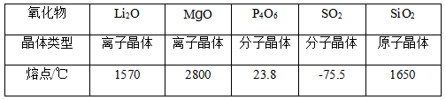

# 化学-晶体类型与熔点（微粒间作用力强弱与晶体熔点的关系）

考点：[[20-考点/判断推理/科学推理/化学-晶体类型与熔点（微粒间作用力强弱与晶体熔点的关系）|科学推理 / 化学-晶体类型与熔点（微粒间作用力强弱与晶体熔点的关系）]]

**问法模型**：问'不能解释熔点差异'的选非题 → 以'作用力越强熔点越高'为标准，逐项校验'晶体类型→作用力性质→熔点高低'链条，表述错误或与表中数据矛盾者即为答案

## 推理链
1. 第1步：题干前提'微粒间的相互作用力越强，熔点越高'，表中数据为MgO(2800℃)>SiO₂(1650℃)>Li₂O(1570℃)>P₄O₆(23.8℃)>SO₂(-75.5℃)
2. 第2步：解题模型为逐项检验——各选项对晶体作用力的描述必须真实，且能对应表中熔点高低
3. 第3步：A项，分子晶体（P₄O₆、SO₂）靠相对较弱的分子间作用力结合，对应其熔点仅23.8℃、-75.5℃，表述正确、能解释低熔点
4. 第4步：B项，离子晶体（Li₂O、MgO）靠相对较强的离子键结合，对应其熔点1570℃、2800℃较高，表述正确、能解释高熔点
5. 第5步：C项，原子晶体（SiO₂）靠共价键结合，共价键属于很强的化学键，SiO₂熔点高达1650℃，'相对较弱的共价键'表述错误且与高熔点矛盾
6. 第6步：D项，同为离子晶体的Li₂O与MgO，Li₂O的离子键弱于MgO，故熔点1570℃<2800℃，能解释同类型晶体内部的差异
7. 第7步：结论：A、B、D均能解释，仅C项表述错误、不能解释，故选C

**最快解法**：⚡ 知识校验法+选非排除：先看问法'不能解释'需选错误项；直接判定C——原子晶体（SiO₂，熔点1650℃）中共价键是很强的作用力而非'相对较弱'，与数据矛盾，锁定C

## 易错点
- ⚠ 误以为共价键'较弱'，把C当成能解释的正确选项（共价键是强化学键，原子晶体熔沸点一般很高）
- ⚠ 忽略选非问法'不能解释'，误选A、B、D等能解释的选项
- ⚠ 忽略D项解释的是同属离子晶体的Li₂O与MgO之间的熔点差异（离子键强弱不同），误认为晶体类型相同就不能解释差异

## 母题抽象
> 🧩 当题干给出'作用力越强熔点越高'+晶体类型与熔点数据表并问'不能解释'时，逐项校验'晶体类型→作用力强弱→熔点高低'链条，凡表述与化学事实或表中数据矛盾者即为答案

**同类特征**：结构决定性质、相互作用力越强熔点越高、氧化物熔点数据表（含晶体类型）、不能解释（选非问法）、离子晶体/分子晶体/原子晶体、离子键/共价键/分子间作用力

## 相关题
- [[10-真题/判断推理/逻辑判断/2456414 解释评价-原因解释（选'不能解释'型）|2456414]]（浙江 2020，相关度1）

---

### 题干

物质的结构决定性质，微粒间的相互作用力越强，熔点越高。一些氧化物的熔点如下表所示：

下列选项中，不能解释氧化物熔点存在差异的是<u>                    </u>。

### 选项
- A. 
分子晶体中的作用力是相对较弱的分子间作用力

- B. 
离子晶体中的作用力是相对较强的离子键

- C. 
原子晶体中的作用力是相对较弱的共价键
　✅
- D. 
中的离子键弱于的

### 官方解析

A项，分子晶体中的作用力是分子间作用力，不是化学键，作用力较弱，熔沸点较低，故A项可以解释氧化物的熔点差异；

B项，离子晶体中的作用力是离子键，属于化学键，作用力较强，熔沸点较高，故B项可以解释氧化物的熔点差异；

C项，原子晶体中的作用力是共价键，属于化学键，作用力很强，熔沸点一般很高，故C项表述错误，不能解释氧化物的熔点差异；

D项，和是离子晶体，离子晶体中的作用力为离子键，离子键能越大，晶体的熔点越高，因为的离子键弱于，所以的熔点比的熔点低，故D项可以解释氧化物的熔点差异。

故正确答案为C。

### 给定材料
（无）
