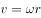
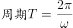

# 物理-双星系统（万有引力提供向心力与匀速圆周运动各量比较）

考点：[[20-考点/判断推理/科学推理/物理-双星系统（万有引力提供向心力与匀速圆周运动各量比较）|科学推理 / 物理-双星系统（万有引力提供向心力与匀速圆周运动各量比较）]]

**问法模型**：题干给出'双星系统、仅相互万有引力、角速度相同'的物理量比较问法 → 先用牛顿第三定律锁定向心力关系，再用F=mrω²、v=ωr、T=2π/ω逐项推导

## 推理链
1. 第1步：从题干提取前提——质量分别为3m和m的两颗恒星'仅在相互之间万有引力的作用下'，'以两星连线上的某点为圆心'做'角速度相同'的匀速圆周运动，图中A大B小即示意质量差异与连线转轴
2. 第2步：所用规则——两星间的万有引力互为作用力与反作用力（牛顿第三定律），大小相等、方向相反；且该引力分别充当两星各自的向心力
3. 第3步：对照A项——两星所受引力大小相等→向心力大小相等，A正确
4. 第4步：对照B项——由F=mrω²，两星F相同、ω相同，但质量3m≠m，故轨道半径r必不相等（r与m成反比，B星半径为A星3倍），B错误
5. 第5步：对照C项——由v=ωr，ω相同而r不相等，线速度必不相等，C错误
6. 第6步：对照D项——由T=2π/ω，角速度相同则周期必相同，'周期不等'说法错误

**最快解法**：⚡ 牛顿第三定律+公式链排除法：由'相互吸引力互为作用力与反作用力'直接秒选A；再用F=mrω²（F、ω同、m异→r异）排B，v=ωr排C，T=2π/ω排D

## 易错点
- ⚠ 误以为质量大的恒星所需的向心力更大——忽略两星向心力由同一对作用力/反作用力提供，大小必然相等
- ⚠ 把双星误当成绕同一圆心、同一半径的模型——双星轨道半径不同，r_B:r_A=3:1（与质量成反比）
- ⚠ 误判周期——角速度相同则周期必相同，不能因半径、线速度不同而误认周期不等

## 母题抽象
> 🧩 当题干出现'双星系统/同轴转动且角速度相同'特征时，先用牛顿第三定律确认向心力等大，再用F=mrω²得r∝1/m，继而由v=ωr、T=2π/ω比较其余物理量

**同类特征**：双星系统、仅在相互万有引力作用下、角速度相同、质量3m和m、以两星连线上某点为圆心、匀速圆周运动

## 相关题
- [[10-真题/判断推理/科学推理/2395205 物理-匀速圆周运动-向心力来源分析|2395205]]（上海 2018，相关度1）

---

### 题干

质量分别为3m和m的两颗恒星A和B组成双星系统，仅在相互之间万有引力的作用下，以两星连线上的某点为圆心，在同一平面内做角速度相同的匀速圆周运动。已知向心力大小与物体质量、轨道半径、角速度平方成正比。下列说法正确的是<u>                    </u>。

### 选项
- A. 两恒星的向心力大小相等　✅
- B. 两恒星的轨道半径相等
- C. 两恒星的线速度相等
- D. 两恒星的周期不等

### 官方解析

根据题意，两颗恒星分别仅受到对方的万有引力作用，这对万有引力是一对作用力和反作用力，力的大小相等，方向相反。

A项，两颗恒星的向心力就是由该万有引力提供，因此两颗恒星的向心力大小相等，正确；

B项，根据公式，，两恒星的向心力大小相等，角速度相等，而质量不相等，所以轨道半径必然不相等，错误；

C项，两恒星角速度相等、轨道半径r不相等，由线速度公式，可知线速度不相等，错误；

D项，匀速圆周运动中，，角速度相等，周期相等，错误。

故正确答案为A。

### 给定材料
（无）
