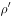
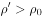
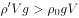

# 物理-浮力与受力运动分析（液体密度随深度变化下的浮沉条件、合力方向与加速-减速判断）

考点：[[20-考点/判断推理/科学推理/物理-浮力与受力运动分析（液体密度随深度变化下的浮沉条件、合力方向与加速-减速判断）|科学推理 / 物理-浮力与受力运动分析（液体密度随深度变化下的浮沉条件、合力方向与加速/减速判断）]]

**问法模型**：给出液体密度随深度增大的规律+只受重力和浮力，问小球运动全过程 → 按'浮力随深度增大'分段比较合力与速度方向，同向加速、反向减速，循环分析并确定终态

## 推理链
1. 第1步：题干给出液体密度随深度增大（ρ随深度h线性增大，式中为常数），且由官方解析'小球的重力大于浮力'可知小球密度大于液体表面密度，投入时G=ρ球gV＞F浮=ρ液gV，合力向下，小球先做向下的加速运动
2. 第2步：所用规则：浮力F浮=ρ液gV排，V排不变而ρ液随深度增大→浮力不断增大；合力与速度同向则加速、反向则减速，速度为0不代表合力为0
3. 第3步：小球下潜使浮力持续增大，当浮力＞重力时合力方向向上、与向下运动方向相反，小球向下做减速运动直至速度减为0
4. 第4步：速度为0后合力仍向上，小球转而向上加速；上升中ρ液减小、浮力减小，当浮力＜重力时合力向下、与向上运动方向相反，小球向上减速至速度为0，再重复向下加速，形成'向下加速—向下减速—向上加速—向上减速'的循环
5. 第5步：逐项排除：B'一直加速'忽略浮力随深度增大；C含'匀速'，但题干明确只受重力和浮力、无阻力，两力不平衡时不可能匀速；A'沉底'与'深度足够⇒必存在ρ液=ρ球、浮力=重力的深度'矛盾
6. 第6步：结论：小球经历若干次加速和减速过程，不会沉底，最终悬浮在液体中某处，选D

**最快解法**：⚡ 分段受力分析法（口诀：合力与速度同向加速、反向减速）：由'重力＞浮力'定先向下加速→抓'密度随深度增大⇒浮力增大'定会出现反向合力与减速→加减速交替循环→用'深度足够必存在浮力=重力的深度'一票否决A、B沉底项，C含匀速排除，锁定D

## 易错点
- ⚠ 默认'V排不变则浮力不变'，忽视液体密度随深度增大导致浮力增大，误选B'一直加速最后沉底'
- ⚠ 把'速度减为0'误当成'合力为0、停止运动'，实际上速度为0处浮力仍大于重力，小球随即反向加速
- ⚠ 误选C：以为小球会经历'匀速'过程，忽略题干限定'只考虑重力和浮力'、无阻力时两力不平衡不可能匀速

## 母题抽象
> 🧩 当题干出现'流体密度随位置单调变化+物体密度介于密度区间内+只受重力和浮力'时，用'合力与速度同向加速、反向减速'的分段循环法分析运动，并验证是否存在浮力=重力的平衡位置，以排除沉底/浮出/匀速类选项

**同类特征**：密度随深度增大（给变化规律式）、实心小球密度大于液体表面密度、只考虑重力和浮力（无阻力）、深度足够、问运动过程表述（加速/减速/匀速+终态）

## 相关题
（暂无）

---

### 题干

已知一种液体的密度随深度而增大，它的变化规律是，式中、是常数，表示深度。设深度足够，有一个密度为的实心小球投入此液体中，且，则小球的运动过程表述正确的是<u>                    </u>。(本题只考虑小球受到重力和浮力两个力)

### 选项
- A. 小球会经历若干次加速和匀速过程，最后沉底
- B. 小球一直加速，最后沉底
- C. 小球会经历若干次匀速和减速过程，最后悬浮在液体中某处
- D. 小球会经历若干次加速和减速过程，最后悬浮在液体中某处　✅

### 官方解析

小球的重力为，小球投入液体中所受浮力为，根据，得到，即小球的重力大于浮力，故小球投入液体中，做向下的加速运动。根据，可知随着小球向下运动，不断增大， 也不断增大，故小球所受浮力增大。

当浮力大于重力时，小球受合力方向向上，与运动方向相反，开始做减速运动，直至速度减少到0。此时小球在向上合力作用下，开始做向上的加速运动，小球所受浮力开始减少。当浮力小于重力时，小球受合力方向向下，与运动方向相反，开始做减速运动，直至速度减少到0，小球又在向下合力作用下，开始向下做加速运动。

故小球会经历若干次加速和减速过程，排除选项B、C。由于深度足够，即必然存在，所以小球不会沉底，最终一定会悬浮在液体中某处，故选项A错误，选项D正确。

故正确答案为D。

### 给定材料
（无）

> [!warning] 疑点（官方解析可能有误，待人工复核）
> 官方解析在'只考虑重力和浮力'的理想条件下断言小球'最终一定会悬浮在液体中某处'存在简化瑕疵：浮力仅随位置变化、无耗散，小球理论上应在浮力=重力的平衡深度附近做往复运动而不会自动静止；'最后悬浮'应理解为围绕该平衡深度的运动终态，此为命题简化处理，不影响答案D的判定

<!-- CODEX-ANSWER-REVIEW:BEGIN -->
### 本次独立复核

**复核状态：** `resolved`（答案与解析已核定）

**计分答案：** D（可计分）

**复核解析：**

固定公式图恢复ρ(h)=ρ0+kh（k>0），小球密度ρ′>ρ0。合力Fnet=Vg(ρ′−ρ0−kh)，平衡深度h*=(ρ′−ρ0)/k。h<h*时合力向下，h>h*时合力向上；在题目限定仅受重力和浮力时没有阻尼，球会穿过平衡点并在其附近往复运动，而不会最后静止悬浮。将D选项“最后悬浮”修为往复运动后，D准确。

**修订选项：**

A. 小球会经历若干次加速和匀速过程，最后沉底
B. 小球一直加速，最后沉底
C. 小球会经历若干次匀速和减速过程，最后悬浮在液体中某处
D. 小球先加速下沉，再在平衡深度附近往复运动；无阻尼时不会最终静止悬浮。

**相关信息：**

科学推理—浮力与变密度液体；受力平衡位置不等于无阻尼系统的静止终态。

**题源依据：** [固定版本原题](https://github.com/Mentat-Uran/kaogongzhentizhengliu/blob/84ab93d4b64b61d897bece8a1c0a5bab06b4feb2/10-%E7%9C%9F%E9%A2%98/%E5%88%A4%E6%96%AD%E6%8E%A8%E7%90%86/%E7%A7%91%E5%AD%A6%E6%8E%A8%E7%90%86/2452976%20%E7%89%A9%E7%90%86-%E6%B5%AE%E5%8A%9B%E4%B8%8E%E5%8F%97%E5%8A%9B%E8%BF%90%E5%8A%A8%E5%88%86%E6%9E%90%EF%BC%88%E6%B6%B2%E4%BD%93%E5%AF%86%E5%BA%A6%E9%9A%8F%E6%B7%B1%E5%BA%A6%E5%8F%98%E5%8C%96%E4%B8%8B%E7%9A%84%E6%B5%AE%E6%B2%89%E6%9D%A1%E4%BB%B6%E3%80%81%E5%90%88%E5%8A%9B%E6%96%B9%E5%90%91%E4%B8%8E%E5%8A%A0%E9%80%9F-%E5%87%8F%E9%80%9F%E5%88%A4%E6%96%AD%EF%BC%89.md)；固定内容 commit `84ab93d4b64b61d897bece8a1c0a5bab06b4feb2`，Markdown blob `812e02797a2a7fd380d62bfb47b35fcbb0812503`。
<!-- CODEX-ANSWER-REVIEW:END -->
