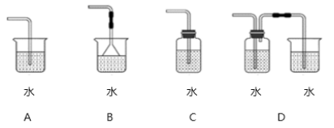

# 化学-气体溶解与尾气吸收装置设计（防逸散+充分溶解）

考点：[[20-考点/判断推理/科学推理/化学-气体溶解与尾气吸收装置设计（防逸散+充分溶解）|科学推理 / 化学-气体溶解与尾气吸收装置设计（防逸散+充分溶解）]]

**问法模型**：题干问'有毒气体溶于水哪种装置最合适'→用'防逸散+可充分溶解'双硬条件对装置逐一筛查

## 推理链
1. 第1步：提取题干限定条件——气体是'有毒气体'，溶于水的装置必须既让气体充分溶解，又不能让未溶解的气体逸散到空气
2. 第2步：由条件推出两个筛选硬指标：①装置不能让未溶解气体直接排空（敞口直排即危险）；②装置不能完全封闭（封闭则气体无法持续通入、水只能溶解少量）
3. 第3步：逐项对照——A项导管直接插入敞口烧杯水中，未溶气体从敞口逸散，不满足①；B项倒扣漏斗虽增大接触面，但烧杯仍敞口，未充分溶解的有毒气体照样逸散，不满足①；C项瓶口密封、玻璃管中气体无法排出，水只能溶解少量气体，不满足②；D项密封瓶溶解后的剩余气体经导管通入第二个敞口烧杯水中'再次溶解'，两级吸收兼顾①②
4. 第4步：仅D项同时满足'有毒气体不逸散'与'气体能充分溶解'两条件，故选D

**最快解法**：⚡ 双条件排除法：抓住'有毒→不能逸散'与'要充分溶解→不能全封闭'两条硬标准，A、B因敞口排除，C因全封闭排除，直接锁定D（两级串联、二次溶解）

## 易错点
- ⚠ 只关注倒扣漏斗'增大接触面积/防倒吸'的加分点而误选B，忽略烧杯敞口时未溶有毒气体仍会逸散
- ⚠ 看到'装置封闭'就直觉认为更安全而误选C，忽略封闭体系气体排不出去、溶解量有限且气压隐患
- ⚠ 忽略'有毒'这一限定词，按普通气体溶解思路误选装置最简单的A

## 母题抽象
> 🧩 当题干出现'有毒（有害）气体通入水/溶液吸收，选最合适装置'的特征时，用'防逸散+能持续充分溶解'双硬条件筛查，全敞口和全封闭都淘汰，优先选带二次吸收（串联续接）的装置

**同类特征**：有毒气体、气体溶于水、装置图筛选、化学实验装置、敞口与封闭、尾气吸收处理

## 相关题
（暂无）

---

### 题干

将气体溶于水有多种装置，如果是一种有毒气体，下列装置最合适的是（  ）。

### 选项
- A. A
- B. B
- C. C
- D. D　✅

### 官方解析
A项：烧杯敞口，有毒气体若未充分溶解会散发到空气中，造成危害，错误；
B项：倒扣漏斗虽然增加了气体与水的接触面，但是烧杯敞口，可能导致未充分溶解的有毒气体散发到空气中，造成危害，错误；
C项：装置封闭，玻璃管中气体无法排出，水只能溶解少量气体，错误；
D项：第一次未溶解气体通入到敞口烧杯内，会进行再次溶解，能使有毒气体充分溶于水，正确。
故正确答案为D。

### 给定材料
（无）
