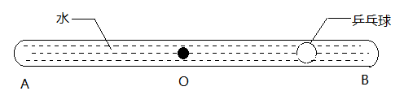
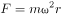

# 物理-圆周运动与离心现象（密度差决定内外位置）

考点：[[20-考点/判断推理/科学推理/物理-圆周运动与离心现象（密度差决定内外位置）|科学推理 / 物理-圆周运动与离心现象（密度差决定内外位置）]]

**问法模型**：封闭管绕中点旋转时轻小物体的最终位置 → 用向心力公式F=mω²r比较水与球的'离心趋势'，密度大者甩向外侧、密度小者被挤向转轴

## 推理链
1. 第1步：从题干提取——AB管两端封闭、装满水，乒乓球直径小于管径可在水中移动，管绕中点O在水平面内转动，球初始位于B端一侧
2. 第2步：所用规则——做圆周运动需向心力F=mω²r，半径r处质量越大所需向心力越大；水密度大于乒乓球，同体积下水的质量远大于球
3. 第3步：水与球角速度相同，单位体积水所需向心力大于球，管壁摩擦不足以约束，球附近的水相对管做离心运动，被'甩'向外侧（A、B两端管底），在管底支持力下继续做圆周运动
4. 第4步：水向外侧让位后，球周围形成指向转轴的压强差，球受合效果指向圆心O，故球从B侧向O（即沿指向A的方向）移动
5. 第5步：稳定位置分析——O点处r=0，所需向心力为零，球在O点各方向水压平衡，转动越快水被甩得越充分，球越稳定地停在O点
6. 第6步：逐项对照——A、B称球停在端点（那是密度大的水的去向），D称球不动（忽略水球可相对流动），均与密度差分析矛盾，只有C'向A端移动、停在O点'符合推理

**最快解法**：⚡ 离心分离模型+排除法：'谁密度大谁被甩向外侧'——水被甩向A、B两端，轻的乒乓球被挤向转轴；管已装满且球轻于水，最终只能停在半径为零的中点O，直接锁定C

## 易错点
- ⚠ 把乒乓球当成普通'甩干'对象，误以为轻小物体被甩到端点而错选A/B，忽略必须比较水与球的密度（离心趋势与质量成正比）
- ⚠ 认为管两端封闭、装满水，球无处可去故停在原处而错选D，忽略水与球可发生相对流动
- ⚠ 误以为停留位置与转速有关或停在A、B之间某处，忽略r=0的O点才是向心力需求为零的平衡位置

## 母题抽象
> 🧩 当封闭旋转系统中存在两种密度不同的物体时，用'密度大者离心向外、密度小者被挤向转轴'判断最终位置，稳定点在半径最小处（转轴/中点）

**同类特征**：两端封闭玻璃管装满水、乒乓球密度小于水、绕中点O在水平面内转动、向心力F=mω²r、离心运动与'甩'向管底、判断最终停留位置

## 相关题
（暂无）

---

### 题干

如图所示、AB为一根两端封闭的玻璃粗管，其中装满水，水中有一个直径小于粗管直径的乒乓球。当玻璃管以中点O点开始在水平面内顺时针转动时，则（  ）。

### 选项
- A. 乒乓球向A端移动，当转动够快时乒乓球能停留在玻璃管的A端
- B. 乒乓球向B端移动，当转动够快时乒乓球能停留在玻璃管的B端
- C. 乒乓球向A端移动，当转动够快时乒乓球能停留在玻璃管的中点O处　✅
- D. 无论转动多快，乒乓球相对玻璃管停留在原处

### 官方解析

物体做圆周运动所需的向心力 ，其中是物体的质量，是物体运动的角速度，是运动的圆周轨道半径。

玻璃管开始旋转时，水和乒乓球以相同的角速度做圆周运动，由于水质量大于乒乓球，故做圆周运动时所需要的向心力光凭管壁摩擦力不足以提供，故乒乓球附近的水会做离心运动，被“甩”到外侧管底，在管底支持力的作用下，进行圆周运动，与此同时，乒乓球在水的作用下向内侧运动，最终停留在O点。

故正确答案为C。

### 给定材料
（无）
