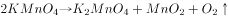

# 化学-绿色化学（原子利用率100%）与污染物处理

考点：[[20-考点/判断推理/科学推理/化学-绿色化学（原子利用率100%）与污染物处理|科学推理 / 化学-绿色化学（原子利用率100%）与污染物处理]]

**问法模型**：题干先给出'绿色化学'的多条判定标准（原子利用率100%、全部转化为产物、'三废'先处理再排放），再问哪种做法或反应符合 → 按定义要点逐条对照的排除法

## 推理链
1. 第1步：从题干提取'绿色化学'三个判定要点：①物质回收或循环利用；②反应物原子利用率为100%且全部转化为产物；③'三废'必须先处理再排放
2. 第2步：确立判定方法——选项只需违反任一要点即排除，全部满足才是答案
3. 第3步：A项'焚烧塑料'看似消除'白色污染'，但焚烧产生大量废气污染空气，违反要点③，排除
4. 第4步：B项'深埋含镉、汞的废旧电池'未先处理直接深埋，会污染土壤和水源，违反要点①③，排除
5. 第5步：C项反应式为丙炔+氢气+一氧化碳→戊二醛，属多反应物生成单一产物的反应，所有原子全部进入产物，原子利用率100%，满足要点②，保留
6. 第6步：D项高锰酸钾加热制氧气，产物除氧气外还有锰酸钾和二氧化锰，副产物使原子利用率不足100%，违反要点②，排除
7. 第7步：只有C项同时满足全部要点，故选C

**最快解法**：⚡ 原子守恒速判法：绿色化学理想反应='化合反应'（反应物原子全部进入唯一产物）。扫一眼四个选项，C是丙炔+H₂+CO→戊二醛的化合式（无副产物），直接锁定；A、B是污染性处理方式可秒排除，D有明显副产物

## 易错点
- ⚠ 被'消除白色污染'的表面目的迷惑——焚烧塑料虽处理了垃圾但产生二次废气污染，过程不绿色
- ⚠ D项误以为'制得有用氧气'就符合绿色化学，忽略锰酸钾、二氧化锰副产物导致原子利用率不足100%
- ⚠ 只盯原子利用率而漏掉'三废先处理再排放''回收循环利用'等并列条件，漏杀A、B

## 母题抽象
> 🧩 当题干给出'绿色化学/原子经济'类标准（原子利用率100%、全部转化为产物、废物先处理）时，用'找单一产物反应法'：优先锁定反应物→唯一产物的化合反应，再对工艺类选项用污染处理方式排除

**同类特征**：绿色化学、原子利用率100%全部转化为产物、三废先处理再排放、选项含化学方程式图片、做法+反应混合类选项、符合要求的是

## 相关题
（暂无）

---

### 题干

“绿色化学”要求物质回收或循环利用，反应物原子利用率为，且全部转化为产物，“三废”必须先处理再排放。下列做法或反应符合“绿色化学”要求的是：

### 选项
- A. 
焚烧塑料以消除“白色污染”

- B. 
深埋含镉、汞的废旧电池

- C. 

　✅
- D. 

### 官方解析

A项：焚烧塑料会产生大量的废气污染空气，不符合条件中的“绿色化学”要求，错误；

B项：深埋含镉、汞的废旧电池，没有先处理再排放，不符合“绿色化学”要求，并且深埋处理会污染土壤和水源，错误；

C项：由化学反应方程式可知，丙炔、氢气、一氧化碳反应生成戊二醛，原子的利用率为，符合“绿色化学”要求，正确；

D项：利用高锰酸钾加热生产氧气，产物还有锰酸钾和二氧化锰，原子的利用率不足，不符合“绿色化学”要求，错误。

故正确答案为C。

### 给定材料
（无）
