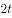

# 物理-焦耳定律与纯电阻电路热量计算（Q=U²t-R的比值分析）

考点：[[20-考点/判断推理/科学推理/物理-焦耳定律与纯电阻电路热量计算（Q=U²t-R的比值分析）|科学推理 / 物理-焦耳定律与纯电阻电路热量计算（Q=U²t/R的比值分析）]]

**问法模型**：电热丝剪短后电阻变为原来的1/4，给出新的电压/时间/热量组合 → 用纯电阻电路热量式Q=U²t/R写出通式，对四个选项逐项代入比值验证

## 推理链
1. 第1步：题干给出原状态——电阻R接在电压U的电路中，时间t内产生热量Q，纯电阻电路满足Q=U²t/R
2. 第2步：剪掉一小段后剩余电阻R'=R/4，建立任一情形的通式Q₁=(U₁²/R₁)·t₁，与原式Q=U²t/R作比值比较
3. 第3步：A项：仍接电压U、时间t，则Q_A=U²t/(R/4)=4Q，而选项称热量仅为Q/4，不符，错误
4. 第4步：B项：仍接电压U时功率P'=U²/(R/4)=4U²/R，要产生热量Q所需时间t'=QR'/U²=t/4，与选项所给时间不符，错误
5. 第5步：C项：接电压U/2、时间t/4，则Q_C=(U/2)²·(t/4)/(R/4)=U²t/(4R)=Q/4，与选项所给热量一致，正确
6. 第6步：D项：时间t/4内产生热量Q所需电压U_D=√(QR'/(t/4))=√(U²)=U，选项称电压为U/2，不符，错误

**最快解法**：⚡ 比例法（功率对比）：抓住功率P=U²/R，电阻变为R/4、电压变为U/2时P'=(U/2)²/(R/4)=U²/R与原功率相同，故时间压缩为t/4时热量恰为Q/4，直接锁定C

## 易错点
- ⚠ 误认为'电阻变为R/4则热量也变为Q/4'而错选A，忽略电压不变时Q=U²t/R与电阻成反比，实际应增大为4Q
- ⚠ 混淆'相同时间t内产生的热量'与'产生相同热量Q所需的时间'，B项应求t'=QR'/U²=t/4，并非把时间成倍放大
- ⚠ D项反求电压时忘记开平方：由U_D²=QR'/t'=U²应得U_D=U，漏掉根号会误判电压关系而错选

## 母题抽象
> 🧩 当题干出现'纯电阻元件的电阻/电压/时间/热量中若干量发生变化，判断其余量的变化结果'特征时，先写出Q=U²t/R（或P=U²/R）通式，再用比值法代入新旧参数逐项验证选项

**同类特征**：纯电阻电路/电热丝、剪短后电阻变为原来的1/4、焦耳定律Q=U²t/R、已知U、t、Q三个基准量、四种电压-时间-热量组合假设、逐项代入验证

## 相关题
- [[10-真题/判断推理/类比推理/10297432 对应关系-工具对应（填空式代入）|10297432]]（四川 2025，相关度1）
- [[10-真题/判断推理/类比推理/12882035 逻辑关系-种属关系与交叉关系辨析（两空式代入法）|12882035]]（内蒙古 2025，相关度1）
- [[10-真题/判断推理/类比推理/19181466 语义关系-种属关系（填空式代入验证）|19181466]]（吉林 2024，相关度1）
- [[10-真题/判断推理/类比推理/19283778 填空式类比-逻辑关系辨析（种属-并列-因果-属性-功能-条件对应）|19283778]]（国考 2025，相关度1）
- [[10-真题/判断推理/类比推理/2045612 填空式类比-代入验证（周期性属性与成像原理的弱对应择优）|2045612]]（广州市考 2017，相关度1）

---

### 题干
一根电热丝的电阻值为，将它接在电压为的电路中时，在时间内产生的热量为。使用一段时间后，将电热丝剪掉一小段，剩下一段的电阻值为。现将剩下的这段电热丝接入电路，则：

### 选项
- A. 
若仍将它接在电压为的电路中，在时间t内产生的热量为

- B. 
若仍将它接在电压为的电路中，产生的热量为，所需时间为

- C. 
若将它接入电压为的电路中，在时间内产生的热量为
　✅
- D. 
若将它接入另一电路，在时间内产生的热量仍为，这个电路的电压为

### 官方解析
热量的表达式为，对于纯电阻电路可变式为。
当电路为一根电热丝时热量，当时，逐项分析：
A项，此时，错误；
B项，若，则，错误；
C项，若，则，正确；
D项，若，，，错误。
故正确答案为C。

### 给定材料
（无）
