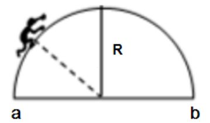
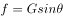
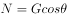

# 物理-共点力平衡（缓慢运动=准静态，重力沿切向-法向分解求f与N的变化）

考点：[[20-考点/判断推理/科学推理/物理-共点力平衡（缓慢运动=准静态，重力沿切向-法向分解求f与N的变化）|科学推理 / 物理-共点力平衡（缓慢运动=准静态，重力沿切向/法向分解求f与N的变化）]]

**问法模型**：题干出现'蚂蚁缓慢爬行半圆弧'且问力的方向/大小变化 → 按'缓慢=合外力为零'的准静态平衡模型，设位置角列切向/法向平衡方程

## 推理链
1. 第1步：蚂蚁受重力、摩擦力、支持力三个力，题干'缓慢爬行'表明任意时刻合外力为0（准静态平衡）
2. 第2步：设蚂蚁与圆心连线与竖直方向夹角为θ，将重力沿切线方向和法线方向正交分解：切向分量mg·sinθ，法向分量mg·cosθ
3. 第3步：沿切线方向平衡得 f=mg·sinθ，因重力使蚂蚁有沿金属丝向下滑动的趋势，摩擦力方向始终沿切线指向圆顶（向上）；法向平衡得 N=mg·cosθ
4. 第4步：从a到圆顶θ由90°减小到0°：sinθ减小→f减小，cosθ增大→N增大；从圆顶到b θ由0°增大到90°：f增大、N减小
5. 第5步：对照A、B项：两段中摩擦力均沿切线向上而非'向下'，A、B均错误
6. 第6步：对照C、D项：支持力N=mg·cosθ先增大后减小，C正确；摩擦力f=mg·sinθ先减小后增大、并非大小不变，D错误

**最快解法**：⚡ 特殊位置法：只看三个特殊点——在a、b端切线竖直，支持力N≈0、摩擦力最大且沿切线向上；在圆顶切线水平，N最大（=mg）、摩擦力为0。由此立刻得出支持力先增后减（C对）、摩擦力先减后增且方向始终向上（A、B、D全排除）

## 易错点
- ⚠ 忽略'缓慢'隐含的准静态平衡条件，误以为圆弧运动存在合力/向心力而无法用共点力平衡
- ⚠ 摩擦力方向误判：误按'摩擦力与运动方向相反'把a→b的运动方向当作判断依据，实际静摩擦方向由相对滑动趋势决定，重力使蚂蚁始终有向下滑的趋势，故摩擦力始终沿切线指向圆顶
- ⚠ 忽略端点极端情形：a、b处切线竖直、支持力接近零，若漏看此点会误判支持力'一直增大'或'一直减小'

## 母题抽象
> 🧩 当题干出现'缓慢沿曲面/圆弧移动'特征时，按准静态平衡处理，把重力沿切向、法向分解（θ为位置半径与竖直方向夹角）：f=mg·sinθ、N=mg·cosθ，再看θ的变化区间判断两力的增减与方向

**同类特征**：缓慢爬行、半圆弧金属丝、竖直于平面内、a、b同一水平线、问摩擦力/支持力方向与大小变化

## 相关题
（暂无）

---

### 题干

有一根金属丝弯成半圆弧的形状竖直于平面内，蚂蚁从a沿金属缓慢爬向b（a、b同一水平线），下列说法正确的是：

### 选项
- A. 蚂蚁从a往圆顶爬时，它受摩擦力向下
- B. 蚂蚁从圆顶往b爬时，它受摩擦力向下
- C. 蚂蚁受的支持力，先增大后减小　✅
- D. 蚂蚁受的摩擦力，大小不变

### 官方解析

A、B项：蚂蚁在沿着金属丝爬行时受到重力的作用，重力会使蚂蚁有沿着金属丝向下滑动的趋势，从a往圆顶爬行时，它所受摩擦力的方向沿着斜面的切线向上，蚂蚁从圆顶往b爬行时，它所受摩擦力的方向沿着斜面的切线向上，故A、B两项均错误；

C、D项：设蚂蚁的重力为， 蚂蚁和圆心连线与竖直方向的夹角为，对蚂蚁进行受力分析（如下图所示），蚂蚁在爬行时，受到重力、摩擦力、支持力，三个力的作用，蚂蚁在缓慢爬行时所受的合外力为0，根据受力平衡重力的分力的大小等于摩擦力，即，支持力，蚂蚁在爬行的过程中，先减小，后增大，则摩擦力先减小，后增大，支持力先增大，后减小。故C项正确，D项错误。

故正确答案为C。

### 给定材料
（无）

> [!warning] 疑点（官方解析可能有误，待人工复核）
> 官方解析中'设蚂蚁的重力为，夹角为'等处变量符号缺失（排版丢失），但受力模型与结论自洽，不影响答案；另端点处N=0而f=mg为理想化处理，属此类题的通用简化，不构成逻辑错误
