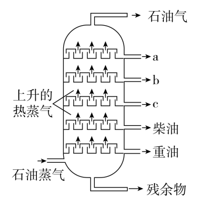

# 化学-石油分馏（沸点与塔内温度梯度的对应关系）

考点：[[20-考点/判断推理/科学推理/化学-石油分馏（沸点与塔内温度梯度的对应关系）|科学推理 / 化学-石油分馏（沸点与塔内温度梯度的对应关系）]]

**问法模型**：‘下列有关说法错误的是’（选非题）→ 依据分馏塔温度梯度规律逐项判断正误，锁定说法错误的一项

## 推理链
1. 第1步：从图形提取结构信息：石油蒸气从塔底进入上升，侧线出口自上而下依次为石油气、a、b、c、柴油、重油，塔底排出残余物
2. 第2步：应用分馏原理：塔内越往上温度越低，沸点高的物质先液化、在下方出口采出，沸点低的物质继续上升、在高处才液化
3. 第3步：由该规律排出沸点序：重油＞柴油＞c＞b＞a＞石油气，故a、b、c中沸点最高的是c，a沸点最低
4. 第4步：逐项对照：A项石油由多种烷烃、环烷烃等组成，属混合物，说法正确
5. 第5步：B项称‘a、b、c中沸点最高的是a’，与‘越往上沸点越低’的规律相反，说法错误
6. 第6步：C项依‘碳原子越多沸点越高’可知重油碳含量高于柴油，说法正确；D项残留物（沥青）可制涂料、塑料等，说法正确
7. 第7步：本题为选非题，说法错误的B项即为答案

**最快解法**：⚡ 图形口诀法：记住‘塔越高→温度越低→沸点越低’，图中a位于最高侧线出口，故a沸点最低，B项说a最高，直接秒选B

## 易错点
- ⚠ 把分馏塔温度梯度记反（误以为塔顶温度高、高沸点在上方），会错选C或A
- ⚠ 忽略‘选非题’问法，误把说法正确的A、C、D当作答案
- ⚠ 混淆‘沸点高先液化沉在下方’与‘低沸点蒸气升到高处’的方向关系，导致a、c排序颠倒

## 母题抽象
> 🧩 当题干出现‘分馏塔/蒸馏塔示意图＋各层出口产物’特征时，用‘上冷下热、上低沸下高沸’口诀排出各出口物质沸点顺序，再验证各选项说法正误

**同类特征**：石油分馏塔示意图、选非题（选错误项）、沸点高低与塔内位置对应、物理变化（分馏）、碳原子数与沸点正相关、残留物的再利用

## 相关题
- [[10-真题/资料分析/增长/51813 年均增速比较+选非题综合判断|51813]]（广州市考 2013，相关度1）
- [[10-真题/判断推理/逻辑判断/2741725 真假话问题-只有一真（假设法+连锁推理）|2741725]]（山东 2021，相关度1）

---

### 题干

石油分馏是将几种不同沸点的混合物分离的一种方法，属于物理变化。右图是石油分馏塔的示意图，下列有关说法错误的是：

### 选项
- A. 石油是一种混合物
- B. a、b、c中沸点最高的是a　✅
- C. 柴油中碳元素的百分含量比重油低
- D. 分馏的残留物还可以制得其他产品

### 官方解析
A项：石油是由多种烷烃、环烷烃等有机物组成的混合物，正确；
B项：石油分馏塔越往上温度越低，石油蒸气在石油分馏塔内上升的过程中，沸点高的物质会先进行液化，沸点低的物质则会逐渐上升，在塔的高处液化，所以越往上物质的沸点越低，所以a、b、c中沸点最高的是c，错误；
C项：由B项的分析可知重油的沸点比柴油的沸点高，沸点的高低与物质中碳原子的多少有关，物质中碳原子越多，物质的沸点也就越高，所以柴油中碳元素的百分含量比重油低，正确；
D项：石油分馏出的残留物主要是沥青，可以用于制造涂料、塑料等，正确。
本题为选非题，故正确答案为B。

### 给定材料
（无）
