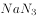
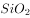
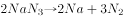
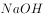
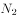

# 化学-元素守恒与反应产物推断（安全气囊反应体系）

考点：[[20-考点/判断推理/科学推理/化学-元素守恒与反应产物推断（安全气囊反应体系）|科学推理 / 化学-元素守恒与反应产物推断（安全气囊反应体系）]]

**问法模型**：'以下推断错误的是'选非题 → 先由反应关系与物质性质定位单质甲、乙，再逐项验证找出推断错误项

## 推理链
1. 第1步：题干指出碰撞时填充物之一分解生成甲、乙两种单质，且另一成分'与可能会对人体造成伤害的单质甲反应，生成单质乙和两种氧化物'
2. 第2步：用物质性质定位单质：金属钠非常活泼、接触水分剧烈反应伤人，而氮气无害，故单质甲为金属钠、单质乙为氮气
3. 第3步：由分解方程可知分解后产生大量氮气，该成分也可与钠反应生成氮气，故安全气囊里充的气体是氮气（A、B正确）
4. 第4步：由'生成单质乙和两种氧化物'结合元素守恒，两种氧化物分别为钠的氧化物和钾的氧化物，产物中不含氮氧化合物
5. 第5步：C项：气囊须在事故极短时间内充气保护乘员，故该成分受剧烈撞击反应迅速，推断正确
6. 第6步：D项称与单质甲反应后'有氮氧化合物生成'，与产物实为两种金属氧化物矛盾，为错误推断

**最快解法**：⚡ 物质定位法+元素守恒：由'甲会对人体造成伤害、乙无害'直接锁定甲=金属钠、乙=氮气；再看产物仅为氮气与两种金属氧化物，无氮氧化合物，锁定D

## 易错点
- ⚠ 混淆'氮气（单质）'与'氮氧化合物（如NO、NO₂）'，误以为含氮反应必有氮氧化合物生成
- ⚠ 忽略'选非题'要求，误把正确的A、B、C当成答案
- ⚠ 未抓住'可能会对人体造成伤害的单质甲'这一关键限定，无法定位甲为金属钠

## 母题抽象
> 🧩 当题干用'甲、乙'隐去化学式指代生成物并给出性质提示（危害性、单质/氧化物类别）时，先用物质性质+元素守恒还原各物质，再逐项验证推断正误

**同类特征**：安全气囊填充物、猛烈碰撞分解生成两种单质、单质甲会对人体造成伤害、生成单质乙和两种氧化物、以下推断错误的是（选非）

## 相关题
（暂无）

---

### 题干

汽车安全气囊中的填充物主要成分是、和。汽车发生猛烈碰撞时，分解，生成甲、乙两种单质，有关的化学方程式为；的作用是与可能会对人体造成伤害的单质甲反应，生成单质乙和两种氧化物。以下推断错误的是<u>　　</u>。

### 选项
- A. 
汽车安全气囊里的气体是氮气

- B. 
单质甲是金属钠

- C. 
安全气囊中受到剧烈撞击反应迅速 

- D. 
与单质甲反应后有氮氧化合物生成 
　✅

### 官方解析

A、B两项：金属钠（）为非常活泼的金属，接触皮肤会与皮肤表面的水分发生剧烈的化学反应，生成强碱，会对人体造成伤害，而氮气（）不会对人体造成伤害，可知单质甲为金属钠，单质乙为氮气，根据反应方程式可知分解后产生了大量氮气，而也可以与反应生成氮气，因此安全气囊里的气体是氮气，A、B两项均正确；

C项：由于安全气囊需要在汽车发生事故的极短时间内充气来保护驾驶员和乘客，因此安全气囊中受到剧烈撞击后，会在极短时间内释放，即安全气囊中受到剧烈撞击反应迅速，正确；

D项：根据与反应生成单质乙和两种氧化物，单质乙为，则另外两种氧化物分别为钠的氧化物和钾的氧化物，故没有氮氧化合物生成，错误。

本题为选非题，故正确答案为D。

### 给定材料
（无）
