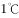

# 物理-密度与温度的关系（水的反常膨胀、4℃密度最大）

考点：[[20-考点/判断推理/科学推理/物理-密度与温度的关系（水的反常膨胀、4℃密度最大）|科学推理 / 物理-密度与温度的关系（水的反常膨胀、4℃密度最大）]]

**问法模型**：题干给出V-t图像并问'分析判断正确的是'→先从曲线提取体积(即密度)随温度的变化规律，再逐项用ρ=m/V和'密度大者下沉'检验情境判断

## 推理链
1. 第1步：读图——0~4℃段曲线下降，一定质量的水体积随温度升高而减小；4℃时体积最小；大于4℃后曲线上升，体积随温度升高而增大。
2. 第2步：换算密度——质量m一定，由ρ=m/V，体积最小处密度最大，即4℃的水密度最大，0℃及高温水的密度均较小。
3. 第3步：验证A项——图像0~4℃段就是反例，'任何情况下体积随温度升高而增大'被曲线直接否定，A错误。
4. 第4步：验证B、C项——冬季气温约0℃时，池塘表层水温接近外界气温约0℃，其体积大于4℃水即密度小于4℃水，密度大的4℃水下沉，池塘形成上冷(近0℃)下热(约4℃)，故C正确、B错误。
5. 第5步：验证D项——夏季表层水接近气温(远大于4℃)，此区间随温度升高体积增大、密度减小，高温低密度水浮在上层，温度稍低、密度大的水沉到底部，即下层比上层凉，与D'上层比下层凉'相反，D错误。
6. 第6步：结论——只有C项与图像规律及密度分层分析一致，选C。

**最快解法**：⚡ 极值点法+下沉判断：抓住'4℃体积最小→密度最大'这一图像关键点，先排除A；再按'密度大者下沉'：冬季0℃表层水密度小于4℃水→上冷下热选C；夏季高温表层水密度小浮在上层→下层凉，排除D。

## 易错点
- ⚠ 忽略0~4℃反常膨胀段，误套'热胀冷缩'常识而错选A
- ⚠ 把'体积大'误当'密度大'，将冬季分层方向判反而错选B
- ⚠ 夏季误以为冷水浮在上层，忽略温度高于4℃后恢复热胀冷缩、高温低密度水浮于上层而错选D

## 母题抽象
> 🧩 当题干出现'V-t(或ρ-t)曲线+水域上下层冷热'特征时，先找曲线极值点确定密度最大的温度，再用'密度大者下沉'逐项判断水体分层方向。

**同类特征**：水的体积随温度变化曲线、0~4℃体积随温度升高减小(反常膨胀)、4℃体积最小即密度最大、冬季池塘水温分层、上冷下热/上热下冷辨析、科学推理图像题

## 相关题
（暂无）

---

### 题干
如图所示为一定质量的水的体积在0-范围内随温度变化的图像。根据图像及水的其他性质，下列分析判断正确的是　   　。

### 选项
- A. 
因热胀冷缩，任何情况下水的体积都随温度升高而增大

- B. 
在冬季气温为的情况下，池塘里水温可能是上热下冷

- C. 
在冬季气温为的情况下，池塘里水温可能是上冷下热
　✅
- D. 
夏季池塘中上层的水可能比下层的水凉 

### 官方解析
A项：根据图像可知，在0-时，水的体积随温度的升高而减小，在大于时，水的体积随温度的升高而增大，因此不是在任何情况下水的体积都随温度升高而增大，错误；
B、C两项：当冬季气温为时，池塘表面的水温接近外界气温，约为，由图像可知，一定质量的水在1℃时的体积大于在时的体积，即水在时的密度小于在时的密度，因此的水会由于密度更大而下沉，所以冬季池塘里的水温可能是上冷下热，B项错误，C项正确；
D项：根据图像可知，在以上时，随温度升高，水的体积增大，密度减小。在夏季（温度远大于），池塘表面的水与气温接近，温度较高，则密度较小，而温度稍低的水会由于密度更大而沉到底部，即下层的水比上层的水凉，D项错误。
故正确答案为C。

### 给定材料
（无）
