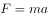
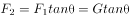

# 物理-牛顿第二定律受力分析与串联电路分压

考点：[[20-考点/判断推理/科学推理/物理-牛顿第二定律受力分析与串联电路分压|科学推理 / 物理-牛顿第二定律受力分析与串联电路分压]]

**问法模型**：'该装置可以测量汽车的____'→先检验匀速态装置输出是否为零以排除'测速度'，再沿'输入量→偏移量→电阻→分压示数'链条判断测量量及方向

## 推理链
1. 第1步：从图提取电路结构——电压表一端接O点（经柔软金属丝连到电阻丝上的触点C），另一端接A点，故电压表测的是圆弧电阻丝AC段的分压
2. 第2步：若汽车匀速行驶，小球与车同做匀速直线运动、处于平衡状态，金属丝竖直下垂仍与电阻丝交于A点，AC段长度为零，电压表无示数，故装置无法测量速度大小，排除A、B
3. 第3步：若汽车水平方向有加速度，对小球受力分析：竖直方向拉力分量与重力平衡，水平方向拉力分量即合外力，由牛顿第二定律F=ma，加速度越大所需合外力越大，金属丝与竖直方向夹角越大
4. 第4步：夹角越大，金属丝与四分之一圆弧电阻丝的交点C沿弧离A越远，AC段弧长越长、接入分压的电阻越大
5. 第5步：根据串联分压规律，AC段电阻越大，电压表示数越大，即'示数越大→加速度越大'
6. 第6步：与选项对照——装置测量的是加速度大小且示数与加速度同向，仅C符合，D方向相反故排除

**最快解法**：⚡ 排除法+因果链：匀速时球不偏转、电压表无示数→装置测不了速度，秒杀排除A、B；再看单调性'加速度大→偏角大→AC段电阻大→分压大→示数大'，示数与加速度同向，选C排除D

## 易错点
- ⚠ 误把摆球偏角当成速度的标志——匀速时金属丝仍竖直、电压表无示数，装置根本无法测速度，A、B是惯性直觉陷阱
- ⚠ 忽略电压表只测AC段分压而非全电阻丝电压，若分压关系想反会错选D（示数越大加速度越小）
- ⚠ 受力分析时漏掉'竖直方向拉力分量与重力平衡'这一共同前提，误认为偏角由速度大小决定

## 母题抽象
> 🧩 当题干出现'悬挂摆球/惯性元件+弧形或滑线变阻器+电压表'的车载传感装置时，先用匀速态输出是否为零排除'测速度'选项，再沿'加速度→偏移量→接入电阻→串联分压'链条验证示数与被测量的同向或反向关系

**同类特征**：四分之一圆弧电阻丝AB、柔软细金属丝拴小球悬挂于O点、水平行驶的汽车、金属丝与电阻丝良好接触、电压表数值变化、串联分压+牛顿第二定律

## 相关题
（暂无）

---

### 题干

如图所示为某人设计的一种测量装置的电路，其中AB部分为四分之一圆弧的电阻丝，一段柔软的细金属丝拴一小球悬挂于O点并与电阻丝良好接触，将其放在水平行驶的汽车中，则该装置可以测量汽车的<u>            </u>。

### 选项
- A. 速度大小，电压表数值越大，汽车速度越大
- B. 速度大小，电压表数值越大，汽车速度越小
- C. 加速度大小，电压表数值越大，汽车加速度越大　✅
- D. 加速度大小，电压表数值越大，汽车加速度越小

### 官方解析

如图所示，小球由细金属丝连接于O点，小球可绕O点摆动，当小球运动到图一所示的位置时，金属丝与电阻丝相交于C点，此时电压表测量AC段电阻两端电压；

若汽车做匀速直线运动，小球也做匀速直线运动，即处于平衡状态，则不会绕O点摆动，金属丝与电阻丝相交于A点，此时电压表无示数，故无法测量汽车速度大小，A、B两项错误；

若汽车水平方向存在加速度，小球与车的加速度相同，根据牛顿第二定律可知，小球水平方向的加速度越大，水平方向所需要的合外力越大，如图二所示，对小球进行受力分析，将小球受到的拉力分解成水平方向和竖直方向，竖直方向上的分力与重力大小相等，方向相反，水平方向上的分力即为小球所受合外力，由受力分析图可知，，若车的加速度越大，小球为了与车达到相同的加速度，需要更大的合外力，即也会更大，金属丝与竖直方向的夹角也越大，则AC段长度越大，电压表所检测部分电阻越大，根据串联分压规律可知，电压表示数将会越大。因此该装置可以用于测量汽车加速度大小，且电压表数值越大，表示汽车加速度越大。

故正确答案为C。

### 给定材料
（无）
