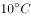
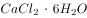

# 化学-相变储热材料筛选（熔点区间判断＋单位质量熔化吸热比较）

考点：[[20-考点/判断推理/科学推理/化学-相变储热材料筛选（熔点区间判断＋单位质量熔化吸热比较）|科学推理 / 化学-相变储热材料筛选（熔点区间判断＋单位质量熔化吸热比较）]]

**问法模型**：'根据表中数据，最佳选用哪种储能介质'→先用昼夜温度区间筛熔点，再在合格项中比单位质量熔化吸热取最优

## 推理链
1. 第1步：提取题干原理——'白天阳光照射时熔化吸热，夜晚降温时凝固放热'，故所选介质熔点必须落在'夜晚最低气温～白天最高气温'之间，才能随昼夜温度自动熔化与凝固
2. 第2步：用该温度区间对照表格'熔点'列：CaCl₂·6H₂O 29.0℃、Na₂SO₄·10H₂O 32.4℃、Na₂HPO₄·12H₂O 36.1℃均在区间内；Na₂S₂O₃·5H₂O熔点48.5℃高于白天最高气温，白天无法熔化，先排除D
3. 第3步：题干问'最佳选用'，合格项还需比储热能力，定位表格'熔化时吸热(kJ·g⁻¹)'列
4. 第4步：逐项比较：0.172、0.251、0.205，其中Na₂SO₄·10H₂O的0.251最大，即单位质量可储存的能量最多
5. 第5步：既满足熔点区间条件又单位质量储能最多的是Na₂SO₄·10H₂O，与选项对照得出B

**最快解法**：⚡ 双指标筛选法：①熔点须在昼夜温度区间内→48.5℃超上限，排除D；②剩余三项比'熔化时吸热'列取最大→0.251对应Na₂SO₄·10H₂O，直接锁定B

## 易错点
- ⚠ 只看熔点落在区间内就选第一行CaCl₂·6H₂O（A项），忽略'最佳'还需比较单位质量储能多少
- ⚠ 忽视熔点前提，误选熔点48.5℃超过白天最高气温、白天根本熔化不了的D项
- ⚠ 读表串列，把'熔化时吸热'数值与'熔点'数值混淆比较

## 母题抽象
> 🧩 当题干出现'相变储能/控温材料＋昼夜温度范围＋数据表'时，先用温度区间筛掉熔点超界的选项，再在剩余项中比较单位质量吸（放）热量取最大者

**同类特征**：储能介质·结晶水合物、白天熔化吸热、夜晚凝固放热、昼夜气温范围限定熔点、表格两列数据：熔点＋熔化时吸热、'最佳选用'类最优选择问法

## 相关题
（暂无）

---

### 题干

应用储能介质（某种结晶水合物）储存和再利用太阳能是一项新技术。其原理是：当白天阳光照射时，储能介质熔化，同时吸收热能；当夜晚降温时，储能介质凝固，同时释放出热能。某地区白天气温可达，夜晚可下降至，若应用上述技术调节室温，根据下表中几种常见的储能介质的数据，最佳选用<u>            </u>。

### 选项
- A. 

- B. 

　✅
- C. 

- D. 

### 官方解析

根据题干信息可知，选取的物质需要满足白天能熔化、晚上能凝固的条件，也就是要求选取的物质熔点在-的范围内，D项错误；根据表格中各结晶水合物熔化时吸收的热量大小可知，单位质量可储存的能量最多，故最佳选用为储能介质。

故正确答案为B。

### 给定材料
（无）
