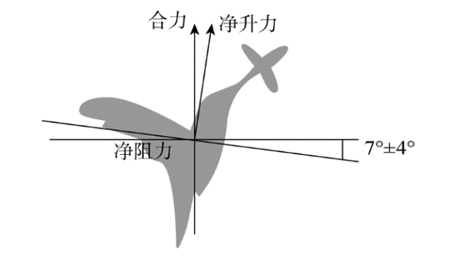

# 物理-力的合成与分解（共点力平衡）

考点：[[20-考点/判断推理/科学推理/物理-力的合成与分解（共点力平衡）|科学推理 / 物理-力的合成与分解（共点力平衡）]]

**问法模型**：结合受力分析图判断悬停主因 → 从力的平衡条件（水平合力为零）出发，锁定图中标注的方向/角度信息，排除图中无依据的干扰项

## 推理链
1. 第1步：读图提取要素——图中标注翅膀平面与水平面夹角仅'7°±4°'，即振翅方向非常接近水平面；同时画出'净升力'（略偏离竖直）、'净阻力'（接近水平向左）、'合力'（竖直向上）三个矢量
2. 第2步：悬停的物理条件——蜂鸟静止悬停要求合力与重力平衡，即合力必须竖直向上，水平方向合力为零
3. 第3步：由图分解——因振翅方向接近水平（7°±4°），净升力几乎竖直，其微小的水平分力恰好与净阻力在水平方向的分力平衡，使'净升力+净阻力'的合力竖直向上
4. 第4步：对照选项——A（频率50~70次/秒）、B（幅度大）、D（体重轻）在图中均无对应信息，且它们只影响升力大小或重力大小，无法解释'水平方向不受净力'这一悬停关键
5. 第5步：C项'振翅的方向非常接近水平面'与图中7°±4°标注直接对应，是保证合力竖直向上、实现悬停的主因

**最快解法**：⚡ 读图定位法——直接抓取图中唯一量化标注'7°±4°'（振翅面与水平面夹角），其物理含义就是'振翅方向接近水平面'，秒选C；再用排除法确认A/B/D均无法从图中获得支撑

## 易错点
- ⚠ 想当然选A'振翅频率高'——频率只决定升力大小，无法解释悬停时为何不产生向前的力
- ⚠ 忽略图中'7°±4°'这一核心标注，未从受力图提取方向信息
- ⚠ 混淆'净升力'与'合力'——合力竖直向上与重力平衡，净升力略倾斜需与净阻力合成后才竖直

## 母题抽象
> 🧩 当科学推理题给出受力示意图并标注角度/方向时，先明确平衡条件（合力方向需与重力共线反向），再对应图中标注的角度量找到选项中的'方向/角度'描述，排除图中无依据的数值或常识型选项

**同类特征**：受力分析图、悬停、7°±4°角度标注、净升力与净阻力、合力竖直向上、力的合成与分解

## 相关题
（暂无）

---

### 题干

如图所示为蜂鸟在空中悬停的受力分析，根据图示内容判断蜂鸟能够悬停的主要原因是：

### 选项
- A. 蜂鸟振翅的频率高，每秒可达50~70次
- B. 蜂鸟振翅的幅度大
- C. 蜂鸟振翅的方向非常接近水平面　✅
- D. 蜂鸟体重轻

### 官方解析
一般鸟类上下扇动翅膀时，不但会得到升力，还会得到向前的力，因此既会上升，同时也会往前飞。蜂鸟可以自由调节其翅膀的角度，由图可见，蜂鸟振翅的方向非常接近水平面，这导致其几乎不会获得向前的动力，而会获得与竖直方向很接近的净升力。若将净升力进行分解，其水平方向的分力将与净阻力在水平方向的分力平衡，因此净升力与净阻力的合力为竖直向上，刚好能与竖直向下的重力平衡，从而使蜂鸟悬停在空中。因此，蜂鸟悬停的关键因素是其振翅的方向，C项正确。
故正确答案为C。

### 给定材料
（无）
