# 物理-热值与热量的计算（Q放=qm、Q吸=cmΔt及比例关系）

考点：[[20-考点/判断推理/科学推理/物理-热值与热量的计算（Q放=qm、Q吸=cmΔt及比例关系）|科学推理 / 物理-热值与热量的计算（Q放=qm、Q吸=cmΔt及比例关系）]]

**问法模型**：题干给燃料热值表并问'下列判断正确的是' → 用'燃料放热Q放=qm全部被水吸收Q吸=cmΔt'建立等量关系，对每个选项代入数值或比例关系逐一验证

## 推理链
1. 第1步：从表格读取关键热值：焦炭3.0×10⁷、木炭3.4×10⁷、煤油4.6×10⁷、汽油4.6×10⁷、氢1.4×10⁸ J/kg；水从10℃加热至60℃，温度变化量Δt=60-10=50℃
2. 第2步：确定两条核心公式与比例规律：燃料放热Q放=qm，因'燃料燃烧释放的能量全部给了水'故Q放=Q吸=cmΔt；等质量燃料比较可加热水量时，水量比=热值比；加热等质量水比较耗燃料时，燃料质量比=热值反比
3. 第3步：验证A项：相同质量的焦炭与汽油，能加热水的质量比=q焦炭:q汽油=3.0×10⁷:4.6×10⁷≈2:3，选项说'约3:2'，比例方向颠倒，错误
4. 第4步：验证B项：加热等质量水，消耗木炭与煤油的质量比=m木炭:m煤油=q煤油:q木炭=4.6×10⁷:3.4×10⁷≈7:5（即23:17），选项说'约5:7'，比例方向颠倒且小于1，错误
5. 第5步：验证C项：2g氢（0.002kg）放热Q=qm=0.002×1.4×10⁸=2.8×10⁵J，可加热水的质量m=Q/(cΔt)=2.8×10⁵/(4.2×10³×50)=2.8×10⁵/2.1×10⁵≈1.33kg≈1.3kg，与选项'约1.3kg'一致，正确
6. 第6步：验证D项：加热1.5kg水需热Q=cmΔt=1.5×4.2×10³×50=3.15×10⁵J，需汽油质量m=Q/q=3.15×10⁵/(4.6×10⁷)≈6.85×10⁻³kg≈7g，选项说'约3g'，错误
7. 第7步：综合四项判断，仅C项数值与方向均正确，故选C

**最快解法**：⚡ 先算数值最'整'的C项锁定答案：2g氢放热=0.002×1.4×10⁸=2.8×10⁵J，直接除以cΔt=4.2×10³×50=2.1×10⁵J/kg，得1.33kg≈1.3kg，秒选C；A、B两个比例题只需用口诀'同质量比水量用热值比、同水量比燃料用热值反比'看方向即可排除（正确均应大于1的方向被颠倒）

## 易错点
- ⚠ 比例方向搞反：A项正确比例是焦炭:汽油≈2:3而非3:2；B项木炭热值低应耗更多，正确比例≈7:5而非5:7，两个错误选项都是把热值比/反比颠倒
- ⚠ 单位换算出错：2g需化成0.002kg代入，结果kg转g时（D项约6.85×10⁻³kg≈7g）易乘除错1000倍
- ⚠ 温度变化量误取：Δt应为60-10=50℃，误用60℃或10℃代入会使所有数值偏差

## 母题抽象
> 🧩 当题干出现'燃料热值表+把水从t1加热到t2+燃烧放热全部被水吸收'的特征时，用Q放=qm=Q吸=cmΔt建等式，比例判断记口诀'燃料等质量→水量比=热值比；水量相等→燃料比=热值反比'，再逐项代入验证。

**同类特征**：燃料热值表、10℃加热至60℃、能量全部给水、水的比热容4.2×10³、相同质量/等质量的比例比较、g与kg单位换算

## 相关题
（暂无）

---

### 题干

下表中所示为部分燃料的热值。若要将10℃的水加热至60℃，假设燃料燃烧释放的能量全部给了水。已知水的比热容为J/kg·℃。下列判断正确的是：

### 选项
- A. 消耗相同质量的焦炭和汽油，能加热水的质量比约为3：2
- B. 分别加热等质量的水，消耗的木炭质量与煤油质量的比约为5：7
- C. 2g氢可以加热约1.3kg的水　✅
- D. 加热1.5kg的水需要约3g的汽油

### 官方解析

A项：由题可知，水的比热容已知，且均从10℃升高至60℃（温度改变量=60℃-10℃=50℃），所以根据吸收热量的计算公式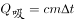可知，水吸收的热量（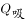）越大，则可加热的水的质量（m）越大，由于燃料燃烧的热量全部被水吸收，所以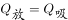，根据热量计算公式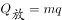可知，相同质量的焦炭和汽油燃烧所释放的热量之比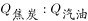，所以能加热水的质量比约为2：3，错误；

B项：由A项分析可知，加热相同质量的水所需的热量相同，由于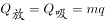，则木炭和煤油的质量之比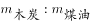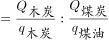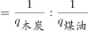，错误；

C项：2g氢气燃烧释放的能量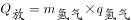J，由于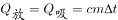，所以加热水的质量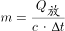kg，正确；

D项：加热1.5kg的水需要的热量J，则所需汽油的质量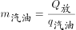kgg，错误。

故正确答案为C。

### 给定材料
（无）
