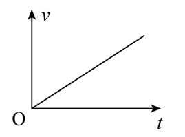
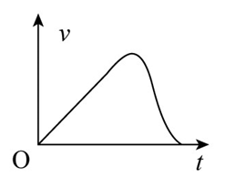
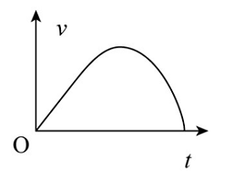
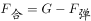
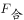
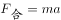
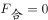
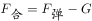

# 物理-牛顿第二定律与v-t图像（斜率表示加速度、弹性绳变力分析）

考点：[[20-考点/判断推理/科学推理/物理-牛顿第二定律与v-t图像（斜率表示加速度、弹性绳变力分析）|科学推理 / 物理-牛顿第二定律与v-t图像（斜率表示加速度、弹性绳变力分析）]]

**问法模型**：题干要求选出正确反映蹦极下落过程的v-t图 → 采用'分段受力分析→确定加速度变化→对应图像斜率变化'的解题模型

## 推理链
1. 第1步：从题干与解析提取四个关键位置——O点（由静止开始下落）、A点（弹性绳原长）、B点（弹力与重力相等）、C点（最低点）
2. 第2步：O到A段只受重力，加速度恒为g，对应v-t图应为斜率不变的倾斜直线（自由落体）
3. 第3步：A到B段弹力小于重力，合力向下且随绳伸长逐渐减小，加速度向下且逐渐减小，对应图像斜率逐渐减小，在B点减为0（速度达到最大）
4. 第4步：B到C段弹力大于重力，合力向上且逐渐增大，加速度向上且逐渐增大，速度开始减小且减小得越来越快，对应斜率为负且绝对值增大
5. 第5步：归纳全程斜率规律：先恒定→再减小到0→再反向增大，且速度先增后减、最低点C处速度为0
6. 第6步：逐项对照，只有D图的斜率呈'恒定→减小到0→反向增大'且在B点切线水平、速度最大，A、B、C三项斜率变化不符

**最快解法**：⚡ 关键点+斜率法：抓住三点即可秒杀——A点（绳绷直）前为直线（匀加速）；B点（弹力=重力）速度最大、斜率为0（切线水平）；C点（最低点）速度为0。v-t图斜率=加速度，故斜率'不变→减小到0→反向增大'，锁定D

## 易错点
- ⚠ 误把B点（弹力=重力处）当成最低点，实际上B点是速度最大点，最低点C在弹力最大处
- ⚠ 误认为绳绷直（A点）后人立即减速，忽略了A到B阶段合力仍向下、人继续加速
- ⚠ 混淆图像物理意义：v-t图斜率代表加速度而非速度或位移，误判曲线的弯曲方向（应为斜率逐渐减小的上凸形）

## 母题抽象
> 🧩 当题干出现'弹性绳/弹簧+重力作用下的下落运动，问v-t图'特征时，用'分段受力分析定加速度→斜率对应图形'方法，验证'匀加速段直线—速度最大点切线水平—最低点速度为零'三个标志点

**同类特征**：蹦极（弹性绳+重力变力运动）、弹性绳原长位置A、弹力与重力相等位置B、最低点之前、v-t图选择、由静止开始下落

## 相关题
（暂无）

---

### 题干
“蹦极”是一项惊险刺激的娱乐项目。下列v-t图能基本正确反映出蹦极中人在到达最低点之前的速度随时间变化关系的是：

### 选项
- A. 

- B. 

- C. 

- D. 

　✅

### 官方解析

蹦极的过程如上图所示，在人下落的过程中，记O点为人从平台由静止开始下落的位置，A点为弹性绳的原长位置，B点为人受到弹性绳的弹力与自身重力相等的位置，C点为人到达的最低点。

人从O点运动到A点的过程中，只受重力的作用，加速度方向向下，大小恒为g；

从A点运动到B点的过程中，人受到竖直向下的重力和弹性绳对人向上的弹力，由于在B点处人所受弹力与重力相等，故在B点之前人所受弹力始终小于自身的重力，则，方向向下，由于人自身的重力保持不变，弹性绳不断被拉长，弹力逐渐增大，即逐渐减小，根据牛顿第二定律可知，人的加速度方向向下，且逐渐减小；在B点处人所受弹力与重力相等，即，人的加速度为0；

从B点运动到C点的过程中，人受到竖直向下的重力和向上的弹力，且弹力大于重力，即，方向向上，由于弹性绳继续被拉长，弹力逐渐增大，即逐渐增大，根据牛顿第二定律可知，人的加速度方向向上，且逐渐增大。

因此在整个过程中，人的加速度先保持不变，然后减小到0，再增大，由于v-t图像中，图像的斜率代表加速度，所以图像的斜率先保持不变，然后减小到0，再增大，故只有D项正确，A、B、C三项错误。

故正确答案为D。

### 给定材料
（无）
