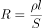
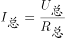

# 物理-电阻定律与欧姆定律（滑动变阻器式传感装置分析）

考点：[[20-考点/判断推理/科学推理/物理-电阻定律与欧姆定律（滑动变阻器式传感装置分析）|科学推理 / 物理-电阻定律与欧姆定律（滑动变阻器式传感装置分析）]]

**问法模型**：“根据以上信息推断下面说法正确的是”的装置原理分析问法 → 建立“力—位移—电阻—电流”因果链，逐项代入检验

## 推理链
1. 第1步：从题干与图形提取关键信息：弹簧穿在“光滑水平放置的电阻率较大的金属细杆上”，N端连迎风板，风从右向左吹，电路经R、电源U、开关、电流传感器与金属杆构成回路，金属杆相当于滑片随迎风板移动的滑动变阻器
2. 第2步：所用方法：沿“风速变化→迎风板位移→弹簧形变与杆接入长度→电阻变化→电流变化”的因果链逐项检验
3. 第3步：A项代入：若弹簧用“导电性良好的金属丝”制成，电阻远小于大电阻率金属杆，相当于导线将金属杆短路，电流不随风速变化，电流传感器失去作用，A错误
4. 第4步：B项代入：迎风板是电流从杆引回电源负极的通路，若“不导电”则电路无法形成闭合回路，电流传感器无示数，B错误
5. 第5步：C、D项推理：风速大→迎风板被吹向左移动并“压缩弹簧”→弹簧形变量变大→压力传感器所受压力变大（读数变大）；同时杆接入电路的长度变小→由电阻定律R=ρL/S知电阻变小→由欧姆定律I=U/R知总电流变大
6. 第6步：与选项对照：压力传感器读数越大，电流传感器读数越大，D正确、C错误

**最快解法**：⚡ 变阻器模型+因果链口诀：风速大→板左移→接入长度短→电阻小→电流大，两个传感器读数同向变化直接锁定D；再用排除法剔除A（弹簧导电会短路金属杆）和B（迎风板不导电会断路）

## 易错点
- ⚠ 未看出“弹簧穿在电阻率较大的金属细杆上”的设计用意，误选A——弹簧导电性良好会将大电阻杆短路，使装置失效
- ⚠ 忽略迎风板在电路中承担导线接续作用，误认为不导电材料更好（B项会造成断路、无电流）
- ⚠ 因果链方向搞反：误以为杆接入长度变短电阻变大，或电阻变小电流变小，从而误选C

## 母题抽象
> 🧩 当题干出现“压力/力传感器+弹簧+滑动接触变阻结构测物理量”的装置题特征时，先写出“力→位移→长度→电阻→电流”因果链，再逐项代入检验元件材料与导电性是否破坏该链条

**同类特征**：测定风速的装置、压力传感器固定在竖直墙上、弹簧M端接传感器、N端连迎风板、穿在电阻率较大的金属细杆上、电流传感器读数反映风速、推断说法正确的是

## 相关题
（暂无）

---

### 题干

如图所示是一种测定风速的装置，压力传感器固定在竖直墙上，弹簧一端固定在传感器上的M点，另一端N与迎风板相连，弹簧穿在光滑水平放置的电阻率较大的金属细杆上。根据以上信息推断下面说法正确的是：

### 选项
- A. 弹簧宜选用导电性良好的金属丝制成
- B. 迎风板应选用不导电的材料制成
- C. 压力传感器读数越大，电流传感器读数就越小
- D. 压力传感器读数越大，电流传感器读数就越大　✅

### 官方解析

此装置测风速的原理是：金属杆与迎风板紧密接触，并接入电路中，当风将迎风板吹向左侧时，金属杆接入电路的长度变化，引起电阻变化，从而导致电流传感器的读数发生变化，进而确定风速。

A项：若弹簧选用导电性良好的金属丝制成，电阻会非常小，相当于导线，由于金属细杆的电阻率较大，所以弹簧会将金属细杆短路，此时整个电路的电流不会随着风速的改变而改变，即电流传感器的示数不变，此时电流传感器失去作用，错误；

B项：若迎风板选用不导电的材料制成，电流从电源的正极出发后无法回到电源的负极，即无法形成闭合回路，此时电流传感器无示数，错误；

C、D两项：当风速大时，迎风板会在风力的作用下向左移动并压缩弹簧，此时弹簧由于形变量变大，所以弹力也会变大，压力传感器所受压力也会变大，所以压力传感器的读数会变大，但此时金属细杆接入电路部分的长度变小，根据可知，当金属细杆的电阻率和横截面积保持不变时，接入电路的长度越小，电阻越小，故金属细杆的接入电路的电阻变小，电路的总电阻也会变小，根据可知，电路的总电流变大，即电流传感器的读数会变大，D项正确，C项错误。

故正确答案为D。

### 给定材料
（无）
