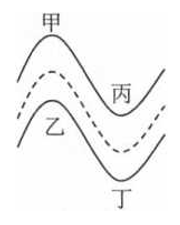
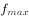

# 物理-圆周运动向心力来源与离心运动（静摩擦力提供向心力，速度过大向外侧偏离）

考点：[[20-考点/判断推理/科学推理/物理-圆周运动向心力来源与离心运动（静摩擦力提供向心力，速度过大向外侧偏离）|科学推理 / 物理-圆周运动向心力来源与离心运动（静摩擦力提供向心力，速度过大向外侧偏离）]]

**问法模型**：问'观众应站在图中哪个位置才安全'→ 用离心运动模型：转弯即圆周运动，车速过大时向心力供需失衡，车向远离圆心方向（弯道外侧）冲出，故安全位置=弯道内侧（圆心一侧）

## 推理链
1. 第1步：从题干提取前提——汽车行驶在'S形的弯道'上，转弯即做圆周运动；由图定位四点：甲在第一弯（凸起段）外侧上方，乙在其内侧下方，丙在第二弯（凹陷段）内侧上方，丁在第二弯外侧下方
2. 第2步：所用规则——水平路面上静摩擦力提供向心力，f_max=μN 保持不变；而所需向心力 F=mv²/r 随车速 v 增大而增大
3. 第3步：供需比较——当车速过大时 mv²/r 超过最大静摩擦力，摩擦力无法使汽车'在当前赛道上做圆周运动'，汽车做离心运动，沿远离圆心方向冲出赛道
4. 第4步：方向判定——'向远离圆心的方向偏离赛道，即向弯道外部偏离'，故失控车辆只会冲向弯道外侧，不会冲向内侧
5. 第5步：逐项对照——甲、丁均在弯道外侧（甲在第一弯凸起外侧、丁在第二弯谷底外侧），是失控车的冲出方向，危险；乙、丙均在弯道内侧（圆心一侧），失控车不会冲入，安全
6. 第6步：结论——观众应站在弯道内部的乙、丙处，对应C项，A、B、D排除

**最快解法**：⚡ 离心方向口诀法：'转弯失控必向外侧甩，站内弯才安全'——直接判定图中甲、丁位于弯道外侧（危险区）排除A、B、D，乙、丙位于弯道内侧（安全区），秒选C

## 易错点
- ⚠ 内外侧方向判反：误以为车速快时车会'甩向内侧'，或把远离圆心的外侧当成安全区，误选A（甲、丁）
- ⚠ 对'弯道内部'望文生义理解成'S形两弯之间的中间区域'，导致误选B或D；此处'内部'实指弯道圆心一侧（内侧）
- ⚠ 凭'离赛道越远越安全'的生活直觉忽略几何关系：丁虽位于图的最下方（看似离赛道远），但恰在第二弯外侧，仍是危险区

## 母题抽象
> 🧩 当题干出现'车辆转弯/圆周运动+车速过快'特征时，用'向心力供需比较→供需失衡即离心→离心方向=远离圆心=弯道外侧'模型，验证安全位置=弯道内侧（圆心一侧）

**同类特征**：S形弯道、转弯做圆周运动、静摩擦力提供向心力、速度过大向心力不足、离心运动冲向弯道外侧、观众安全站位判内外侧

## 相关题
- [[10-真题/判断推理/科学推理/4652038 物理-圆周运动向心力（F=mv²-r，半径与侧滑风险的关系）|4652038]]（上海 2022，相关度1）

---

### 题干

小明在家观看汽车拉力赛，发现汽车行驶在一段s形的弯道上，如图所示，如果要保证现场观众的安全，观众应站在图中的位置是<u>        </u>。

### 选项
- A. 甲、丙
- B. 甲、丁
- C. 乙、丙　✅
- D. 乙、丁

### 官方解析

由图可知，汽车在转弯时做圆周运动，水平方向的静摩擦力为其提供向心力，由于路面对汽车的最大静摩擦力（）近似等于滑动摩擦力，根据滑动摩擦力公式可知，当汽车对路面的压力保持不变时，路面对汽车的最大静摩擦力（）不变，根据向心力的公式可知，汽车过弯的速度越大，则所需的向心力越大，若汽车过弯时的速度过大，所需向心力超过路面对汽车的最大静摩擦力时，路面对汽车的最大静摩擦力无法使汽车在当前赛道上做圆周运动，汽车会向远离圆心的方向偏离赛道，即向弯道外部偏离，所以观众站在弯道内部较为安全，即观众应站在乙处或丙处，C项正确，A、B、D三项均错误。

故正确答案为C。

### 给定材料
（无）
