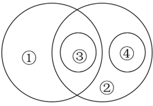

# 概念外延关系（欧拉图：交叉、种属、并列-全异）

考点：[[20-考点/判断推理/类比推理/概念外延关系（欧拉图：交叉、种属、并列-全异）|类比推理 / 概念外延关系（欧拉图：交叉、种属、并列/全异）]]

**问法模型**：题干给出圆圈（欧拉图）表示的概念外延关系，问哪个选项的概念关系与之相符 → 先将图转写为'两两关系清单'，再逐项造句比对，重点核对小圆落在哪个区域。

## 推理链
1. 第1步：读图，①与②两圆部分重叠，为交叉关系；③圆完全落在①②交叠区内，即③⊂①且③⊂②（双重种属）。
2. 第2步：读图，④圆完全落在②内、①外，即④⊂②且④与①全异（无共同元素）；③④两圆互不重叠且同在②内，构成②之下的并列关系。
3. 第3步：A项，'很多茶具也是用陶瓷制成的'表明陶瓷器皿①与茶具④是交叉关系，与图中'④⊂②、④与①全异'不符，排除。
4. 第4步：B项，弦鸣乐器①与气鸣乐器②按发声方式划分，是并列（全异）关系，与图中'①②交叉'不符，排除。
5. 第5步：C项，热带植物①与常绿乔木②交叉；可可树③既是热带植物又是常绿乔木（③⊂①∩②）；冷杉④是常绿乔木但生长在亚寒带（④⊂②、与①全异）；③④同为②下并列，与图完全对应。
6. 第6步：D项，法律史学③是法学①与历史学②的交叉学科（①②交叉、③在交集均符合图），但部门法学④⊂法学①，与图中'④⊂②、④与①全异'不符，排除。
7. 第7步：C项四个概念的两两关系与图逐一吻合，当选。

**最快解法**：⚡ 读图定锚+排除法：先把图译成口诀'①②交叉、③在交集、④只属②不属①'；逐项只需核查两个锚点——①②是否交叉、④是否属②且不属①——即可快速排除A（①④交叉）、B（①②并列）、D（④⊂①），锁定C。

## 易错点
- ⚠ 只验证①②交叉和③在交集就匆忙选D（法律史学），漏查④：D中部门法学⊂法学①，与图中'④属②不属①'不符。
- ⚠ 把图中④与①的'全异'误读成交叉，导致对A项（陶瓷器皿与茶具交叉）关系判断失误。
- ⚠ 被B项'中国传统乐器既有弦鸣也有气鸣'带偏，误以为①②可经③建立交叉，实际弦鸣与气鸣按发声方式分类本身是并列全异。

## 母题抽象
> 🧩 当题干出现'用圆圈表示概念外延'的欧拉图时，先翻译成两两关系清单（交叉/种属/并列/全异），再用造句法逐项核对每一编号的两两关系，尤其盯住'小圆落在哪一区域'的位置信息，不能只验部分关系。

**同类特征**：圆圈/欧拉图表示概念外延、两圆交叉、③位于①②交集内、④仅属②且与①全异、③④为②下并列、逐项造句验证概念关系

## 相关题
- [[10-真题/判断推理/类比推理/19526268 集合关系-交叉关系与种属关系（概念外延关系）|19526268]]（国考 2026，相关度1）

---

### 题干

如果用圆圈表示概念的外延，下列符合上述概念外延关系的是：

### 选项
- A. 陶瓷器皿（①）耐热性强，易于清洗，陶瓷餐具（③）是餐桌上常见的餐具（②），很多茶具（④）也是用陶瓷制成的
- B. 弦鸣乐器（①）通过琴弦振动发声，气鸣乐器（②）依赖气流振动发声，中国传统乐器（③）既有弦鸣乐器也有气鸣乐器，唢呐（④）即是一种气鸣乐器
- C. 热带植物（①）适应高温高湿的环境。在热带地区，常绿乔木（②）较多，可可树（③）即是其中之一，冷杉（④）也是一种常绿乔木，但其主要生长在亚寒带地区　✅
- D. 法学（①）和历史学（②）分别属于社会科学和人文科学的范畴，法律史学（③）是法学和历史学的交叉学科。它不同于刑法等部门法学（④），主要研究法律的产生及其演变规律

### 官方解析
第一步：判断题干元素间逻辑关系。
根据题干图形可知，①和②是交叉关系；③属于①，③和①是种属关系；④不属于①，④和①是反向种属关系；③属于②，③和②是种属关系；④属于②，④和②是种属关系；③和④是并列关系。
第二步：判断选项词语间逻辑关系。
A项：“陶瓷器皿”（①）与“茶具”（④）是交叉关系，与题干逻辑关系不一致，排除；
B项：“弦鸣乐器”（①）与“气鸣乐器”（②）是并列关系，与题干逻辑关系不一致，排除；
C项：“热带植物”（①）与“常绿乔木”（②）是交叉关系，“可可树”（③）属于“热带植物”（①），③和①是种属关系，“冷杉”（④）不属于“热带植物”（①），④和①是反向种属关系，“可可树”（③）属于“常绿乔木”（②），③和②是种属关系，“冷杉”（④）属于“常绿乔木”（②），④和②是种属关系，“可可树”（③）和“冷杉”（④）是并列关系，与题干逻辑关系一致，当选；
D项：“部门法学”（④）属于“法学”（①），④和①是种属关系，与题干逻辑关系不一致，排除。
故正确答案为C。

### 给定材料
（无）

> [!warning] 疑点（官方解析可能有误，待人工复核）
> 官方解析称'④和①是反向种属关系'，'反向种属'非规范术语，按图④与①实为全异（不相交）关系，此仅是表述不严谨，不影响C项结论的正确性。

<!-- CODEX-ANSWER-REVIEW:BEGIN -->
### 本次独立复核

**复核状态：** `confirmed`（独立复算确认答案）

**计分答案：** C（可计分）

**复核解析：**

第一步：判断题干元素间逻辑关系。
根据题干图形可知，①和②是交叉关系；③属于①，③和①是种属关系；④不属于①，④和①是反向种属关系；③属于②，③和②是种属关系；④属于②，④和②是种属关系；③和④是并列关系。
第二步：判断选项词语间逻辑关系。
A项：“陶瓷器皿”（①）与“茶具”（④）是交叉关系，与题干逻辑关系不一致，排除；
B项：“弦鸣乐器”（①）与“气鸣乐器”（②）是并列关系，与题干逻辑关系不一致，排除；
C项：“热带植物”（①）与“常绿乔木”（②）是交叉关系，“可可树”（③）属于“热带植物”（①），③和①是种属关系，“冷杉”（④）不属于“热带植物”（①），④和①是反向种属关系，“可可树”（③）属于“常绿乔木”（②），③和②是种属关系，“冷杉”（④）属于“常绿乔木”（②），④和②是种属关系，“可可树”（③）和“冷杉”（④）是并列关系，与题干逻辑关系一致，当选；
D项：“部门法学”（④）属于“法学”（①），④和①是种属关系，与题干逻辑关系不一致，排除。
故正确答案为C。

**相关信息：**

按三词/词组间的概念关系、语义关系或结构关系逐项比较；注意选项是否存在同样成立的解释。

**题源依据：** [固定版本原题](https://github.com/Mentat-Uran/kaogongzhentizhengliu/blob/84ab93d4b64b61d897bece8a1c0a5bab06b4feb2/10-%E7%9C%9F%E9%A2%98/%E5%88%A4%E6%96%AD%E6%8E%A8%E7%90%86/%E7%B1%BB%E6%AF%94%E6%8E%A8%E7%90%86/15833786%20%E6%A6%82%E5%BF%B5%E5%A4%96%E5%BB%B6%E5%85%B3%E7%B3%BB%EF%BC%88%E6%AC%A7%E6%8B%89%E5%9B%BE%EF%BC%9A%E4%BA%A4%E5%8F%89%E3%80%81%E7%A7%8D%E5%B1%9E%E3%80%81%E5%B9%B6%E5%88%97-%E5%85%A8%E5%BC%82%EF%BC%89.md)；固定内容 commit `84ab93d4b64b61d897bece8a1c0a5bab06b4feb2`，Markdown blob `e80d826c8e8d50c47afbc746496f1e3bcd134ca6`。
<!-- CODEX-ANSWER-REVIEW:END -->
