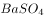
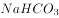

# 逻辑关系-对应关系（化学俗名与化学式一一对应，含顺序要求）

考点：[[20-考点/判断推理/类比推理/逻辑关系-对应关系（化学俗名与化学式一一对应，含顺序要求）|类比推理 / 逻辑关系-对应关系（化学俗名与化学式一一对应，含顺序要求）]]

**问法模型**：题干给出'物质俗名：其化学式'的对应范例 → 在选项中寻找'俗名与其真实化学式一一对应且位置顺序一致'的搭配

## 推理链
1. 第1步：题干'熟石灰：Ca(OH)₂'中，俗名与化学式表示同一种物质，构成全同（对应）关系，且顺序为'俗名在前、化学式在后'。
2. 第2步：确立双重验证规则——①化学式必须与该俗名指同一种物质；②'俗名：化学式'的先后顺序必须与题干一致。
3. 第3步：A项'钡餐：BaSO₄'，钡餐的成分即硫酸钡，化学式对应正确且顺序与题干一致，保留。
4. 第4步：B项'纯碱：所给化学式'，解析判定该化学式与纯碱实际成分不对应，排除。
5. 第5步：C项'CO₂：干冰'，化学式本身与干冰对应正确，但化学式被放在冒号前，顺序与题干'俗名：化学式'相反，排除。
6. 第6步：D项'生石灰：所给化学式'，解析判定该化学式与生石灰实际成分不对应，排除。
7. 第7步：只有A项同时满足'对应正确+顺序一致'两个条件，故正确答案为A。

**最快解法**：⚡ 双重排除法：先扫选项位置，发现C项化学式在冒号前、顺序颠倒直接排除；再核对A项钡餐与所给化学式对应无误即锁定答案（B、D对应错误天然排除）。

## 易错点
- ⚠ 只验证'俗名—化学式'内容是否对应，忽略题干'俗名在前、化学式在后'的顺序要求，误选C
- ⚠ 俗名张冠李戴：见'纯碱'就按碱类、见'生石灰'就按石灰类随意配化学式，未核实成分的真实对应关系
- ⚠ 对'钡餐'这一医学俗名对应的化学成分不熟悉，把正确项A误当错误项排除

## 母题抽象
> 🧩 当题干出现'俗名/简称：化学式（或名称：符号）'的对应范例时，用'一一对应+顺序一致'双重验证法，先排对应错误的项，再排顺序颠倒的项。

**同类特征**：熟石灰（化学俗名）、冒号后接化学式、俗名与化学式全同对应、顺序：俗名在前、化学式在后、化学常识型类比、选项混入顺序颠倒干扰项

## 相关题
（暂无）

---

### 题干
熟石灰：

### 选项
- A. 
钡餐：
　✅
- B. 
纯碱：

- C. 
：干冰

- D. 
生石灰：

### 官方解析
第一步：判断题干词语间逻辑关系。
熟石灰的化学式是。
第二步：判断选项词语间逻辑关系。
A项：钡餐的化学式是，符合题干的逻辑关系，当选；
B项：纯碱的化学式是，不符合题干的逻辑关系，排除；
C项：干冰的化学式是，但是顺序反了，不符合题干的逻辑关系，排除；
D项：生石灰的化学式是，不符合题干的逻辑关系，排除。
故正确答案为A。

### 给定材料
（无）
