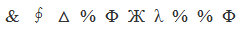
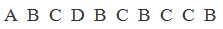
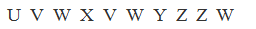
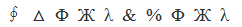

# 字符规律-相同符号位置对应

考点：[[20-考点/判断推理/类比推理/字符规律-相同符号位置对应|类比推理 / 字符规律-相同符号位置对应]]

**问法模型**：题干给出一串无实义汉字序列，要求选出符号位置规律相同的一项 → 采用'编号定位法'：给字符逐位标号，比对相同字符出现的位置集合是否一致

## 推理链
1. 第1步：将题干'渡长江过长江长江江长'逐字编号：1渡、2长、3江、4过、5长、6江、7长、8江、9江、10长
2. 第2步：归纳位置规律：位置2、5、7、10的字符相同（长）；位置3、6、8、9的字符相同（江）；位置1（渡）、4（过）各自唯一，不与其他位置重复
3. 第3步：将规律抽象为位置模板——①④各出现一次且互不相同，②⑤⑦⑩同字，③⑥⑧⑨同字
4. 第4步：验证A项：位置2、5、7、10的字符并不相同，第二组同字规律不成立，排除
5. 第5步：验证B项：位置2、5、7、10同字、位置3、6、8、9同字、位置1和4字符唯一且不重复，与题干规律完全一致
6. 第6步：验证C、D项：位置2、5、7、10的字符均不完全相同，与题干不一致，排除，故选B

**最快解法**：⚡ 编号定位法+排除法：给题干10个字符标序号，先锁定核心规律'②⑤⑦⑩同字、③⑥⑧⑨同字、①④唯一'，再逐项只查关键位置组是否为相同字符，快速排除

## 易错点
- ⚠ 只数字符总数或凭开头结尾字形相似度判断，忽略'相同字符必须落在相同位置'的核心规律
- ⚠ 逐位比对时数错位次，尤其第8、9位连续两个相同字符（江江）处容易跳位
- ⚠ 把'各字符出现次数相同'误当规律，忽略位置1、4的字符应各自唯一不重复这一约束

## 母题抽象
> 🧩 当题干出现'一串字符/汉字，要求选出符号位置规律相同的一项'时，用编号定位法：给每个字符标序号，提取'相同字符出现的位置集合+唯一字符位置'模板，逐项核对选项同位置是否同字符

**同类特征**：一串10个汉字的字符序列、全部字符仅4种：渡/长/江/过、相同字符间隔重复出现、位置2、5、7、10为同一字符、位置3、6、8、9为同一字符、位置1、4的字符各只出现一次

## 相关题
- [[10-真题/判断推理/类比推理/2172355 字符规律-相同符号位置对应|2172355]]（江苏 2018，相关度2）

---

### 题干
渡长江过长江长江江长

### 选项
- A. 

- B. 

　✅
- C. 

- D. 

### 官方解析
第一步：分析题干符号间关系。
从相同符号的位置入手：位置2、5、7、10的符号相同；位置3、6、8、9的符号相同；并且位置1、4上的符号与其他位置均不相同。
第二步：判断选项符号间关系。
A项：位置2、5、7、10的符号并不相同，与题干不一致，排除；
B项：位置2、5、7、10的符号相同；位置3、6、8、9的符号相同；并且1、4位置上的符号与其他位置均不相同，与题干一致，当选； 
C项：位置2、5、7、10的符号并不完全相同，与题干不一致，排除；
D项：位置2、5、7、10的符号并不完全相同，与题干不一致，排除。
故正确答案为B。

### 给定材料
（无）
