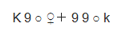
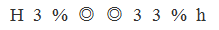
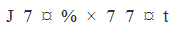

# 字符规律-相同符号位置对应

考点：[[20-考点/判断推理/类比推理/字符规律-相同符号位置对应|类比推理 / 字符规律-相同符号位置对应]]

**问法模型**：题干给出9个符号序列，问哪项符号间的位置对应关系与题干一致 → 采用'相同符号位置标注法'，把相同符号的位置分组后逐项比对

## 推理链
1. 第1步：提取题干9个符号：K、9、○、♀、＋、9、9、○、k
2. 第2步：按相同符号位置归纳规律：位置1（K）与位置9（k）为同一字母的大小写形式；位置2、6、7（9）符号相同；位置3、8（○）符号相同；位置4（♀）、5（＋）与其他位置均不相同
3. 第3步：逐项对照：A项位置4、5符号相同，违反'4、5与他位均不同'，排除；B项位置1和9并非同一字母大小写，排除；C项位置3、4、8符号均相同，违反'仅3、8相同'，排除
4. 第4步：D项'1与9大小写配对、2/6/7相同、3与8相同、4与5孤立不重复'四条规律全部吻合，与题干一致，当选

**最快解法**：⚡ 排除法+位置标注法：先看最易辨认的'首尾为同一字母大小写'排除B，再查'位置4、5须与其他位置均不同'排除A（其4、5相同），最后核对'仅3与8相同'排除C（其3、4、8相同），锁定D

## 易错点
- ⚠ 把大小写K与k误当作相同符号，混淆'同一字母'与'同一字符'两个概念
- ⚠ 忽略'位置4、5与其他位置均不相同'这一隐含条件，误选4、5符号相同的A项
- ⚠ 逐位比对时顺序混乱，漏查某一位置组的重复情况

## 母题抽象
> 🧩 当题干出现'一串符号/字母/数字，问哪项位置关系一致'时，先按相同符号标注位置分组（大小写算一组配对但非同符号），再逐项按位置组核对排除。

**同类特征**：9个符号组成序列、首尾为同一字母的大小写、相同符号位置成组（2/6/7、3/8）、存在两个与其他位置均不重复的孤立符号、按位置逐一比对的问法

## 相关题
- [[10-真题/判断推理/类比推理/2172328 字符规律-相同符号位置对应|2172328]]（江苏 2018，相关度2）

---

### 题干

### 选项
- A. 

- B. 

- C. 

- D. 

　✅

### 官方解析
第一步：分析题干符号间关系。
题干一共出现9个符号，从相同符号的位置入手：位置1和9分别是同一字母的大小写形式；位置2、6、7的符号相同；位置3、8的符号相同；并且位置4、5上的符号与其他位置均不相同。

第二步：判断选项符号间关系。
A项：位置1和9分别是同一字母的大小写形式；位置2、6、7的符号相同；位置3、8的符号相同；但是位置4、5上的符号相同，与题干不一致，排除；
B项：位置1和9并非同一字母的大小写形式，与题干不一致，排除； 
C项：位置1和9分别是同一字母的大小写形式；位置2、6、7的符号相同；但位置3、4、8的符号均相同，与题干不一致，排除；
D项：位置1和9分别是同一字母的大小写形式；位置2、6、7的符号相同；位置3、8的符号相同；并且位置4、5上的符号与其他位置均不相同，与题干一致，当选。
故正确答案为D。

### 给定材料
（无）
