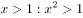
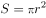

# 逻辑关系-条件关系（充分条件且非全同）

考点：[[20-考点/判断推理/类比推理/逻辑关系-条件关系（充分条件且非全同）|类比推理 / 逻辑关系-条件关系（充分条件且非全同）]]

**问法模型**：题干给出'直线交叉：直线不平行'的词项对 → 用'只要…就…'造句判断前件是否为后件的充分条件，并二次验证二者是否非全同关系

## 推理链
1. 第1步：题干'直线交叉：直线不平行'——两条直线只要交叉，则一定不平行，前者是后者的充分条件
2. 第2步：辨析外延——直线还存在'异面（既不交叉也不平行）'关系，故'直线交叉'与'直线不平行'外延不等，是充分条件而非全同关系
3. 第3步：A项代入——只要x大于1，则x的平方一定大于1，'x>1'是'x²>1'的充分条件；且x<-1时x²>1也成立，二者非全同，与题干两重关系均一致
4. 第4步：B项代入——不同液体沸点不同，'达到100'不必然'沸腾'，前者不是后者的充分条件，排除
5. 第5步：C项代入——臭氧化学式与其名称'臭氧'指同一物质，属全同关系而非充分条件，排除
6. 第6步：D项代入——该式即圆面积的表达式，与'圆面积'等价（全同），不是充分条件关系，排除
7. 第7步：逐项对照后仅A满足'充分条件且非全同'，与题干逻辑关系一致

**最快解法**：⚡ 充分条件造句法+非全同二次筛选：用'只要…就…'造句，题干'只要交叉就不平行'成立；A'只要x>1则x²>1'成立且非全同，B'只要100℃就沸腾'不成立（沸点因液体而异），C（O₃=臭氧）、D（πr²=圆面积）均为全同关系直接排除，秒选A

## 易错点
- ⚠ 把C项'O₃：臭氧'、D项'公式：圆面积'误判为充分条件，实则二者是全同（等价）关系
- ⚠ 对B项默认'水的沸点是100℃'而误认为100℃→沸腾成立，忽略'不同液体沸点不同'
- ⚠ 忽略充分条件不可逆推这一隐含维度：题干'不平行未必交叉'（异面直线）对应A项'x²>1未必x>1'（x<−1），A项需同时满足'充分+非全同'两重关系

## 母题抽象
> 🧩 当题干词对满足'有前必有后、但有后未必有前'时，用充分条件关系验证：先用'只要…就…'造句筛掉后件不必然成立的选项，再验证外延是否相等以排除全同关系选项

**同类特征**：直线交叉、直线不平行、只要…就…、充分条件、非全同关系、异面直线（不交叉也不平行）

## 相关题
- [[10-真题/判断推理/逻辑判断/11367777 翻译推理-逆否规则（假言命题翻译与等价转换）|11367777]]（江苏 2025，相关度1）
- [[10-真题/判断推理/类比推理/1797234 逻辑关系-条件关系（充分条件与逆否等价）|1797234]]（山东 2016，相关度1）
- [[10-真题/判断推理/逻辑判断/18643984 翻译推理-逆否规则（否后必否前，否前-肯后无结论）|18643984]]（广东 2026，相关度1）
- [[10-真题/判断推理/逻辑判断/2367948 翻译推理-逆否规则（否前-肯后无结论）|2367948]]（江苏 2019，相关度1）
- [[10-真题/判断推理/逻辑判断/2663744 翻译推理-逆否规则（否后必否前）与'可能为真'的兼容性判断|2663744]]（新疆 2020，相关度1）

---

### 题干
直线交叉：直线不平行

### 选项
- A. 

　✅
- B. 
100：沸腾

- C. 
：臭氧

- D. 
：圆面积

### 官方解析

第一步：判断题干词语间逻辑关系。 两条直线只要交叉，则一定不平行，前者是后者的充分条件。

注：直线间除了在同一平面内存在交叉和平行关系，还可以在不同平面内存在不交叉、不平行的关系，所以题干二者不是全同关系。

第二步：判断选项词语间逻辑关系。 A项： 只要x大于1，则x的平方一定大于1，前者是后者的充分条件，与题干逻辑关系一致，当选； B项：液体并非只要达到100，一定会沸腾，不同液体的沸点并不一定相同，前者不是后者的充分条件，与题干逻辑关系不一致，排除； C项：臭氧是地球大气中的一种微量气体，含有3个氧原子，是臭氧的化学式表示，二者是全同关系，与题干逻辑关系不一致，排除； D项：圆面积公式等于半径平方与圆周率的乘积，用字母可以表示为：，前者不是后者的充分条件，与题干逻辑关系不一致，排除。 故正确答案为A。 

### 给定材料
（无）
