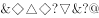
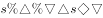
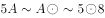

# 符号串规律-相同符号的位置对应

考点：[[20-考点/判断推理/类比推理/符号串规律-相同符号的位置对应|类比推理 / 符号串规律-相同符号的位置对应]]

**问法模型**：题干给出一串符号，问哪个选项与其特征或规律最相符 → 将符号串按位置编号，提炼'哪些位置符号相同、哪些位置孤立'的位置结构，逐项比对

## 推理链
1. 第1步：给题干符号串按位置1~9编号，提取相同符号的位置对：位置1、7符号相同；位置2、4符号相同；位置3、6符号相同；位置5、8符号相同
2. 第2步：确认孤立位：位置9上的符号与其他位置均不相同，即每对相同符号必须落在完全相同的位置上，且9号位必须为孤立符号
3. 第3步：逐项核对：A项位置5、8的符号并不相同，与题干'5=8'的规律冲突，排除；B项位置3、6的符号并不相同，与题干'3=6'的规律冲突，排除；C项位置5、8的符号并不相同，与题干'5=8'的规律冲突，排除
4. 第4步：D项位置1=7、2=4、3=6、5=8均成立，且位置9上的符号与其他位置均不相同，与题干规律完全一致，当选

**最快解法**：⚡ 位置编号对照法+排除法：把题干符号串按位置编号，记牢四组相等位置对'1=7、2=4、3=6、5=8'和'9号孤立'，逐项只查这几个位置对的符号是否相同，先发现冲突即排除

## 易错点
- ⚠ 只数符号种类数量不看位置，误认为符号个数一致即可当选
- ⚠ 验证不完整，只查了1=7、2=4等部分位置对就匆忙下结论，漏查5=8或3=6
- ⚠ 忽略位置9须为孤立符号的要求，错选虽有三对相同但孤立位不符的选项

## 母题抽象
> 🧩 当题干给出一串符号（或字符）要求找规律最相符的选项时，先按位置给每个符号编号，提炼'相同符号出现的位置对+孤立符号位置'这一结构模板，再逐项对相同位置逐一验证同位置符号是否相等

**同类特征**：一串符号的特征或规律最为相符、符号串按位置编号、相同符号成对出现且位置对应、存在孤立符号位、逐位比对排除

## 相关题
（暂无）

---

### 题干

请从四个选项中选出恰当的一项，其特征或规律与题干给出的一串符号的特征或规律最为相符。

### 选项
- A. 

- B. 

- C. 

- D. 

　✅

### 官方解析
从相同符号的位置入手：位置1、7的符号相同；位置2、4的符号相同；位置3、6的符号相同；位置5、8的符号相同；位置9上的符号与其他位置均不相同。
第二步：判断选项符号间关系。
A项：位置5、8的符号并不相同，与题干不一致，排除；
B项：位置3、6的符号并不相同，与题干不一致，排除；
C项：位置5、8的符号并不相同，与题干不一致，排除；
D项：位置1、7的符号相同；位置2、4的符号相同；位置3、6的符号相同；位置5、8的符号相同；位置9上的符号与其他位置均不相同，与题干一致，当选。
故正确答案为D。

### 给定材料
（无）
