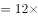

# 逻辑关系-并列关系与变化方向（负相关-此消彼长）

考点：[[20-考点/判断推理/类比推理/逻辑关系-并列关系与变化方向（负相关-此消彼长）|类比推理 / 逻辑关系-并列关系与变化方向（负相关/此消彼长）]]

**问法模型**：题干给出一对'××率'名词，问法为找逻辑关系最贴近的选项 → 先判定词项间关系类型（并列/换算），再用'越……越……'造句验证变化方向（正相关或负相关）后择优

## 推理链
1. 第1步：题干'亏损率'与'收益率'均为经济学中衡量经营结果的比率概念，二者为并列关系
2. 第2步：进一步辨析变化方向：同一经营对象中亏损越多收益越少，即'亏损率'越高，'收益率'越低，二者此消彼长（负相关）
3. 第3步：A项'就业率'与'失业率'同为统计学并列概念，就业率越高则失业率越低，与题干'并列+负相关'双重关系一致
4. 第4步：B项'死亡率'与'出生率'虽为并列关系，但二者无此消彼长的联动，排除
5. 第5步：C项'升学率'与'辍学率'虽为并列关系，官方认定二者无相互影响，与题干不一致，排除
6. 第6步：D项'月利率'与'年利率'是换算关系（年利率=月利率×12），月利率越高年利率越高，为正相关而非负相关，排除
7. 第7步：逐项对照后仅A项同时满足'并列关系+反向变化'，故选A

**最快解法**：⚡ 造句法+双重关系验证：先造句'亏损率越高，收益率越低'锁定'负相关'这一核心关系，再对四个选项套用'××率越高，××率越低'检验，只有A项（就业率越高失业率越低）成立，直接锁定A

## 易错点
- ⚠ 只验证一级关系'并列'就作答，B、C两项均并列，忽略'变化方向（负相关）'这一二级辨析
- ⚠ 误以为'亏损率+收益率=100%'才叫此消彼长，纠结于数量互补而漏选A；题干核心仅是反向联动
- ⚠ D项'月利率：年利率'看似也有关联，忽略其本质是换算关系且为正相关，与题干方向相反

## 母题抽象
> 🧩 当题干出现两个'××率'类名词且一个升高另一个降低（此消彼长）时，用'越……越……'造句法先定变化方向，再在并列选项中筛选同样呈负相关联动的一组，排除仅并列无联动或呈正相关（换算关系）的选项

**同类特征**：两个'××率'名词对举、并列关系、负相关/此消彼长、经济学统计概念、二级辨析看变化方向

## 相关题
- [[10-真题/判断推理/类比推理/10204611 语义关系-反义关系（并列结构短语的拆词对应辨析）|10204611]]（黑龙江 2024，相关度1）
- [[10-真题/判断推理/类比推理/10297124 语义关系-反义关系+成语结构辨析（并列-因果-转折对应区分）|10297124]]（天津 2025，相关度1）
- [[10-真题/判断推理/类比推理/10297251 填空型类比-代入法+关系辨析（并列关系vs地点对应关系，二级辨析按环境归属择优）|10297251]]（浙江 2025，相关度1）
- [[10-真题/判断推理/类比推理/10297424 语义关系-并列关系+功能相反（二级辨析）|10297424]]（四川 2025，相关度1）
- [[10-真题/判断推理/类比推理/11367770 语义关系-比喻象征义+并列关系（含词序位置对应）|11367770]]（江苏 2025，相关度1）

---

### 题干
亏损率：收益率

### 选项
- A. 就业率：失业率　✅
- B. 死亡率：出生率
- C. 升学率：辍学率
- D. 月利率：年利率

### 官方解析

第一步，判断题干词语间逻辑关系。

“亏损率”和“收益率”为经济学中的两个概念，二者为并列关系，且“亏损率”越高，“收益率”越低。

第二步，判断选项词语间逻辑关系。

A项：“就业率”和“失业率”为统计学中的两个概念，二者为并列关系，且“就业率”越高，“失业率”越低，与题干逻辑关系一致，当选；

B项：“死亡率”和“出生率”为并列关系，但二者无相互影响，与题干逻辑关系不一致，排除；

C项：“升学率”和“辍学率”为并列关系，但二者无相互影响，与题干逻辑关系不一致，排除；

D项：“月利率”和“年利率”是不同的利率计算方式，年利率月利率，月利率越高，年利率越高，与题干逻辑关系不一致，排除。

故正确答案为A。

### 给定材料
（无）

> [!warning] 疑点（官方解析可能有误，待人工复核）
> 官方解析对C项仅以'二者无相互影响'排除，未说明其与A项的本质区别（如'就业率/失业率'分母同一口径、严格此消彼长，而'升学率/辍学率'统计口径不同），排除理由略显笼统，但不影响A为最优答案的结论

<!-- CODEX-ANSWER-REVIEW:BEGIN -->
### 本次独立复核

**复核状态：** `confirmed`（独立复算确认答案）

**计分答案：** A（可计分）

**复核解析：**

第一步，判断题干词语间逻辑关系。“亏损率”和“收益率”为经济学中的两个概念，二者为并列关系，且“亏损率”越高，“收益率”越低。第二步，判断选项词语间逻辑关系。A项：“就业率”和“失业率”为统计学中的两个概念，二者为并列关系，且“就业率”越高，“失业率”越低，与题干逻辑关系一致，当选；B项：“死亡率”和“出生率”为并列关系，但二者无相互影响，与题干逻辑关系不一致，排除；C项：“升学率”和“辍学率”为并列关系，但二者无相互影响，与题干逻辑关系不一致，排除；D项：“月利率”和“年利率”是不同的利率计算方式，年利率月利率，月利率越高，年利率越高，与题干逻辑关系不一致，排除。故正确答案为A。

**相关信息：**

按三词/词组间的概念关系、语义关系或结构关系逐项比较；注意选项是否存在同样成立的解释。

**题源依据：** [固定版本原题](https://github.com/Mentat-Uran/kaogongzhentizhengliu/blob/84ab93d4b64b61d897bece8a1c0a5bab06b4feb2/10-%E7%9C%9F%E9%A2%98/%E5%88%A4%E6%96%AD%E6%8E%A8%E7%90%86/%E7%B1%BB%E6%AF%94%E6%8E%A8%E7%90%86/2776048%20%E9%80%BB%E8%BE%91%E5%85%B3%E7%B3%BB-%E5%B9%B6%E5%88%97%E5%85%B3%E7%B3%BB%E4%B8%8E%E5%8F%98%E5%8C%96%E6%96%B9%E5%90%91%EF%BC%88%E8%B4%9F%E7%9B%B8%E5%85%B3-%E6%AD%A4%E6%B6%88%E5%BD%BC%E9%95%BF%EF%BC%89.md)；固定内容 commit `84ab93d4b64b61d897bece8a1c0a5bab06b4feb2`，Markdown blob `882846bab46dbb872206722597d99d4448762473`。
<!-- CODEX-ANSWER-REVIEW:END -->
