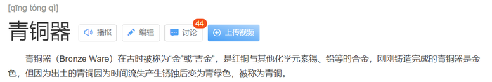

# 词项关系-交叉关系与种属关系复合辨析（三元词项）

考点：[[20-考点/判断推理/类比推理/词项关系-交叉关系与种属关系复合辨析（三元词项）|类比推理 / 词项关系-交叉关系与种属关系复合辨析（三元词项）]]

**问法模型**：三词类比题，先判断前两词关系、再判断前两词与第三词的关系 → 用'两两造句验证+逐项排除'模型

## 推理链
1. 第1步：题干前两词'青铜器物'与'商朝礼器'造句验证：有的青铜器物是商朝礼器，有的商朝礼器不是青铜器物（商朝礼器也可非青铜材质），二者为交叉关系
2. 第2步：题干第三词'文化遗产'：青铜器物是文化遗产的一种，商朝礼器也是文化遗产的一种，即前两词均与第三词构成种属关系（据注：青铜器是合金且锈蚀呈青绿色，与铜器物相区别，确为文化遗产的种）
3. 第3步：验证A项：科幻小说与微型小说造句为'有的科幻小说是微型小说'，构成交叉关系，且科幻小说、微型小说均是文学作品的一种，前两词交叉+均与第三词种属，与题干结构完全一致
4. 第4步：排除B项：'苏州园林是一种中式建筑'，前两词为种属而非交叉关系，与题干结构不符
5. 第5步：排除C项：半坡遗址是新石器时代仰韶文化聚落遗址，前两词为对应关系而非交叉；且仰韶文化是华夏文明的组成部分，属组成关系而非种属关系
6. 第6步：排除D项：进口食品与速冻海鲜虽为交叉关系，但进口食品与冷冻食品也是交叉关系（进口食品不都是冷冻食品），未形成'均与第三词种属'结构，与题干不符

**最快解法**：⚡ 造句法+排除法：对题干造句'有的青铜器物是商朝礼器，二者都是文化遗产'锁定结构；B项造句'苏州园林是一种中式建筑'直接种属排除；D项第二层验证'进口食品是冷冻食品？'为交叉而非种属排除，秒选A

## 易错点
- ⚠ 把'青铜器物：商朝礼器'误判为全同或种属关系，忽略青铜器不限于商朝、商朝礼器不限于青铜材质这两个维度
- ⚠ D项二级辨析缺位：只验证到前两词交叉就匆忙对比，忽略第三词'冷冻食品'与前两词均为交叉而非种属
- ⚠ C项混淆'组成关系'与'种属关系'（仰韶文化是华夏文明的组成部分，不能说'仰韶文化是一种华夏文明'）

## 母题抽象
> 🧩 当类比推理三词题干呈现'前两词交叉+均与第三词种属'结构时，用造句法逐项验证前两词关系和第三词关系，重点排查交叉与种属、种属与组成的二级辨析

**同类特征**：三词类比、前两词交叉关系、与第三词种属关系、造句验证、二级辨析排除、组成与种属混淆

## 相关题
- [[10-真题/判断推理/类比推理/13504485 三词类比-种属关系+功能对应（二级辨析）|13504485]]（新疆 2025，相关度2）
- [[10-真题/判断推理/类比推理/17097268 语义关系-组成关系（部分-部分-整体的链式组成）|17097268]]（山西 2024，相关度2）
- [[10-真题/判断推理/类比推理/1797844 对应关系-载体与感知器官|1797844]]（河南 2016，相关度2）
- [[10-真题/判断推理/类比推理/18643832 语义关系-并列关系+功能对应（主要功能）|18643832]]（四川 2026，相关度2）
- [[10-真题/判断推理/类比推理/2022316 逻辑关系-原材料对应+并列关系（复合关系位置对应）|2022316]]（吉林 2016，相关度2）

---

### 题干
青铜器物：商朝礼器：文化遗产

### 选项
- A. 科幻小说：微型小说：文学作品　✅
- B. 中式建筑：苏州园林：特色建筑
- C. 仰韶文化：半坡遗址：华夏文明
- D. 进口食品：速冻海鲜：冷冻食品

### 官方解析

第一步：判断题干词语间逻辑关系。

青铜器物与商朝礼器构成交叉关系，同时二者均是文化遗产的一种，二者均与文化遗产构成种属关系。

第二步：判断选项词语间逻辑关系。

A项：科幻小说与微型小说构成交叉关系，同时二者均是文学作品的一种，二者均与文学作品构成种属关系，与题干逻辑关系一致，当选；

B项：苏州园林是一种中式建筑，二者为种属关系，中式建筑和特色建筑构成交叉关系，与题干逻辑关系不一致，排除；

C项：半坡遗址是新石器时代仰韶文化聚落遗址，二者为对应关系；仰韶文化是华夏文明的组成部分，二者为组成关系，与题干逻辑关系不一致，排除； 

D项：进口食品与速冻海鲜构成交叉关系，但进口食品与冷冻食品也构成交叉关系，与题干逻辑关系不一致，排除。

故正确答案为A。

注：青铜器物不仅是红铜与其他化学元素锡、铅等的合金，而且因为刚刚铸造完成的青铜器是金色，出土的青铜因为时间流失产生锈蚀后变为青绿色，所以被称为青铜。因此现在仅仅由红铜与其他化学元素锡、铅等物质制成的器具是不能称之为青铜器的，只能称之为铜器物。故题干青铜器物和文化遗产间是种属关系。

### 给定材料
（无）
