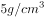

# 填空式类比-代入验证（原材料与成品的对应关系）

考点：[[20-考点/判断推理/类比推理/填空式类比-代入验证（原材料与成品的对应关系）|类比推理 / 填空式类比-代入验证（原材料与成品的对应关系）]]

**问法模型**：题干为'A对于（ ）相当于（ ）对于B'的填空式问法 → 应采用逐项代入造句法，验证前后两端逻辑关系类型是否一致

## 推理链
1. 第1步：题干为填空式类比，左端为'眼镜镜片+空1'，右端为'空2+铝合金'，需将选项代入两空后分别造句比对
2. 第2步：解题规则为代入法+造句法，给前后两半各造一个句子，判断关系类型（原材料、功能、属性、交叉、并列等）是否完全相同
3. 第3步：A项代入：'眼镜镜片'用来矫正'视力'是功能对应，'铝合金'具有'坚固'是属性对应，功能≠属性，排除
4. 第4步：B项代入：'树脂'是制作'眼镜镜片'的原材料，'铝合金'是制作'易拉罐'的原材料，两端均为'原材料—成品'对应，关系一致
5. 第5步：C项代入：'眼镜镜片'与'凹透镜'是交叉关系（有的镜片是凹透镜，有的不是），而'重金属'与'铝合金'是全异关系（铝合金不是重金属），一交叉一全异，排除
6. 第6步：D项代入：'眼镜镜片'与'眼镜镜架'是共属'眼镜'整体的并列两部分，'铝合金'与'不锈钢'是两种独立存在的材质，并列层级不同，排除
7. 第7步：只有B项前后逻辑关系一致，故正确答案为B

**最快解法**：⚡ 代入造句法：优先代入B项造句'树脂做成眼镜镜片，铝合金做成易拉罐'，两端同为原材料对应成品，直接锁定；再快速造句排除A（矫正视力是功能、坚固是属性，不一致）

## 易错点
- ⚠ C项易将'眼镜镜片与凹透镜'误判为种属关系，实际因'有的…有的…'是交叉关系，与铝合金和重金属的全异关系不对应
- ⚠ A项两组都笼统叫'对应关系'，但功能对应（矫正视力）与属性对应（坚固）类型不同，需精细二级辨析
- ⚠ D项两组均为并列关系，易只看表面相同就误选，需注意镜片与镜架共存于'眼镜'整体，而铝合金与不锈钢是独立材质，并列语境不同

## 母题抽象
> 🧩 当题干出现'A对于（ ）相当于（ ）对于B'填空式特征时，用代入造句法，给前后两半各造一个句子，验证关系类型（原材料/功能/属性/交叉/并列）是否完全一致

**同类特征**：填空式类比、眼镜镜片、铝合金、逐一代入选项、原材料与成品、造句验证前后一致

## 相关题
- [[10-真题/判断推理/类比推理/12100994 语义关系-原材料与成品对应（二级辨析：加工工艺-晾晒脱水）|12100994]]（江苏 2025，相关度1）
- [[10-真题/判断推理/类比推理/15419104 填空式类比-逐一代入+造句验证（情境与心态对应+语法结构二级辨析）|15419104]]（湖北 2025，相关度1）
- [[10-真题/判断推理/类比推理/1797804 语义关系-偏正修饰关系（成语作定语搭配）|1797804]]（广西 2016，相关度1）
- [[10-真题/判断推理/类比推理/19526255 对应关系-因果关系（填空式代入验证）|19526255]]（国考 2026，相关度1）
- [[10-真题/判断推理/类比推理/2030034 逻辑关系-并列关系+原材料与成品的对应关系|2030034]]（四川 2016，相关度1）

---

### 题干
眼镜镜片 对于 （    ） 相当于 （    ） 对于 铝合金

### 选项
- A. 视力；坚固
- B. 树脂；易拉罐　✅
- C. 凹透镜；重金属
- D. 眼镜镜架；不锈钢

### 官方解析

逐一代入选项。

A项：“眼镜镜片”可以用来矫正“视力”，二者是对应关系；“铝合金”具有“坚固”的属性，二者是属性对应关系，前后逻辑关系不一致，排除；

B项：“树脂”是制作“眼镜镜片”的一种原材料，二者是原材料的对应关系；“铝合金”是制作“易拉罐”的一种原材料，二者是原材料的对应关系，前后逻辑关系一致，当选；

C项：有的“眼镜镜片”是“凹透镜”，有的“眼镜镜片”不是“凹透镜”，有的“凹透镜”是“眼镜镜片”，有的“凹透镜”不是“眼镜镜片”，二者是交叉关系；“重金属”是指密度大于的金属，“铝合金”不是“重金属”，二者是反向种属关系，前后逻辑关系不一致，排除；

D项：“眼镜镜片”和“眼镜镜架”是组成眼镜的两个部分，二者是并列关系；“铝合金”和“不锈钢”是两种不同的材质，二者是并列关系，但二者是独立存在的，前后逻辑关系不一致，排除。

故正确答案为B。

### 给定材料
（无）
