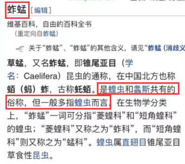
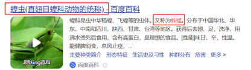

# 语义关系-全同关系（同一事物不同称谓）

考点：[[20-考点/判断推理/类比推理/语义关系-全同关系（同一事物不同称谓）|类比推理 / 语义关系-全同关系（同一事物不同称谓）]]

**问法模型**：题干给出两个生物名词'考拉：树袋熊'→ 判断词项间语义关系（全同/并列），逐项对照选逻辑关系一致且无争议的一项

## 推理链
1. 第1步：从题干提取词项关系——'考拉'与'树袋熊'是同一种动物的两种称呼，二者为全同关系
2. 第2步：所用方法为语义关系比对法，以'是否为同一动物的不同名称'为标准逐项验证
3. 第3步：A项'墨鱼：乌贼'为同一种动物的不同称呼，全同关系，与题干一致，保留
4. 第4步：B项蜜蜂属蜜蜂科、黄蜂属胡蜂科，是两种不同昆虫，为并列关系，排除
5. 第5步：C项'蚱蜢：蝗虫'关系存在争议——维基百科、百度百科视为全同，但《现代汉语词典》认为并非同一种动物，暂保留待比
6. 第6步：D项金龟子是金龟总科昆虫的通称，天牛是天牛科昆虫的总称，分属不同类群，为并列关系，排除
7. 第7步：对比A、C两项，C项词项关系有争议、A项为无争议的全同关系，按'无争议优先'确定答案为A

**最快解法**：⚡ 全同关系判定法：先确认'考拉=树袋熊'为同一动物不同叫法，直接锁定A项'墨鱼=乌贼'；再用'争议项让位于无争议项'原则排除可能全同但存在争议的C项（蚱蜢/蝗虫），排除B、D并列关系

## 易错点
- ⚠ 看到C项'蚱蜢：蝗虫'部分资料（维基百科、百度百科）支持全同关系，误选C而忽略其关系存在权威争议
- ⚠ 把'外形相似、名称相近的不同昆虫'（如蜜蜂与黄蜂、金龟子与天牛）误判为同一动物的不同叫法
- ⚠ 对'俗称/译名与学名'的二级辨析缺位，未意识到全同关系需'无争议'才稳妥

## 母题抽象
> 🧩 当题干出现'同一生物的两种名称（外来译名/俗称/别名）'特征时，用全同关系判定法，验证选项哪一组是'无争议的同一事物不同称谓'；若出现争议组，选无争议的全同项

**同类特征**：考拉、树袋熊、同一动物不同名称、全同关系、生物名词对、译名与别名

## 相关题
- [[10-真题/判断推理/类比推理/15833778 语义关系-全同关系（二级辨析：音译外来词）|15833778]]（内蒙古 2026，相关度1）
- [[10-真题/判断推理/类比推理/16069772 语义关系-全同关系（同一概念不同称谓）|16069772]]（福建 2026，相关度1）
- [[10-真题/判断推理/类比推理/17058530 语义关系-全同关系（并列罗列与固定统称）|17058530]]（选调 2023，相关度1）
- [[10-真题/判断推理/类比推理/18643650 语义关系-全同关系（古今别称）+对应关系（对象与场所）|18643650]]（天津 2026，相关度1）
- [[10-真题/判断推理/类比推理/2263047 语义关系-全同关系（别称-俗称）|2263047]]（四川 2016，相关度1）

---

### 题干
考拉：树袋熊

### 选项
- A. 墨鱼：乌贼　✅
- B. 蜜蜂：黄蜂
- C. 蚱蜢：蝗虫
- D. 金龟子：天牛

### 官方解析

第一步：判断题干词语间逻辑关系。

考拉和树袋熊是同一种动物，二者为全同关系。

第二步：判断选项词语间逻辑关系。

A项：墨鱼和乌贼是同一种动物，二者为全同关系，与题干逻辑关系一致，保留；

B项：黄蜂属于胡蜂科，蜜蜂属于蜜蜂科，二者为并列关系，与题干逻辑关系不一致，排除；

C项：蚱蜢和蝗虫的关系较有争议，部分资料显示二者为全同关系，与题干逻辑关系一致，保留；

D项：金龟子是鞘翅目金龟总科的通称，天牛是多食亚目天牛科昆虫的总称，二者为并列关系，与题干逻辑关系不一致，排除。

对比A、C两项，C项中蚱蜢和蝗虫的关系较有争议，如下图所示，维基百科和百度百科都表明二者是全同关系，但现代汉语词典表明二者并不是同一种动物，目前无法确定出题人对二者的关系是如何判定的，相对来说，A项中的墨鱼和乌贼是没有争议的全同关系，因此，小粉笔更倾向于将正确答案给到A项。

故正确答案为A。

### 给定材料
（无）

> [!note] 复核版本状态
> 原题不可计分（genuine_multi_answer；来源记录的答案键/竞争项：A、C）；仅当前明确标注的编辑版按答案A计分。
> 详细原题疑点、修订题面、解析和证据见下方独立复核记录。

<!-- CODEX-ANSWER-REVIEW:BEGIN -->
### 本次独立复核

**复核结论：** `resolved`（答案与解析已核定）

**原题计分状态：** 不计分（`genuine_multi_answer`：多个答案均成立）。来源中记录的答案键/竞争项：A、C；这些记录不代表原题已核准答案。

**原题疑点与处理：**

浙江 2022 〔20-考点/判断推理/类比推理/语义关系-全同关系（同一事物不同称谓）〕 — 官方解析自述C项'蚱蜢：蝗虫'在维基百科、百度百科中均为全同关系，仅因《现代汉语词典》持不同观点及'无法确定出题人判定'而倾向A项，命题依据的唯一性存疑；但按官…

**当前计分版本：** 明确标注的编辑版；未列出的题干、材料或选项沿用固定题源。答案不回填为原题答案。

**计分答案：** A（可计分）

**复核解析：**

固定题源指出“蚱蜢：蝗虫”的名称范围存在词典分歧，因此原C不能作为可靠干扰项。本修订版将A改为“马铃薯：土豆”，并按《重编国语辞典修订本》“土豆”的大陆义项，土豆指马铃薯，二者为同物异名。C改为“蚱蜢：蜻蜓”，二者是不同昆虫类群；B蜜蜂与黄蜂、D金龟子与天牛也各为不同类群，不是同一对象的两个名称。修订版唯一答案A。

**修订题干：**

【编辑修订：按“同一对象的名称与别称”判定】考拉：树袋熊。选择关系相同的一项。

**修订材料：**

本编辑版按教育部《重编国语辞典修订本》2021的大陆地区义项理解“土豆”：土豆指马铃薯。题面明确使用这一义项，避免同一词形在不同地区指向不同植物。

**修订/采用选项：**

A. 马铃薯：土豆
B. 蜜蜂：黄蜂
C. 蚱蜢：蜻蜓
D. 金龟子：天牛

**相关信息：**

类比推理—全同关系；跨地区词典可能为同一词条收录不同俗称义项，比较前需明确词典与义项。

**核对依据与来源边界：**

- 固定题源：[原题文件](https://github.com/Mentat-Uran/kaogongzhentizhengliu/blob/84ab93d4b64b61d897bece8a1c0a5bab06b4feb2/10-%E7%9C%9F%E9%A2%98/%E5%88%A4%E6%96%AD%E6%8E%A8%E7%90%86/%E7%B1%BB%E6%AF%94%E6%8E%A8%E7%90%86/5102353%20%E8%AF%AD%E4%B9%89%E5%85%B3%E7%B3%BB-%E5%85%A8%E5%90%8C%E5%85%B3%E7%B3%BB%EF%BC%88%E5%90%8C%E4%B8%80%E4%BA%8B%E7%89%A9%E4%B8%8D%E5%90%8C%E7%A7%B0%E8%B0%93%EF%BC%89.md)；内容版本 `84ab93d4b64b61d897bece8a1c0a5bab06b4feb2`，源 Markdown blob `17ae873f2c6ec07208d9dd48f91126a0d1edf272`.
- **核心依据：** 以权威词典明确指定的“土豆=马铃薯”构造修订版A；将有分歧的原C替换为不同类群的蚱蜢与蜻蜓，B、D仍是不同昆虫类群。
- 固定题图/公式图：`90-图片/题目图/181e34522030580.png`, `90-图片/题目图/181e3455598435e.png`, `90-图片/题目图/181e34565b8c157.png`.

<!-- CODEX-ANSWER-REVIEW:END -->
