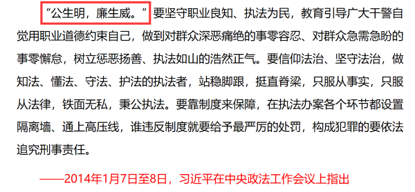

# 填空式类比-代入验证（必要条件关系+择优二级辨析）

考点：[[20-考点/判断推理/类比推理/填空式类比-代入验证（必要条件关系+择优二级辨析）|类比推理 / 填空式类比-代入验证（必要条件关系+择优二级辨析）]]

**问法模型**：题干为'（　）对于A相当于B对于（　）'的填空式类比→将选项逐一代入两空，分别造句判断前后词项逻辑关系是否一致；多个选项均一致时按择优原则做二级辨析。

## 推理链
1. 第1步：题干为填空式类比，需将每个选项代入'（　）对于明辨是非'与'清正廉洁对于（　）'两空，分别造句验证。
2. 第2步：代A造句：'公正公平才能明辨是非''清正廉洁才能树立威信'，对应古语'公生明，廉生威'，均为'前者是后者的必要条件'，且两句主语一致（为官者）、结构对称，关系平行对应，保留。
3. 第3步：代B造句：'明辨是非需要独立思考''风清气正需要清正廉洁'，虽也呈条件关系，但'风清气正'描述的是政治环境状态，与'明辨是非'（主体能力）不在同一层面，对应不如A工整，暂时保留。
4. 第4步：代C造句：'热爱真理'与'明辨是非'无明显逻辑关系，而'清正廉洁'与'口碑声望'为因果（因廉洁而获口碑），前后不一致，排除。
5. 第5步：代D造句：'修身养性'与'明辨是非'、'清正廉洁'与'政治生态'（环境状态概念）均无明显逻辑关系，前后不一致，排除。
6. 第6步：对比保留的A、B：A项'公生明，廉生威'有固定出处，两句关系性质完全相同（必要条件→主体自身结果），择优选A。

**最快解法**：⚡ 逐项代入+造句法：先代C、D快速排除（前后关系明显不一致），再对A、B做二级辨析——A项'公生明，廉生威'两句结构对称、主语一致、均为必要条件关系，B项'风清气正'为环境状态非主体结果，故选A。

## 易错点
- ⚠ B项代入后前后也呈条件关系，只做一重判断会误选B，必须进行二级辨析（主体层级、语义对应是否工整、有无固定出处搭配）。
- ⚠ 被'清正廉洁'与'风清气正'字面相近迷惑，忽略'风清气正'描述的是政治环境状态而非主体自身结果。
- ⚠ 填空式类比必须先代入再造句验证，凭词面直觉或只看单侧关系易出错。

## 母题抽象
> 🧩 当题干出现'（　）对于X相当于Y对于（　）'的填空式类比特征时，用逐项代入+造句法验证前后逻辑关系是否一致；当多个选项关系均一致时，按'关系性质与结构是否完全对称（主体一致、有固定出处搭配）'择优。

**同类特征**：填空式（两端带括号）类比、词项均为四字短语、需代入验证、条件/因果关系辨析、多个选项关系一致需择优、'公生明，廉生威'固定对应结构

## 相关题
- [[10-真题/判断推理/类比推理/1797868 填空型类比-代入法与逻辑关系类型一致性（因果关系 vs 动宾-功能-地点对应）|1797868]]（河南 2016，相关度1）
- [[10-真题/判断推理/类比推理/18643833 填空式类比-代入法（对应关系辨析+二级辨析择优）|18643833]]（四川 2026，相关度1）
- [[10-真题/判断推理/类比推理/2144737 语义关系-常识对应（地名与特产-别称）|2144737]]（新疆 2017，相关度1）
- [[10-真题/判断推理/类比推理/2387996 填空式类比-代入验证（对应关系与并列关系级别辨析）|2387996]]（河北 2019，相关度1）
- [[10-真题/判断推理/类比推理/5445788 四词填空-代入法验证种属关系与对应关系的一致性|5445788]]（国考 2023，相关度1）

---

### 题干
（    ） 对于 明辨是非 相当于 清正廉洁 对于 （    ）

### 选项
- A. 公正公平；树立威信　✅
- B. 独立思考；风清气正
- C. 热爱真理；口碑声望
- D. 修身养性；政治生态

### 官方解析

逐一代入选项。

A项：古语有云“公生明，廉生威”，意思是为官公正公平，才能明辨是非；为官清正廉洁，才能在百姓中树立威信，前者是后者的必要条件，前后逻辑关系一致，保留；

B项：要想能明辨是非，需要独立思考；要想保持风清气正的政治环境，需要清正廉洁，前者是后者的条件，前后逻辑关系一致，保留；

C项：热爱真理与明辨是非无明显逻辑关系；因为做官清正廉洁所以获得了口碑声望，二者为因果关系，前后逻辑关系不一致，排除；

D项：修身养性是指通过自我反省体察，使身心达到完美的境界，与明辨是非无明显逻辑关系；清正廉洁是指为官正直廉洁，政治生态是指各类政治主体生存发展的环境和状态，二者无明显逻辑关系，前后逻辑关系不一致，排除。

对比A、B两项，A项有明显的历史出处，且如下图所示，“公生明，廉生威”是习近平总书记在中央政法工作会议上指出的原话，故粉笔教研团队一致认为，本题择优选择A项。

故正确答案为A。

### 给定材料
（无）
