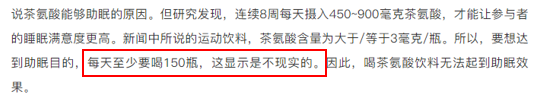

# 削弱论证-他因削弱（兼辨析弱拆桥）

考点：[[20-考点/判断推理/逻辑判断/削弱论证-他因削弱（兼辨析弱拆桥）|逻辑判断 / 削弱论证-他因削弱（兼辨析弱拆桥）]]

**问法模型**：“以下哪项如果为真，最能质疑该厂商的说法”→削弱论证题：先定位论点论据，判断话题是否跳跃，优先在“拆桥”“他因削弱”“削弱论点”中比较削弱力度

## 推理链
1. 第1步：提取论证结构——论点是“这款饮料有助于缓解失眠、促进睡眠”，论据是“连续8周每天服用450-900毫克茶氨酸后，被试的睡眠满意度显著提高”
2. 第2步：识别论证特征——论据说的是原料“茶氨酸”的实验效果，论点说的是产品“含茶氨酸的饮料”的功效，二者主体存在跳跃；且实验对象、实验条件信息不明，可从拆桥、他因削弱、削弱论点三个方向找最强削弱
3. 第3步：对照A项——“茶氨酸含量较低，一天需要饮用4-5瓶”，但“4-5瓶”并非完全不可实现的天文数字，无法通过“量”彻底拆断“茶氨酸”与“含茶氨酸的饮料”之间的联系，削弱力度弱
4. 第4步：对照B、C项——B项“减缓神经冲动，帮助缓解紧张情绪”是在解释茶氨酸助眠的机理，属加强项；C项“消减苦涩味、增强鲜味甜味”只涉及口味，与“缓解失眠”话题无关
5. 第5步：对照D项——被试“均患有症状为持续紧张不安的广泛焦虑症”且“实验期间服用了抗抑郁药物”，说明睡眠满意度提高可能是抗抑郁药物所致而非茶氨酸所致，属他因削弱，直接动摇实验结论对论点的支持
6. 第6步：力度比较——D的他因削弱直击实验因果归因的可靠性，明显强于A的弱拆桥，故选D

**最快解法**：⚡ 他因削弱定位法：锁定论点“饮料助眠”后，扫选项找“实验过程另有干扰因素”的关键词——D项“实验期间服用了抗抑郁药物”直接提示睡眠改善另有他因，优先比对D与A的力度即可，无需纠结剂量换算

## 易错点
- ⚠ 把A项误判为强拆桥：只看到“含量低、要喝4-5瓶”就认为切断了联系，忽略“4-5瓶”实际可以实现，无法通过“量”拆断因果链
- ⚠ 误选B项：看到“缓解紧张情绪”“神经传导物质”等字眼觉得与失眠相关，未识别其是解释因果机理的加强项
- ⚠ 漏读D项关键限定：“实验期间服用了抗抑郁药物”这一时间限定词是他因削弱的核心，只看“患有焦虑症”可能误以为D只是质疑样本代表性而低估其力度

## 母题抽象
> 🧩 当题干出现“某研究/实验的结论被商家用作产品宣传依据”特征时，先检查实验对象是否特殊、实验过程是否有混杂变量（如同时服用其他药物），优先用他因削弱选项质疑实验结论的因果归因；注意区分“剂量不够、难以实现”式弱拆桥与真正的切断联系

**同类特征**：某研究发现/实验表明、厂商据此推出产品并拍广告宣传、最能质疑、论据主体（原料实验）与论点主体（产品功效）不一致、实验对象与实验条件信息缺失

## 相关题
- [[10-真题/判断推理/逻辑判断/16070053 削弱论证-削弱论点（无证据直接质疑）|16070053]]（广西 2026，相关度1）
- [[10-真题/判断推理/逻辑判断/1797386 削弱论证-力度比较（推翻隐含假设＞补充替代依据）|1797386]]（山东 2016，相关度1）
- [[10-真题/判断推理/逻辑判断/2031006 削弱论证-直接否定因果关系（根本原因另有他因，削弱力度比较）|2031006]]（北京 2017，相关度1）
- [[10-真题/判断推理/逻辑判断/2047888 削弱论证-削弱论点（指出技术有害的负面效应）|2047888]]（广东 2017，相关度1）
- [[10-真题/判断推理/逻辑判断/2144605 削弱论证-否定论点（多结论观点的质疑）|2144605]]（选调 2018，相关度1）

---

### 题干
某研究发现，连续8周每天服用450-900毫克茶氨酸后，被试的睡眠满意度显著提高。某厂商因此推出一款含有茶氨酸的饮料，并以该研究为主要内容拍摄广告，声称这款饮料有助于缓解失眠、促进睡眠。
以下哪项如果为真，最能质疑该厂商的说法？

### 选项
- A. 该饮料茶氨酸含量较低，要达到450毫克的实验剂量，一天需要饮用4-5瓶
- B. 茶氨酸可通过影响大脑中的神经传导物质来减缓神经冲动，帮助缓解紧张情绪
- C. 茶氨酸易溶于水，能够消减咖啡碱引起的苦涩味并增强鲜味和甜味，使饮料味道更好
- D. 参与该研究的被试均患有症状为持续紧张不安的广泛焦虑症，且实验期间服用了抗抑郁药物　✅

### 官方解析

第一步：找出论点和论据。

论点：这款饮料有助于缓解失眠、促进睡眠。

论据：连续8周每天服用450-900毫克茶氨酸后，被试的睡眠满意度显著提高。某厂商因此推出一款含有茶氨酸的饮料。

本题论点讨论的是含有茶氨酸的饮料有助于缓解失眠、促进睡眠，论据讨论的是茶氨酸能够有助于睡眠，二者话题不一致，削弱优先考虑拆桥，也可以考虑削弱论点或他因削弱。

第二步：逐一分析选项。

A项：该项说的是该饮料茶氨酸的含量较低，一天需要饮用4-5瓶，“4-5瓶”并不是完全不可实现的天文数字，部分人可以每天饮用4-5瓶饮料，所以该项削弱力度比较弱，保留；

B项：该项说的是茶氨酸能够帮助缓解紧张情绪，从而可能让入睡前的心情更平静，解释了茶氨酸能够助眠的原因，加强项，无法削弱，排除；

C项：该项说的是茶氨酸易溶于水，能消减咖啡碱引起的苦涩味且增加鲜味和甜味，让饮料的味道更好，与论点讨论的含有茶氨酸的饮料能否有助于缓解失眠、促进睡眠无关，话题不一致，无法削弱，排除；

D项：该项说的是参与研究的被试者均患有焦虑症，且在“实验期间”服用了抗抑郁的药物，说明有可能是“抗抑郁的药物“ 起到了缓解失眠、促进睡眠的作用，他因削弱，可以削弱，保留；

对比A、D两项，可能有部分小伙伴认为A项是拆桥，但结合实际情况后可以发现，“每天需要饮用4-5瓶饮料”这个方式对于部分人是可以实现的，因此就无法通过“量”来拆断“茶氨酸”和“含茶氨酸的饮料”之间的联系。且查阅原文后得知，本题A项中出题人将原文中的“每天至少喝150瓶”缩减为“一天需要饮用4-5瓶”，可能也是有意为之，意在通过数量之间的巨大差异极大降低A项的削弱力度。

故正确答案为D。

### 给定材料
（无）
