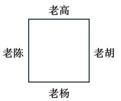
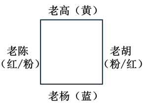

# 分析推理-方位定桩与属性匹配（组合排列）

考点：[[20-考点/判断推理/逻辑判断/分析推理-方位定桩与属性匹配（组合排列）|逻辑判断 / 分析推理-方位定桩与属性匹配（组合排列）]]

**问法模型**：'由此可以推出'的多元方位匹配题 → 以确定信息为桩画方桌草图，排除法定人，再顺推颜色与夫妻关系

## 推理链
1. 第1步：条件（3）给出确定信息——老陈坐在老杨左手边，且老陈不穿蓝色，确定推理起点为老杨
2. 第2步：条件（5）'穿黄色上衣的人坐在老杨对面，穿黄色上衣的不是老胡'——对面者穿黄且非老胡，又因老陈在老杨左手边（相邻），故对面只能是老高
3. 第3步：由方桌四人两两相邻补全方位：老杨左手边是老陈、对面是老高，则右手边必是老胡
4. 第4步：条件（4）'穿蓝色上衣的人右手边是老胡'——老胡的左手边即穿蓝者，恰为老杨，故老杨穿蓝色（与老陈非蓝一致）
5. 第5步：条件（5）对面者穿黄 → 老高穿黄色；剩余老陈、老胡只能分别穿粉色、红色，但谁红谁粉题干无法确定
6. 第6步：条件（1）'相对而坐的两人均是夫妻' → 老杨-老高为夫妻，老陈-老胡为夫妻；穿红与穿粉者即老陈和老胡，二人相对而坐，故穿红色和穿粉色的是夫妻，A项可推出
7. 第7步：验证排除：B项老陈对面是老胡而非穿黄的老高；C项红粉归属不定，无法推出；D项老高与老杨相对而非相邻，故选A

**最快解法**：⚡ 方位定桩画图法+排除法：以老杨为桩画方桌，老陈定左手边；由'穿黄者对面且非老胡'排除法定老高在对面、老胡在右手边；再由'蓝衣者右手边是老胡'锁定老杨穿蓝、老高穿黄；最后用'对坐即夫妻'直接锁定A（无需确定老陈老胡谁红谁粉）

## 易错点
- ⚠ 左右方位以本人自身朝向判断，易把'老杨的右手边'与观察者视角混淆，安错老胡位置
- ⚠ 忽略'穿黄色上衣的不是老胡'，误把老胡排到老杨对面，导致全盘方位错乱
- ⚠ 纠结老陈、老胡谁穿红谁穿粉无法确定而误选C或放弃；其实A项只需二者相对而坐即成立，与具体颜色归属无关

## 母题抽象
> 🧩 当题干出现'围坐方位（左右手/对面）+多属性一一匹配+含确定信息'时，先用确定信息定桩画草图，用排除法逐位定人，再顺推属性，最后结合'相对/相邻'关系直接对照选项，归属不定的属性不影响关系型结论

**同类特征**：围坐方桌、左右手方位、相对而坐是夫妻、颜色一一对应匹配、确定信息定桩（老杨）、排除法确定座位、部分归属不定不碍推论

## 相关题
（暂无）

---

### 题干
老高、老胡、老杨、老陈围坐在一张方桌前，相对而坐的两人均是夫妻。这4人穿的上衣颜色各不相同，有蓝色、黄色、粉色和红色。其中，坐在老杨左手边的老陈上衣不是蓝色，穿蓝色上衣的人右手边是老胡，穿黄色上衣的人坐在老杨对面，穿黄色上衣的不是老胡。
由此可以推出：

### 选项
- A. 穿红色和穿粉色上衣的是夫妻　✅
- B. 老陈和穿黄色上衣的相对而坐
- C. 穿红色上衣的人是老胡
- D. 老高和老杨相邻而坐

### 官方解析

第一步：分析题干条件。

（1）老高、老胡、老杨、老陈围坐在一张方桌前，相对而坐的两人均是夫妻；

（2）4人上衣颜色各不相同，有蓝色、黄色、粉色和红色；

（3）坐在老杨左手边的老陈上衣不是蓝色；

（4）穿蓝色上衣的人右手边是老胡；

（5）穿黄色上衣的人坐在老杨对面，穿黄色上衣的不是老胡。

第二步：根据题干条件进行推理。

条件（3）和（5）都涉及关于老杨的确定信息，故可从老杨入手推理。由条件（3）可知，老陈坐在老杨的左手边，再结合条件（5）可知，坐在老杨对面的人既不是老陈、也不是老胡，则只能是老高，进而可知坐在老杨右手边的人是老胡，如下图所示（只表示四人之间的左右手关系，不明确四人东南西北的位置）：

根据条件（4）和上图可知，老杨的右手边是老胡，所以老杨穿蓝色上衣；根据条件（5）和上图可知，老高坐在老杨对面，所以老高穿黄色上衣。老陈和老胡谁穿粉色谁穿红色根据题干条件无法推出，如下图所示：

由条件（1）和上图可知，A项正确。

故正确答案为A。

### 给定材料
（无）
