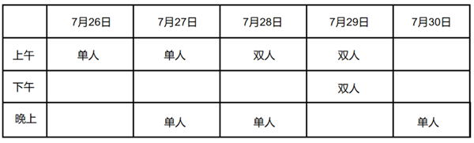

# 分析推理-日程安排（代入排除法）＋翻译推理-逆否规则

考点：[[20-考点/判断推理/逻辑判断/分析推理-日程安排（代入排除法）＋翻译推理-逆否规则|逻辑判断 / 分析推理-日程安排（代入排除法）＋翻译推理-逆否规则]]

**问法模型**：'若小马的比赛均安排在上午，以下哪项一定是错误的'→选非题用代入法：把每个选项当真代入题干条件，能排出无矛盾日程的排除，推出与某条件正面矛盾者即为'一定错误'项

## 推理链
1. 第1步：提取前提：①'小王参加的3场比赛仅安排在上午或者下午'；②'小陈的比赛均在上午，且不在连续的两天中'；③'小孙不与小陈共同参加1场双人比赛→小孙的比赛均安排在7月26日至28日'（后件为'孙均26—28日'）；④8场比赛＝3场双人＋5场单人，每人参加2至3场；⑤'小马的比赛均安排在上午'
2. 第2步：问'一定错误'即找必与题干矛盾项，采用代入法逐项验证，可与题干共存的均排除
3. 第3步：代入A'7月27日上午小陈参加比赛'：由②推小陈29日上午还有比赛，由④⑤推小马上午至少2场，小王下午最多1场故上午至少2场，上午陈、马、王各2场可排开，无矛盾，可能正确，排除
4. 第4步：代入B'7月30日晚上小梁参加比赛'与D'7月29日上午小马参加比赛'：均可按A项的表格安排成功，属'可能正确'，排除
5. 第5步：代入C'7月29日下午小孙参加比赛'：直接否定③的后件'小孙的比赛均安排在7月26日至28日'，否后必否前，得'小孙与小陈共同参加1场双人比赛'
6. 第6步：由②'小陈的比赛均在上午'，该双人赛只能安排在7月28日或29日上午；小陈必另占1场上午单人赛，由④⑤小马参加上午剩下的2场，此时小王上午＋下午合计最多只能参加2场，与①'小王参加3场比赛'矛盾
7. 第7步：C项代入必与条件①冲突，是唯一'一定错误'的选项，当选

**最快解法**：⚡ 代入法＋逆否口诀'否后必否前'：优先验证与假言条件相关的C项——'29日下午小孙'否掉后件'孙均26—28日'，逆否得'孙与陈打双打'，双打被'陈均在上午'锁死在上午；陈占2个上午名额、马按④⑤再占2场，数出小王最多2场，与①'王3场'矛盾，直接锁定C

## 易错点
- ⚠ 选非题方向看反：题干问'一定是错误的'，A、B、D均为'可能正确'项，代入排除后勿误按'选正确'作答
- ⚠ 把条件③'孙不与陈双打，孙均安排在26—28日'误读为两个并列信息而非假言命题，漏用'否后必否前'，导致C项无法判定
- ⚠ 场次数漏：孙陈双人赛与小陈单人赛占掉上午名额后，须按④⑤数出'小王最多2场'才见与①矛盾，跳过计数会误以为C也可能成立

## 母题抽象
> 🧩 当题干出现'一定正确/一定错误＋日程（或座位等）分配约束＋含假言命题的条件组'时，用代入法逐项试排：能排出无矛盾方案的排除，代入后经'否后必否前'等规则推出与某条件正面冲突的即为答案

**同类特征**：选非问法'一定是错误的'、日期×上午/下午/晚上的比赛日程分配、假言条件'不共同参加双打→比赛均安排在26—28日'、8场＝3场双人＋5场单人，每人参加2至3场、小陈均在上午且不在连续两天、代入法找矛盾

## 相关题
（暂无）

---

### 题干
若小马的比赛均安排在上午，则可以得出以下（    ）项一定是错误的。

### 选项
- A. 7月27日上午小陈参加比赛
- B. 7月30日晚上小梁参加比赛
- C. 7月29日下午小孙参加比赛　✅
- D. 7月29日上午小马参加比赛

### 官方解析

第一步：分析题干条件。

（1）小王参加的3场比赛仅安排在上午或者下午；

（2）小陈的比赛均在上午，且不在连续的两天中；

（3）小孙不与小陈共同参加1场双人比赛小孙的比赛均安排在7月26日至28日；

（4）小陈、小孙、小梁、小马、小王5人共参加8场比赛，其中3场比赛他们中有2人共同参加，其他5场比赛他们中仅有1人参加，每人参加其中的2至3场；

（5）小马的比赛均安排在上午。

第二步：根据题干条件进行推理。

代入A项：7月27日上午小陈参加比赛。结合条件（2）可得小陈参加7月29日上午的比赛。根据条件（4）（5）可得小马上午至少参加2场比赛。小王下午最多参加1场比赛，结合条件（1）可知，小王上午至少参加2场比赛。综合可得上午小陈、小马、小王各自参加2场比赛。则其可能情况如下表所示，可能正确，排除；

代入B项：7月30日晚上小梁参加比赛。根据A项表格，可能正确，排除；

代入C项：7月29日下午小孙参加比赛。这是对条件（3）的否后，否后必否前，可得小孙与小陈共同参加1场双人比赛，结合条件（2）可得，小孙与小陈参加7月28日或7月29日上午的双人比赛。无论哪种情况，小陈必然参加上午的1场单人比赛。结合条件（4）（5）可得，小马参加上午剩下的2场比赛，此时，小王上午和下午一共最多只能参加2场比赛，与条件（1）矛盾。因此，该项一定错误，当选；

代入D项：7月29日上午小马参加比赛。根据A项表格，可能正确，排除。

本题为选非题，故正确答案为C。

### 给定材料

7月26日至30日，小陈、小孙、小梁、小马、小王5人共参加8场比赛。其中3场比赛他们中有2人共同参加，其他5场比赛他们中仅有1人参加，每人参加其中的2至3场。具体场次安排见下表。已知：

（1）小王参加的3场比赛仅安排在上午或者下午；

（2）小陈的比赛均在上午，且不在连续的两天中；

（3）若小孙不与小陈共同参加1场双人比赛，则其比赛均安排在7月26日至28日。

