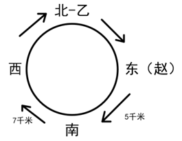
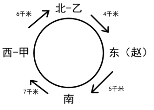

# 分析推理-环湖方位排布与距离对应（顺时针环形定位）

考点：[[20-考点/判断推理/逻辑判断/分析推理-环湖方位排布与距离对应（顺时针环形定位）|逻辑判断 / 分析推理-环湖方位排布与距离对应（顺时针环形定位）]]

**问法模型**：'根据上述信息，可以得出以下哪项'→必然性结论题：先用方向+距离条件锁定环上关键段与关键元素，再逐项验证哪个选项在所有剩余可能性下都成立

## 推理链
1. 第1步：顺时针环湖，方位循环顺序固定为 北→东→南→西→北；由条件(2)乙在北边，四段距离4/5/6/7各不相同
2. 第2步：条件(4)'过了赵所在的服务点之后朝西南方向前进5千米'：环上唯一西南向路段是 东→南，故赵在东边，且'东南'段=5千米
3. 第3步：条件(2)与北（乙）相邻的'西北''北东'两段均不是7千米，而'东南'段已是5千米，故7千米只能是'南西'段
4. 第4步：条件(3)甲到下一服务点为6千米：甲若在东则下一段5、若在南则下一段7、北被乙占据，只有甲在西且'西北'段=6千米才满足，进而'北东'段=4千米
5. 第5步：丙、丁只能分列东、南，二者互换不影响已确定的各段距离
6. 第6步：对照选项：甲的上一段'南西'=7（A错）；乙的上一段'西北'=6（B对）；丙、丁的上一段在'北东'4与'东南'5之间不确定（C、D错）

**最快解法**：⚡ 环序固定+关键段锁定法：先由'西南方向5千米'锁定赵在东、东南段=5；再由条件(2)排除法锁定7千米在南西段；最后由甲的6千米倒逼甲在西、西北段=6，乙的上一站即西边的甲，直接选B

## 易错点
- ⚠ 方向搞反：环上西南向路段只有东→南，误定位到南→西或西→北会把赵的位置和各段距离全盘推错
- ⚠ 忽略'上一服务点'与顺时针方向的关系：甲在西时其上一站是南（相隔7千米），若按逆时针思维会误判A项
- ⚠ 误以为必须先确定丙、丁的具体位置才能解题，实际上二者位置不确定也能排除C、D

## 母题抽象
> 🧩 当题干出现'环形/方位循环排布+各段距离互异+人物对应位置'特征时，先固定环序（顺/逆时针的方位循环），再用方向词+距离锁定关键段，继而倒逼其余元素落位，最后以'所有可能下均成立'为标准筛选选项

**同类特征**：环湖顺时针方向、东西南北各一个服务点、四段距离4/5/6/7互不相同、朝西南方向前进5千米、与上一服务点相隔、可以得出以下哪项

## 相关题
- [[10-真题/判断推理/逻辑判断/1791828 翻译推理-三段论连锁传递（含否定前件谬误辨析）|1791828]]（江苏 2016，相关度1）
- [[10-真题/判断推理/逻辑判断/1791834 分析推理-不等式比较与同项消去（整体与部分的大小比较）|1791834]]（江苏 2016，相关度1）
- [[10-真题/判断推理/逻辑判断/2042362 翻译推理-逆否规则（结合选言命题否定肯定式）|2042362]]（江苏 2017，相关度1）
- [[10-真题/判断推理/逻辑判断/2043686 分析推理-时间与店铺双向匹配（排除法+确定信息优先）|2043686]]（江苏 2017，相关度1）
- [[10-真题/判断推理/逻辑判断/2172760 翻译推理-假言命题逆否规则（只有才=后推前、肯前必肯后、否后必否前）|2172760]]（江苏 2018，相关度1）

---

### 题干
某市拟举办一场环湖长跑比赛，安排运动员围绕景观湖顺时针方向长跑。为了更好服务运动员，举办方在湖边设置了甲、乙、丙、丁四个服务点。服务人员张、王、李、赵四人随机安排至甲、乙、丙、丁四个服务点，每个服务点均有一人。各服务点之间的距离并不相等，其距离分别为4千米、5千米、6千米、7千米。已知：
（1）湖东、西、南、北边各有一个服务点；
（2）北边的乙服务点与相邻服务点之间的距离不是7千米；
（3）甲服务点与下一服务点之间的距离为6千米；
（4）过了赵所在的服务点之后，运动员朝西南方向前进5千米后到达下一服务点。
根据上述信息，可以得出以下哪项?

### 选项
- A. 甲与上一服务点相隔5千米
- B. 乙与上一服务点相隔6千米　✅
- C. 丙与上一服务点相隔7千米
- D. 丁与上一服务点相隔4千米

### 官方解析

第一步：分析题干条件。

（1）湖东、西、南、北边各有一个服务点；

（2）北边的乙服务点与相邻服务点之间的距离不是7千米；

（3）甲服务点与下一服务点之间的距离为6千米；

（4）过了赵所在的服务点之后，运动员朝西南方向前进5千米后到达下一服务点；

（5）顺时针方向长跑，各服务点之间的距离分别为4千米、5千米、6千米、7千米。

第二步：根据题干条件进行推理。

根据条件（5）可知，运动员沿顺时针方向长跑，其运动轨迹应为“北东南西北”的循环路径，如下图所示：

根据条件（2）可知，北边的服务点为乙，且“西北”、“北东”两条路径的距离均不是7千米，说明距离为7千米的路径要么是“东南”要么是“南西”。根据条件（4）可知，过了赵所在的服务点后，运动员的后续运动方向为西南方向，说明赵此刻位于东边，其下一站应为南边，而“东南”两个服务点之间的距离为5千米，说明距离为7千米的路径为“南西”，具体情况如下图所示：

根据条件（3）可知，甲服务点与下一服务点之间的距离为6千米，说明甲服务点只能位于西边，而剩余的丙、丁两个服务点只能位于东边和南边，但具体二者如何分配无法得知。具体情况如下图所示：

逐一验证选项。

A项：甲与上一服务点相隔5千米。如图所示，甲的上一个服务点位于南边，二者相隔7千米，无法得出该结论，排除；

B项：乙与上一服务点相隔6千米。如图所示，乙的上一个服务点是位于西边的甲服务点，二者相隔6千米，可以得出该结论，当选；

C项：丙与上一服务点相隔7千米。如图所示，丙服务点要么位于东边要么位于南边，当位于东边时，丙的上一个服务点是位于北边的乙，二者相隔4千米，而当位于南边时，丙的上一个服务点位于东边，二者相隔5千米，无法得出该结论，排除；

D项：丁与上一服务点相隔4千米。如图所示，丁服务点要么位于东边要么位于南边，当位于东边时，丁的上一个服务点是位于北边的乙，二者相隔4千米，而当位于南边时，丁的上一个服务点位于东边，二者相隔5千米，具体无法确定，无法得出该结论，排除。

故正确答案为B。

### 给定材料
（无）
