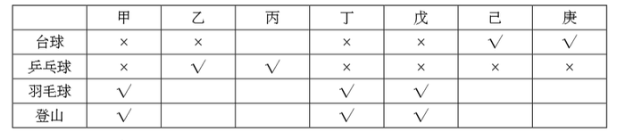

# 分析推理-分组匹配（列表法+人数上限反证）

考点：[[20-考点/判断推理/逻辑判断/分析推理-分组匹配（列表法+人数上限反证）|逻辑判断 / 分析推理-分组匹配（列表法+人数上限反证）]]

**问法模型**：题干给出分组人数约束和多个'相同/如果则'条件，问'若…则…'哪项必然成立→先由确定信息和逆否推出每人组别框架，再用小组人数上限对选项作假设反证。

## 推理链
1. 第1步：由'乙与丁都没有参加台球组'和条件(1)'丁与戊的参加情况完全相同'，推出乙、丁、戊均未参加台球组。
2. 第2步：对条件(3)'如果甲参加台球组，则丁也会参加台球组'作逆否：丁不参加台球→甲不参加台球，故甲、乙、丁、戊四人都不在台球组。
3. 第3步：台球组'最少有两人参加'，候选人只剩丙、己、庚，而己与庚参加情况完全相同（同进同退），故己、庚必然都参加台球组。
4. 第4步：由条件(4)'只有乙和丙参加乒乓球组'，知甲、丁、戊、己、庚均不参加乒乓球组；甲、丁、戊每人须参加两个组，故甲、丁、戊只能同时参加羽毛球组和登山组，两组各已有3人。
5. 第5步：己、庚已占台球名额，第二组只能在羽毛球、登山中二选一且两人必须一致；羽毛球、登山组已有甲丁戊3人，上限5人，各组最多再容纳2人。
6. 第6步：验证D：若乙参加羽毛球组（羽毛球已有甲丁戊乙4人），假设己也参加羽毛球，则与己相同的庚也参加，羽毛球组达6人>5，与题干矛盾；故己不能参加羽毛球组，只能参加登山组，D必然成立。
7. 第7步：排除A/C：丙、庚的第二组在台球/羽毛球/登山间仍可自由选择且不超上限，'丙参加登山''庚参加登山'均不必然；排除B：戊已确定未参加台球组，B的后件直接为假。

**最快解法**：⚡ 列表法+上限反证：先钉死框架'甲丁戊=羽毛球+登山、己庚=台球+羽毛球/登山二选一、乙丙=乒乓球+二选一'，D项直接用'每组最多5人'反证——乙进羽毛球后己庚不能再进，只能进登山组。

## 易错点
- ⚠ 漏用'每组最多5人'这一上限条件，导致D项无法反证、只能猜答案。
- ⚠ 把'只有乙和丙参加乒乓球组'仅理解为排除他人，忽略它同时锁定乙、丙必在乒乓球组、各只剩一个名额。
- ⚠ 忽视'参加情况完全相同'意味着己庚（及丁戊）在剩余组别中同进同退，不能单独安排其中一人。

## 母题抽象
> 🧩 当题干出现'若干人分若干组、每人固定选2组、每组有人数上下限+若干人参加情况完全相同+如果则条件句'时，先用确定信息与逆否规则推出每人组别框架，再对选项条件命题假设前件、用人数上限找矛盾反证后件。

**同类特征**：每人各参加其中两个小组、每个小组最少2人最多5人、参加情况完全相同、如果…则…（条件句给推导）、只有乙和丙参加乒乓球组、已知乙与丁都没有参加台球组

## 相关题
（暂无）

---

### 题干
某单位工会成立职工业余兴趣活动小组，分台球、乒乓球、羽毛球、登山四个小组。已知该单位的甲、乙、丙、丁、戊、己、庚等7人每人各参加其中的两个小组，每个小组最少有其中的两人参加。最多有其中的5人参加。另外，还知道：
（1）丁与戊的参加情况完全相同；
（2）己与庚的参加情况完全相同；
（3）如果甲参加台球组，则丁也会参加台球组；
（4）只有乙和丙参加乒乓球组。
如果乙与丁都没有参加台球组，则可以得出以下哪项？

### 选项
- A. 如果己参加台球组，则丙参加登山组
- B. 如果庚参加台球组，则戊参加台球组
- C. 如果甲参加羽毛球组，则庚参加登山组
- D. 如果乙参加羽毛球组，则己参加登山组　✅

### 官方解析

题干信息较多，采用列表法解题。由已知条件“乙与丁都没有参加台球组”和“丁与戊的参加情况完全相同”，推出乙、丁、戊都没参加台球组；结合已知条件“如果甲参加台球组，则丁也会参加台球组”，推出甲没参加台球组，则甲、乙、丁、戊均未参加台球组。因为“每个小组最少有其中的两人参加”且“己与庚的参加情况完全相同”，则己、庚必然参加了台球组。而“只有乙和丙参加乒乓球组”，说明甲、丁、戊、己、庚均未参加乒乓球组，甲、丁、戊只能参加羽毛球组和登山组。

列表如下：

A项：丙不确定是否参加了登山组，排除；

B项：戊没有参加台球组，排除；

C项：庚不确定是否参加了登山组，排除；

D项：如果乙参加了羽毛球组，己也参加了羽毛球组，同时己和庚的情况完全相同，那么羽毛球组就有6个人，与题干矛盾，因此己不能参加羽毛球组，那么己只能参加登山组，符合题干，当选。

故正确答案为D。

### 给定材料
（无）
