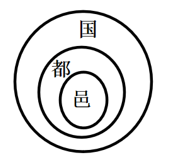
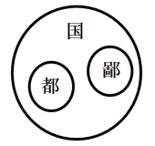
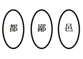

# 概念间关系（集合关系）——包含、并列、交叉的欧拉图判断

考点：[[20-考点/判断推理/逻辑判断/概念间关系（集合关系）——包含、并列、交叉的欧拉图判断|逻辑判断 / 概念间关系（集合关系）——包含、并列、交叉的欧拉图判断]]

**问法模型**：题干给出多个概念定义并要求选出正确集合关系图示 → 先给每个概念划定外延，再两两判定包含/并列/交叉关系，与图示逐一对照排除

## 推理链
1. 第1步：提取定义要点：'国'=诸侯封地或天子/诸侯的都城；'都'=具有重要政治地位的大城邑；'鄙'=边远的小城；'邑'=城镇
2. 第2步：明确图例：P圈在Q圈内表示'P包含于Q'，两圈并排表示并列关系
3. 第3步：判定核心关系：'都'是大城邑、'鄙'是小城，二者均为'城镇（邑）'的一种，故'都'包含于'邑'、'鄙'包含于'邑'，且'都'与'鄙'按大小为并列关系
4. 第4步：由解析可知'国'（都城义）与'都'为交叉关系：有些'国'是'都'，有些不是
5. 第5步：逐项对照：A图把'邑'画成包含于'都'，包含方向画反，排除；B图把'都'画成包含于'国'，应为交叉而非包含，排除；C图把'邑'与'都'画成并列，漏掉'都⊂邑'的包含关系，排除
6. 第6步：D图中'都'⊂'邑'、'鄙'⊂'邑'且'都'与'鄙'并列，与第3步判定一致，当选

**最快解法**：⚡ 抓上位概念法：'都'和'鄙'都有'城邑/城镇'属性，先锁定'都⊂邑、鄙⊂邑且并列'这一框架，直接排除C（并列错位）和A（方向反了）；再用'国与都交叉（有的是、有的不是）'排除B，锁定D

## 易错点
- ⚠ 包含关系方向画反：误以为'邑'包含于'都'（大概念与小概念颠倒）
- ⚠ 把交叉关系误判为包含：'国'与'都'只是部分重合，不是'都⊂国'
- ⚠ 只盯'都-邑'关系而漏看'鄙⊂邑'，误将'邑'与'都'画成并列
- ⚠ '国'一词多义（封地/都城），只取其中一义易致关系误判

## 母题抽象
> 🧩 当题干出现'多个概念定义+选择正确图示'的特征时，先给每个概念划外延定大小，再两两比较包含/并列/交叉，按'先定上下位、再查交叉并列'的顺序与图示逐一对照排除

**同类特征**：多个古汉语概念定义、概念外延大小比较、包含关系（P包含于Q）、并列关系图示、交叉关系（有的是、有的不是）、欧拉图/集合关系图示题

## 相关题
（暂无）

---

### 题干
都、国、鄙、邑四个词在古汉语中表示不同的概念。“国”既可以指诸侯的封地，又可以指天子或诸侯的都城。“都”本义是大城邑，后引申为具有重要政治地位的大城邑。“鄙”在古汉语中是指边邑，即边远的小城。“邑”在古汉语中是指城镇。
下列图示对上述概念关系的描述，正确的是：

### 选项
- A. 

- B. 

- C. 

- D. 

　✅

### 官方解析

第一步：找出定义关键词。

国：“天子或诸侯的都城”；

都：“具有重要政治地位的大城邑”；

鄙：“边远的小城”；

邑：“城镇”。

图示中，

表示：P包含于Q；

表示：Q和P是并列关系。

第二步：逐一分析选项。

A项：“都”指具有重要政治地位的大城邑，“邑”指城镇，“都”包含于“邑”，而图片表示为“邑”包含于“都”，图示关系错误，排除；

B项：“国”指天子或诸侯的都城，“都”指具有重要政治地位的大城邑，有些“国”是“都”，有些“国”不是“都”，有些“都”是“国”，有些“都”不是“国”，“国”和“都”是交叉关系，而图片表示为“都”包含于“国”，图示关系错误，排除；

C项：“都”指具有重要政治地位的大城邑，“邑”指城镇，“都”包含于“邑”，而图片表示为“邑”和“都”是并列关系，图示关系错误，排除；

D项：“都”指具有重要政治地位的大城邑，“邑”指城镇，“鄙”指边远的小城，“都”包含于“邑”，“鄙”包含于“邑”，“都”和“鄙”是并列关系，图示关系正确，当选。

故正确答案为D。

### 给定材料
（无）

> [!warning] 疑点（官方解析可能有误，待人工复核）
> 官方解析对D项仅验证了'都⊂邑、鄙⊂邑且并列'，未说明'国'在D图中的呈现位置及'国'与'都'的交叉关系是否在图中正确体现，解析在此处存在说明缺口，但不影响D项所含定案关系的正确性
