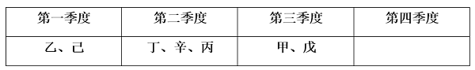
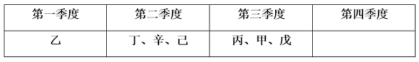
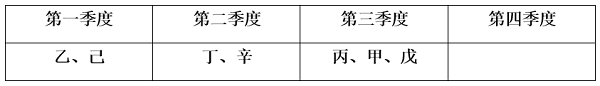

# 分析推理-排序匹配与位置假设（容量限制下的组合安排）

考点：[[20-考点/判断推理/逻辑判断/分析推理-排序匹配与位置假设（容量限制下的组合安排）|逻辑判断 / 分析推理-排序匹配与位置假设（容量限制下的组合安排）]]

**问法模型**：给定附加条件后问'某对象不可能与谁同组/同时段'→采用分析推理法：先锁定约束最多对象的可能位置，逐一假设并用容量上限排除

## 推理链
1. 第1步：提取题干条件：(1)丁、辛在第二季度；(2)甲、戊同一季度；(3)丁在乙之后、丙之前；(4)丙在甲之前、己之后；(5)每季度最多3次；(6)甲在第三季度、第四季度不安排，由此得顺序链乙<丁<丙<甲且己<丙
2. 第2步：丙受丁（第二季度）和甲（第三季度）双向夹逼，只能在第一、二、三季度，故对丙逐一假设位置
3. 第3步：假设丙在第一季度——由条件(1)丁在第二季度且条件(3)丁在丙之前，矛盾，排除
4. 第4步：假设丙在第二季度——由(1)(2)(6)得第二季度为丁、辛、丙（已满3次），乙、己须在丙之前故进第一季度，甲、戊在第三季度；庚只能安排在第一季度或第三季度，可与乙、己、甲、戊同季度，但丙所在季度已满
5. 第5步：假设丙在第三季度——由(1)(2)(6)得第三季度为甲、戊、丙（已满3次），乙、己在第一季度或第二季度；庚可安排在第一季度或第二季度，可与乙、己、丁、辛同季度，丙所在季度仍已满
6. 第6步：综上，三种情况下庚均无法进入丙所在季度，而与乙、己、辛均可同季度，故'不可能与庚同季度'的是丙，选B

**最快解法**：⚡ 容量锁定法：先由顺序链乙<丁<丙<甲+丁辛固定第二季度，锁定丙只能在第二或第三季度；再发现无论丙在哪个季度，其所在季度必被3次上限占满（丙+丁+辛或丙+甲+戊），庚永远挤不进去，直接锁定丙，无需逐一验证其他选项

## 易错点
- ⚠ 忽略'每个季度最多举办3次'的容量限制，误以为庚可与丙同季度
- ⚠ 把'丙在甲之前'误解为必须跨季度，从而漏掉丙与甲同在第三季度的合法情形，导致假设不全
- ⚠ 漏验'丙在第一季度'的情况（需用'丁在丙之前且丁在第二季度'排除），仅凭部分假设就下结论

## 母题抽象
> 🧩 当题干出现'多对象分时段/分批安排+先后顺序链+每批容量上限'时，先固定已确定对象，再对被双向约束最多的对象逐一假设位置，用容量上限检查各组是否已满，即可锁定'永远无法同批'的对象

**同类特征**：8次会议分四个季度、每季度最多举办3次（容量限制）、丁、辛固定第二季度、多重先后顺序约束（乙<丁<丙<甲，己<丙）、附加条件'甲在第三季度、第四季度不安排'、问'不可能与庚同一季度'（选非题）

## 相关题
（暂无）

---

### 题干
如果甲安排在第三季度，第四季度不安排会议，庚不可能和哪次会议安排在同一个季度？

### 选项
- A. 乙
- B. 丙　✅
- C. 己
- D. 辛

### 官方解析

第一步：分析题干条件。

（1）丁、辛在第二季度；

（2）甲、戊同一季度；

（3）丁在乙之后，在丙之前；

（4）丙在甲之前，在己之后；

（5）甲、乙、丙、丁、戊、己、庚、辛8次学术会议，每个季度最多举办3次；

（6）甲在第三季度，第四季度不安排会议。

第二步：根据题干条件进行推理。

根据题干条件（3）和条件（4）可知，丙前有乙、丁和己，情况较少，因此可优先从丙入手进行假设。

假设丙被安排在第一季度，由条件（1）可知，丁、辛在第二季度，此时，丙在第一季度，丁在第二季度，不符合条件（3），因此，丙不能安排在第一季度。

假设丙被安排在第二季度，由条件（1）（2）（6）可知，丁、辛在第二季度，甲、戊在第三季度。结合条件（3）（4）（5）可知，乙和己在丙之前的第一季度，此时第一季度和第三季度均可安排庚，庚可能和乙、己、甲、戊安排在同一个季度。

假设丙被安排在第三季度，由条件（1）（2）（6）可知，丁、辛在第二季度，甲、戊在第三季度。结合条件（3）（4）（5）可知，乙和己在丙之前的第一季度或第二季度（如下图所示）。此时第一季度和第二季度均可安排庚，庚可能和乙、己、丁、辛安排在同一个季度。

或或

综上，庚不可能和丙安排在同一个季度。

本题为选非题，故正确答案为B。

### 给定材料

某科研机构今年拟举办甲、乙、丙、丁、戊、己、庚、辛8次学术会议，每个季度最多举办3次，且各次会议举办时间不重叠。具体安排要求如下：

（1）丁、辛安排在第二季度；

（2）甲、戊安排在同一个季度；

（3）丁在乙之后丙之前举办；

（4）丙在甲之前己之后举办。

