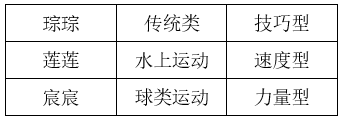

# 分析推理-排除法（人+双维属性匹配）

考点：[[20-考点/判断推理/逻辑判断/分析推理-排除法（人+双维属性匹配）|逻辑判断 / 分析推理-排除法（人+双维属性匹配）]]

**问法模型**：确定型问法'莲莲对应的运动类型是'→ 锁定目标对象莲莲，用排除法逐一排除其不可能的类型，剩余唯一项即答案

## 推理链
1. 第1步：从条件（5）'宸宸搞球类运动'和条件（6）'三人分别参与不同的运动项目'推出莲莲不搞球类运动，排除D项（且D项'球类运动'属类别维度，并非问的类型）
2. 第2步：从条件（4）'琮琮是技巧型'推出莲莲不是技巧型，排除C项
3. 第3步：从条件（3）'莲莲搞水上运动'与条件（2）'水上运动不是力量型'联立，推出莲莲不是力量型，排除B项
4. 第4步：类型仅剩'速度型'，故莲莲是速度型，对应A项
5. 第5步：回验整体匹配：琮琮=传统类·技巧型（满足条件1不搞球类）、莲莲=水上运动·速度型、宸宸=球类运动·力量型，全条件无矛盾，答案成立

**最快解法**：⚡ 排除法：以莲莲为靶心——条件（5）排除球类D，条件（4）排除技巧型C，条件（2）（3）联立排除力量型B，剩余即速度型A，考场30秒内可完成

## 易错点
- ⚠ D项'球类运动'是类别维度而非类型维度，问的是'类型'却误选类别选项（维度混淆）
- ⚠ 由'琮琮是技巧型'推'莲莲非技巧型'依赖'三人项目互异→类型互异'这一隐含前提，忽略条件（6）则无法排除C
- ⚠ 条件（2）'水上运动不是力量型'为否定表述，误读为'水上运动是力量型'会错排成B项

## 母题抽象
> 🧩 当题干出现'多人+每维属性各不相同+若干确定/否定条件'的匹配题时，锁定提问对象，用排除法把其不可能选项逐项排除，剩余唯一项即为答案

**同类特征**：三人三项目各不相同、双维分类（类型×类别）、含否定条件'不是'、问某个具体人的属性、确定信息多、适合排除法、选项含跨维度干扰项

## 相关题
（暂无）

---

### 题干
琮琮、莲莲、宸宸三人分别参与不同的运动项目，运动项目按照类型分为速度型、力量型、技巧型；运动项目按照类别分为传统类、水上运动、球类运动。已知以下条件：
（1）琮琮不搞球类运动；
（2）水上运动不是力量型；
（3）莲莲搞水上运动；
（4）琮琮是技巧型；
（5）宸宸搞球类运动。
请问莲莲对应的运动类型是：

### 选项
- A. 速度型　✅
- B. 力量型
- C. 技巧型
- D. 球类运动

### 官方解析

第一步：分析题干条件。

（1）琮琮：球类运动；

（2）水上运动：力量型；

（3）莲莲：水上运动；

（4）琮琮：技巧型；

（5）宸宸：球类运动；

（6）琮琮、莲莲、宸宸三人分别参与不同的运动项目。

第二步：根据题干条件进行推理。

根据条件（5）可知宸宸搞球类运动，可以推出莲莲不搞球类运动，排除D项；

根据条件（4）可知琮琮是技巧型，可以推出莲莲不是技巧型，排除C项；

根据条件（2）（3）可以推出莲莲不是力量型，排除B项。

综合上述推理，可以确定莲莲是速度型，对应A项。

故正确答案为A。

### 给定材料
（无）

> [!warning] 疑点（官方解析可能有误，待人工复核）
> 官方解析第一步抄录条件时漏掉否定词，将（1）（2）写成'琮琮：球类运动''水上运动：力量型'，与题干原意相反；但第二步推理实际按'不搞球类''不是力量型'执行，结论A仍正确。另排除C、D时默认'项目互异'可推出'类型/类别互异'，属未明说的隐含前提，逻辑上稍欠严谨但不影响答案。

<!-- CODEX-ANSWER-REVIEW:BEGIN -->
### 本次独立复核

**复核状态：** `confirmed`（独立复算确认答案）

**计分答案：** A（可计分）

**复核解析：**

莲莲参加水上运动，而水上运动不是力量型，故她不属力量型；琮琮是技巧型且三人运动项目不同，莲莲不能是技巧型；宸宸参加球类且项目不同，莲莲不参加球类。三个类别为传统、水上、球类，而类型为速度、力量、技巧；在题目的一一匹配限制下，剩下速度型，A。

**相关信息：**

双维属性匹配；项目类型和类别不得混淆。

**题源依据：** [固定版本原题](https://github.com/Mentat-Uran/kaogongzhentizhengliu/blob/84ab93d4b64b61d897bece8a1c0a5bab06b4feb2/10-%E7%9C%9F%E9%A2%98/%E5%88%A4%E6%96%AD%E6%8E%A8%E7%90%86/%E9%80%BB%E8%BE%91%E5%88%A4%E6%96%AD/19591560%20%E5%88%86%E6%9E%90%E6%8E%A8%E7%90%86-%E6%8E%92%E9%99%A4%E6%B3%95%EF%BC%88%E4%BA%BA%2B%E5%8F%8C%E7%BB%B4%E5%B1%9E%E6%80%A7%E5%8C%B9%E9%85%8D%EF%BC%89.md)；固定内容 commit `84ab93d4b64b61d897bece8a1c0a5bab06b4feb2`，Markdown blob `991051e82ef4a125f7a2d6a90dafd6b3af7fe22c`。
<!-- CODEX-ANSWER-REVIEW:END -->
