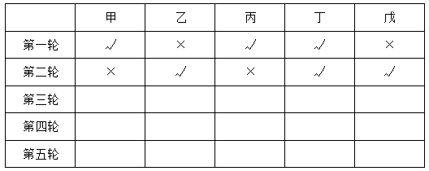
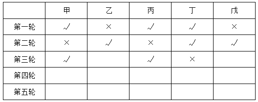

# 分析推理-假设法与矛盾排除（轮次排班匹配）

考点：[[20-考点/判断推理/逻辑判断/分析推理-假设法与矛盾排除（轮次排班匹配）|逻辑判断 / 分析推理-假设法与矛盾排除（轮次排班匹配）]]

**问法模型**：确定人选的'一定'型问法 → 以已确定的轮次信息为起点，先用规则推出必然项，再对不确定项做假设，出现矛盾即排除，锁定唯一必然者

## 推理链
1. 第1步：由规则(3)'每个人都必须吸氧三轮'知五人共需5×3=15人次，规则(5)'每次只能供三人'，故总共安排5轮，第四、五轮必然存在
2. 第2步：第一轮为甲丙丁、第二轮为乙丁戊，甲、丙第二轮未吸氧，由规则(2)'不能连续两轮不吸氧'，甲、丙第三轮必须吸氧
3. 第3步：第三轮仅剩一个名额，在乙、丁、戊中取一；乙、戊前两轮情况相同，故从特殊的丁入手假设
4. 第4步：假设丁第三轮吸氧，则丁第1、2、3轮连续吸满三轮，由规则(3)'吸氧三轮'（恰好三轮）知丁第四、五轮均不能再吸，与规则(2)'不能连续两轮不吸氧'矛盾
5. 第5步：假设不成立，故丁第三轮不吸氧，第三轮吸氧者为甲、丙加乙或戊之一
6. 第6步：丁第三轮未吸氧，由规则(2)反推，丁第四轮一定使用吸氧机，答案为D

**最快解法**：⚡ 假设法+必推项：先锁定'甲丙第三轮必吸'（连续两轮不吸氧），再对丁假设'第三轮也吸'→连吸三轮→第4、5轮必歇→违反'不连续歇两轮'→矛盾排除，故丁第三轮歇、第四轮必吸，秒选D

## 易错点
- ⚠ 把规则(3)'必须吸氧三轮'误解为'至少三轮'，则丁连吸三轮后第4、5轮可再吸，推不出矛盾
- ⚠ 忽略规则(2)对甲、丙的约束，没有先推出'第三轮必含甲丙'这一确定信息作为突破口
- ⚠ 误选乙或戊：二者前两轮情况完全对称、无法唯一确定，只有丁是必然结论

## 母题抽象
> 🧩 当题干出现'轮换使用+连续吸氧上限+连续不吸下限+每人总次数固定'的排班条件时，先由总人次算出总轮数，再从已确定的轮次入手，用假设法检验矛盾排除不确定项，锁定必然人选

**同类特征**：轮流使用三台设备每次三人、连续吸氧不能超过三轮、不能连续两轮不吸氧、每人必须吸氧三轮、前两轮人选已确定、问某人'一定'在某轮使用

## 相关题
（暂无）

---

### 题干
某病房中的五名病人甲、乙、丙、丁、戊轮流使用三台吸氧机。三台吸氧机每次只能供三人使用。下列是有关的使用规则：
（1）没有人可以连续吸氧超过三轮；
（2）没有人可以连续两轮不吸氧；
（3）每个人都必须吸氧三轮。
如果甲、丙和丁在第一轮使用吸氧机，而乙、丁和戊在第二轮使用，那么        一定会在第四轮使用吸氧机。

### 选项
- A. 甲
- B. 乙
- C. 丙
- D. 丁　✅

### 官方解析

第一步：分析题干条件。

（1）连续吸氧不能超过三轮；

（2）不能连续两轮不吸氧；

（3）每个人都必须吸氧三轮；

（4）甲、丙和丁在第一轮使用吸氧机，乙、丁和戊在第二轮使用吸氧机；

（5）三台吸氧机每次只能供三人使用。

第二步：根据题干条件进行推理。

条件（4）信息确定，以条件（4）作为推理的起点，结合条件（3）和（5）可知，最终使用吸氧机的轮次一共应有五轮。截至第二轮，吸氧的具体情况如下表所示：

结合条件（2）可知，第三轮中甲、丙一定需要吸氧，因此剩余吸氧的人应在乙、丁、戊中选择一人。由于乙、戊前两轮的吸氧情况一致，因此可以从不同的丁入手进行假设。假设第三轮中吸氧的人是丁。那么丁在前三轮中都吸氧。为满足条件（3），丁的第四轮和第五轮均不能再吸氧，此时与条件（2）发生矛盾。因此，该假设不成立，说明在第三轮中，丁不能吸氧。此时具体情况如下表所示：

结合条件（2）“不能连续两轮不吸氧”可知，丁在第四轮一定要使用吸氧机。

故正确答案为D。

### 给定材料
（无）
