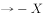
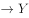

# 集合推理-三段论递推（有的A是B＋所有B是C⇒有的A是C）

考点：[[20-考点/判断推理/逻辑判断/集合推理-三段论递推（有的A是B＋所有B是C⇒有的A是C）|逻辑判断 / 集合推理-三段论递推（有的A是B＋所有B是C⇒有的A是C）]]

**问法模型**：‘假设以上陈述为真，则以下哪项一定为真’→将题干翻译为全称/特称集合命题，用递推链条（有的A是B＋所有B如何⇒有的A如何）找必然结论

## 推理链
1. 第1步：提取条件①‘所有院士都反对人类食用转基因食品’——全称命题：院士→反对食用
2. 第2步：提取条件②‘公司领导层都认为转基因食品安全、提倡放心食用’——全称命题：领导层→支持食用，与①构成对立立场
3. 第3步：提取条件③‘一些大学教授兼任公司领导’——特称命题：有的教授→领导层
4. 第4步：应用递推规则‘有的A是B＋所有B是C⇒有的A是C’：有的教授是领导层＋领导层都支持食用⇒有的大学教授支持食用转基因食品
5. 第5步：A项验证：由③②得有的教授支持食用，而①院士都反对，故这些教授必不是院士，只能得‘有的教授不是研究院院士’，‘不是’推不出‘是’，排除
6. 第6步：B项验证：①表明院士（全部）反对食用，‘有的反对’不能推出‘有的支持’，与全称反对直接冲突，排除
7. 第7步：D项验证：已得‘有的教授支持食用’，‘有的支持’不能推出‘有的不支持’，排除
8. 第8步：结论：C项‘一些大学教授支持人们食用转基因食品’由③②递推必然得出，当选

**最快解法**：⚡ 递推法（三段论连锁）：抓住‘有的教授→领导层→支持食用’两步递推直接锁定C；再用口诀‘有的S是P推不出有的S不是P’‘有的反对推不出有的支持’快速排除A、B、D

## 易错点
- ⚠ 误选A：由‘教授兼领导’与‘领导支持、院士反对’的立场对立，误推出‘有的教授是院士’，实际递推只能得‘有的教授不是院士’
- ⚠ 误选D：混淆‘有的支持’与‘有的不支持’，下反对关系在‘一定为真’的问法下不能互推
- ⚠ 忽略全称命题①的作用：A项排除正是依赖‘所有院士都反对’与‘领导层支持’的互斥性搭不上桥

## 母题抽象
> 🧩 当题干出现‘所有A都…、所有B都（立场相反）…、有的C是B’且问‘一定为真’时，用‘有的C是B＋所有B如何⇒有的C如何’的两段递推直接锁定答案，并用‘有的S是P⇏有的S不是P’排除偷换结论的干扰项

**同类特征**：所有…都…（两个全称命题）、有的…兼任/是…（特称桥接命题）、两类主体立场对立（反对vs支持食用）、问‘一定为真’、递推链条（教授→领导层→支持）

## 相关题
（暂无）

---

### 题干

在美国，研究院的所有院士都反对人类食用转基因食品，而专门生产转基因玉米的公司，其所有领导层人员都认为转基因食品是安全的，提倡人们放心食用。一些大学教授兼任公司的领导。

假设以上陈述为真，则以下哪项一定为真？

### 选项
- A. 
有些大学教授是美国研究院的院士

- B. 
有些研究院院士支持人类食用转基因食品

- C. 
一些大学教授支持人们食用转基因食品
　✅
- D. 
有些大学教授不支持人们食用转基因食品

### 官方解析

第一步：翻译题干。

①研究院的院士反对人类食用转基因食品

②公司领导层赞成人类食用转基因食品

③有的大学教授公司领导层

第二步：逐一翻译选项。

A项，根据条件③、②、①的递推规则可得出，有的大学教授公司领导层赞成人类食用转基因食品研究院的院士，即“有些大学教授不是美国研究院的院士”，因此无法得出“有些大学教授是美国研究院的院士”，排除；

B项，根据题干①可知，研究院的院士反对人类食用转基因食品，已知研究院的院士只是所有研究院院士中的一部分，可知：有些研究院院士反对人类食用转基因食品，“有的反对”不能推出“有的支持”，故无法推出，排除；

C项，根据条件③、②的递推规则可得出：有的大学教授公司领导层赞成人类食用转基因食品，可以得出“有的大学教授赞成人类食用转基因食品”的结论，当选；

D项，根据C项，我们已经得出“有的大学教授赞成人类食用转基因食品”的结论，“有的支持”不能推出“有的不支持”，排除。

故正确答案为C。

### 给定材料
（无）
