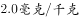

# 加强论证-举例加强（支持专家观点）

考点：[[20-考点/判断推理/逻辑判断/加强论证-举例加强（支持专家观点）|逻辑判断 / 加强论证-举例加强（支持专家观点）]]

**问法模型**：“以下哪项如果为真，最能支持上述专家的观点”→支持型论证题，需找到能补充论据、证明“统一标准并非都合理”的选项，优先选能举出实质差异例证的项

## 推理链
1. 第1步：提取论点——有专家认为，我国对稻谷、玉米、小麦、茶叶等食物的稀土限量“做出统一标准”的制定“并非都是合理的”
2. 第2步：提取论据背景——稀土对健康影响的研究欠缺，国际权威机构未做危害评估、未设立“安全摄入标准”，而我国却对不同食物设统一限量
3. 第3步：明确支持方向——论点是存在性判断“并非都合理”，只需举出某类食物（如茶叶）与粮食在稀土实际暴露上存在实质差异，即可证明“一刀切”统一标准不合理
4. 第4步：A项说稻谷、玉米、小麦稀土含量“一般都低于”限量值，只说明现状符合标准，未触及标准制定本身是否合理，属无关项，排除
5. 第5步：B项指出“茶叶中的稀土只有大约（一小部分）会进入茶水中，而一个人每天食用的茶叶量要远远小于粮食”，与粮食对比说明茶叶的实际稀土摄入暴露远低于粮食，却与粮食统一限量，举反差实例支持“并非都合理”，当选
6. 第6步：C项“具有一定的超前性”不等于“合理”，超前甚至意味着缺乏科学依据，无法加强，排除；D项“茶叶出口大国”“唯一制定标准的国家”与标准是否合理无关，排除，故选B

**最快解法**：⚡ 论点关键词法+排除法：锁定论点“并非都是合理的”，需找能体现不同食物实际差异的项；A“含量低于标准”、D“唯一制定国”话题偏移直接排除，C用“超前性”偷换“合理性”排除，仅B通过茶叶与粮食的对比举出不合理实例，快速锁定B

## 易错点
- ⚠ 把A项“含量低于限量值”误当支持项——混淆了“符合标准”与“标准制定是否合理”两个概念
- ⚠ 把C项“超前性”误当合理性的正面评价——超前不等于合理，属偷换概念
- ⚠ 忽略论点“并非都是”是存在性判断——误以为要支持需证明全部不合理，从而错过只需一个反例的B项

## 母题抽象
> 🧩 当论点出现“并非都/有的不”等存在性判断，且题干给出“统一标准/一刀切”类措施时，用“找特例反差”法，选能举出某一对象与整体存在实质差异（如实际暴露量、食用量不同）的选项来支持

**同类特征**：最能支持（支持型问法）、专家认为“并非都是合理的”、统一限量标准（一刀切）、国际权威未评估危害、未设安全摄入标准、稀土健康影响研究欠缺、茶叶与粮食等多类食物并列

## 相关题
（暂无）

---

### 题干

食品安全标准不仅关系到食品安全，更关系到国家利益。稀土在土壤中广泛存在，也在现有的各种食物中广泛存在。目前，科学界关于稀土对人类健康影响的研究很欠缺，国际权威机构迄今为止并没有对稀土的危害性做出评估，更没有设立所谓“安全摄入标准”。近年来，我国对稻谷、玉米、小麦、茶叶等食物中的稀土限量标准做出统一标准，均为。有专家据此认为，这些标准的制定并非都是合理的。

以下哪项如果为真，最能支持上述专家的观点？

### 选项
- A. 
目前，我国的稻谷、玉米、小麦中的稀土含量一般都低于

- B. 
茶叶中的稀土只有大约会进入茶水中，而一个人每天食用的茶叶量要远远小于粮食
　✅
- C. 
中国先于国际权威机构制定食物中稀土的“安全摄入标准”，具有一定的超前性

- D. 
中国是茶叶出口大国，又是世界上唯一制定了茶叶稀土限量标准的国家

### 官方解析

第一步：找到论点论据。

论点：这些标准的制定并非都是合理的。

论据：近年来，我国对稻谷、玉米、小麦、茶叶等食物中的稀土限量标准做出统一标准，均为。

第二步：逐一分析选项。

A项：“我国的稻谷、玉米、小麦中的稀土含量一般都低于”说明规定达到国家标准，至于这些标准制定的合理不合理没说，无关项，排除；

B项：“茶叶中的稀土只有大约会进入茶水中，而一个人每天食用的茶叶量要远远小于粮食”和粮食对比说明茶叶的稀土进入水中的少、食用量小，采取统一限定标准不合理，举例加强，当选；

C项：“具有一定的超前性”不一定就是合理的，无法加强，排除；

D项：“中国是茶叶出口大国，又是世界上唯一制定了茶叶稀土限量标准的国家”和制定标准是否合理，无关项，排除。

故正确答案为B。

### 给定材料
（无）
