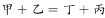
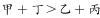
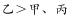
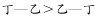
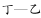
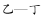
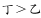

# 数学排序型推理-等式与不等式联立作差（不等式性质）

考点：[[20-考点/判断推理/逻辑判断/数学排序型推理-等式与不等式联立作差（不等式性质）|逻辑判断 / 数学排序型推理-等式与不等式联立作差（不等式性质）]]

**问法模型**：四人成绩只给'和的关系+互换后不等式+两两比较'，问谁最高 → 设字母列等式/不等式，作差消元确定隐藏大小关系

## 推理链
1. 第1步：设甲=A、乙=B、丙=C、丁=D，由'甲、乙的成绩之和等于丁、丙的成绩之和'得①A+B=C+D
2. 第2步：由'甲和丁的成绩之和大于乙和丙的成绩之和'（乙丁互换后）得②A+D>B+C；由'乙的成绩比甲、丙的成绩都高'得③B>A且B>C
3. 第3步：先用③定性排除：甲、丙都不能是最高，排除A、C两项
4. 第4步：对②①作差（大于号两边减去相同的数大于号方向不变）：(A+D)-(A+B)>(B+C)-(C+D)，得D-B>B-D
5. 第5步：整理得2D>2B，即D>B，也就是丁>乙
6. 第6步：结合③乙>甲、乙>丙，得丁>乙>甲、丁>乙>丙，故丁的成绩最高，选D

**最快解法**：⚡ 排除+作差法：先用'乙比甲丙都高'排除A、C，再由'两组和相等'的等式代入不等式作差得丁>乙，锁定B、D中的D

## 易错点
- ⚠ 只利用'乙比甲、丙都高'排除A、C后，默认乙就是最高而误选B，漏掉了乙与丁的大小比较
- ⚠ 设未知数时把'乙丁互换'后的对应关系写错，导致列出的不等式与等式矛盾、无法作差
- ⚠ 不敢对等式与不等式联立作差，忽略'两边减去相同的数大于号方向不变'这一不等式性质

## 母题抽象
> 🧩 当题干出现'两组之和相等+一个和的不等式+个别两两比较'的成绩排序条件时，设字母列式，把等式代入不等式两边作差消元，挖出未直接给出的大小关系

**同类特征**：四人成绩排序、两组之和相等、互换后比较大小、乙比其余人高（部分比较）、作差消元、问谁最高

## 相关题
（暂无）

---

### 题干
已知一次英语考试甲、乙、丙、丁的成绩如下：甲、乙的成绩之和等于丁、丙的成绩之和，如果把乙和丁的成绩互换，甲和丁的成绩之和大于乙和丙的成绩之和，乙的成绩比甲、丙的成绩都高。
根据以上所知，下列哪项为真？

### 选项
- A. 甲的成绩最高
- B. 乙的成绩最高
- C. 丙的成绩最高
- D. 丁的成绩最高　✅

### 官方解析

根据题干条件可知： 

①，②，③； 

根据③，甲、丙的成绩不能是最高的，排除A、C两项。

由②—①推出：（大于号两边减去相同的数大于号方向不变）。

为正数，为负数，即。

故正确答案为D。

### 给定材料
（无）

> [!warning] 疑点（官方解析可能有误，待人工复核）
> 题干条件②按字面（乙丁互换后'甲+丁'中的丁持乙原成绩）应化为A+B>D+C，与条件①A+B=C+D直接矛盾；官方解析实际使用的不等式为A+D>B+C（由②-①推出丁>乙），且解析中①②③后的公式显示缺失。此处题干表述与解析所用不等式存在出入，但按官方逻辑推导结论丁最高成立，答案D不变
