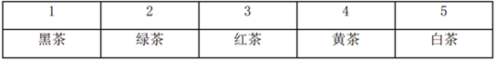

# 翻译推理-充要条件（当且仅当）与匹配排除法

考点：[[20-考点/判断推理/逻辑判断/翻译推理-充要条件（当且仅当）与匹配排除法|逻辑判断 / 翻译推理-充要条件（当且仅当）与匹配排除法]]

**问法模型**：题干给出'当且仅当'类限定条件和假设前提（绿茶装2号、白茶不装1号），求某茶位置 → 先把充要条件双向翻译，再用一一对应的排除法逐盒确定

## 推理链
1. 第1步：提取前提——(1)黄茶装2号或4号；(2)白茶装3号当且仅当绿茶装5号；(3)红茶装1号或2号当且仅当黑茶装5号；题干假设'绿茶装在2号'、'白茶没有装在1号'
2. 第2步：规则准备——'当且仅当'为充要条件，双向可用；五个盒子五类茶一一对应，可用排除法逐盒占位
3. 第3步：绿茶已占2号，由条件(1)黄茶不能装2号，故黄茶装4号
4. 第4步：由条件(2)白茶装3号则绿茶装5号，与'绿茶装2号'矛盾，故白茶不装3号；白茶又不能装1号（题干）、2号（绿茶占）、4号（黄茶占），故白茶装5号
5. 第5步：由条件(3)充要条件逆否——5号已被白茶占据，黑茶不装5号，则'黑茶装5号'为假，等价地'红茶装1号或2号'也为假，即红茶不装1号也不装2号
6. 第6步：红茶排除1、2、4、5号（1号待定但已排除、2号绿茶、4号黄茶、5号白茶），故红茶装3号
7. 第7步：剩余1号只能装黑茶，故黑茶装1号，对应A项

**最快解法**：⚡ 排除法+充要条件逆否：绿茶占2号→黄茶只能4号；白茶装3号会推出绿茶装5号（矛盾），白茶又不装1、2、4号→白茶占5号；5号被占→黑茶不装5号→由'当且仅当'逆否得红茶不装1、2号→红茶占3号→黑茶只能装1号，选A

## 易错点
- ⚠ 不会用'当且仅当'的逆否方向：由'黑茶不装5号'应推出'红茶不装1号或2号'，只当单向条件用会卡住
- ⚠ 漏用条件(2)：未发现'白茶装3号→绿茶装5号'与假设'绿茶装2号'矛盾，误把白茶放3号
- ⚠ 忽略五个盒子一一对应的排除约束，白茶位置推错导致后续全错

## 母题抽象
> 🧩 当题干出现'当且仅当'连接的两组位置限定且多元素一一对应时，先把充要条件双向翻译，再代入假设用排除法逐盒占位，剩余元素的位置自然确定

**同类特征**：当且仅当（充要条件）、五盒五茶一一对应、假设绿茶装2号、白茶没有装在1号、求黑茶所在盒子、适合排除法逐盒占位

## 相关题
- [[10-真题/判断推理/逻辑判断/2042788 翻译推理-充要条件（当且仅当）与逆否推理+占位排除|2042788]]（江苏 2017，相关度1）
- [[10-真题/判断推理/逻辑判断/2042796 翻译推理-充要条件（当且仅当）与逆否规则、选言否一推一|2042796]]（江苏 2017，相关度1）
- [[10-真题/判断推理/逻辑判断/4651546 翻译推理-假设法（恰一-恰二限定+当且仅当的逆否运用）|4651546]]（江苏 2022，相关度1）

---

### 题干
如果绿茶装在2号盒子中，白茶没有装在1号盒子中，则黑茶装在哪个盒子中？

### 选项
- A. 1号　✅
- B. 3号
- C. 4号
- D. 5号

### 官方解析

分析题干。

（1）黄茶装2号或者4号。

（2）白茶装3号绿茶装5号。

（3）红茶装在1号或者2号盒子中，当且仅当黑茶装在5号盒子中。当且仅当为充要条件，翻译为：红茶装1号或2号黑茶装5号。

如下表，如果绿茶装2号，那么根据条件（1），黄茶装4号。白茶不装1号，假如白茶装3号，那么绿茶装5号，与题干条件矛盾，所以，白茶装5号。根据条件（3），黑茶不装5号，红茶不装1号和2号，所以红茶装3号，黑茶装1号。A项正确。

故正确答案为A。

### 给定材料

黑茶、白茶、黄茶等5种茶叶装在1-5号5个盒子中，每个盒子只装1种茶叶，已知：

（1）黄茶装在2号或者4号盒子中；

（2）如果白茶装在3号盒子中，则绿茶装在5号盒子中；

（3）红茶装在1号或者2号盒子中，当且仅当黑茶装在5号盒子中。

