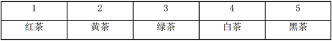

# 翻译推理-充要条件（当且仅当）与逆否规则、选言否一推一

考点：[[20-考点/判断推理/逻辑判断/翻译推理-充要条件（当且仅当）与逆否规则、选言否一推一|逻辑判断 / 翻译推理-充要条件（当且仅当）与逆否规则、选言否一推一]]

**问法模型**：给定'黑茶装5号、黄茶不装4号'两个确定前提，结合装盒约束求绿茶位置→按'充要条件双向翻译＋选言否一推一＋逆否等价＋占位排除'的连锁推理模型逐盒确定

## 推理链
1. 第1步：从题干提取前提'黑茶装在5号盒子中'‘黄茶没有装在4号盒子中'；条件(1)'黄茶装2号或者4号'，条件(2)'白茶装3号→绿茶装5号'，条件(3)'红茶装1号或2号'当且仅当'黑茶装5号'
2. 第2步：'当且仅当'是充要条件，可双向推出，由黑茶装5号推得'红茶装1号或2号'
3. 第3步：由条件(1)'黄茶装2号或者4号'与'黄茶没有装4号'，选言否一推一，得黄茶装2号
4. 第4步：占位排除——2号已被黄茶占据，'红茶装1号或2号'中排除2号，得红茶装1号
5. 第5步：5号已被黑茶占据，绿茶不装5号；由条件(2)逆否等价'绿茶不装5号→白茶不装3号'
6. 第6步：剩余3号、4号分配给白茶与绿茶，白茶不装3号则白茶装4号，绿茶装3号
7. 第7步：对照选项，C项'3号'正确

**最快解法**：⚡ 翻译推理＋占位排除法：先把'当且仅当'双向翻译，黑茶装5号⇒红茶装1号或2号；黄茶不装4号⇒黄茶占2号，逼红茶进1号；再用逆否规则'绿茶不装5号⇒白茶不装3号'，白茶被赶到4号，绿茶唯一剩3号，锁定C

## 易错点
- ⚠ 把'当且仅当'误读成单向'如果…那么…'或相容选言'或'，推不出'红茶装1号或2号'导致卡壳
- ⚠ 忽略逆否等价，从'绿茶不装5号'误作肯定前件式推理，错推'白茶装3号'
- ⚠ 漏用'每种茶只装一个盒子'的占位约束，未借黄茶占2号逼定红茶装1号，后续无法收敛

## 母题抽象
> 🧩 当题干出现'当且仅当'（充要条件）与'或者'类位置约束的组合命题时，先把充要条件双向翻译、选言命题用否一推一，再结合盒子/位置一一对应的占位排除，唯一空位即答案

**同类特征**：当且仅当（充要条件）、或者…或者…的位置约束、五茶对五盒一一占位、给定两个确定前提求第三者、逆否等价推理、多条件连锁推确定结论

## 相关题
- [[10-真题/判断推理/逻辑判断/2042788 翻译推理-充要条件（当且仅当）与逆否推理+占位排除|2042788]]（江苏 2017，相关度1）
- [[10-真题/判断推理/逻辑判断/2042792 翻译推理-充要条件（当且仅当）与匹配排除法|2042792]]（江苏 2017，相关度1）
- [[10-真题/判断推理/逻辑判断/2444056 翻译推理-逆否等价+选言否定肯定式（补前提型）|2444056]]（江西 2019，相关度1）
- [[10-真题/判断推理/逻辑判断/4651546 翻译推理-假设法（恰一-恰二限定+当且仅当的逆否运用）|4651546]]（江苏 2022，相关度1）

---

### 题干
如果黑茶装在5号盒子中，黄茶没有装在4号盒子中，则绿茶装在哪个盒子中？

### 选项
- A. 1号
- B. 2号
- C. 3号　✅
- D. 4号

### 官方解析

分析题干。

（1）黄茶装2号或者4号。

（2）白茶装3号绿茶装5号。

（3）红茶装在1号或者2号盒子中，当且仅当黑茶装在5号盒子中。当且仅当为充要条件，翻译为：红茶装1号或2号黑茶装5号。

如下表，如果黑茶装5号，黄茶没有装4号，根据条件（1），那么黄茶装2号。根据条件（3），红茶装1号。根据条件（2），绿茶不装5号，那么白茶不装3号，则白茶装4号，所以，绿茶装3号。C项正确。

故正确答案为C。

### 给定材料

黑茶、白茶、黄茶等5种茶叶装在1-5号5个盒子中，每个盒子只装1种茶叶，已知：

（1）黄茶装在2号或者4号盒子中；

（2）如果白茶装在3号盒子中，则绿茶装在5号盒子中；

（3）红茶装在1号或者2号盒子中，当且仅当黑茶装在5号盒子中。

